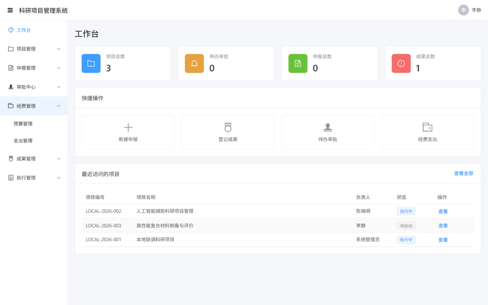
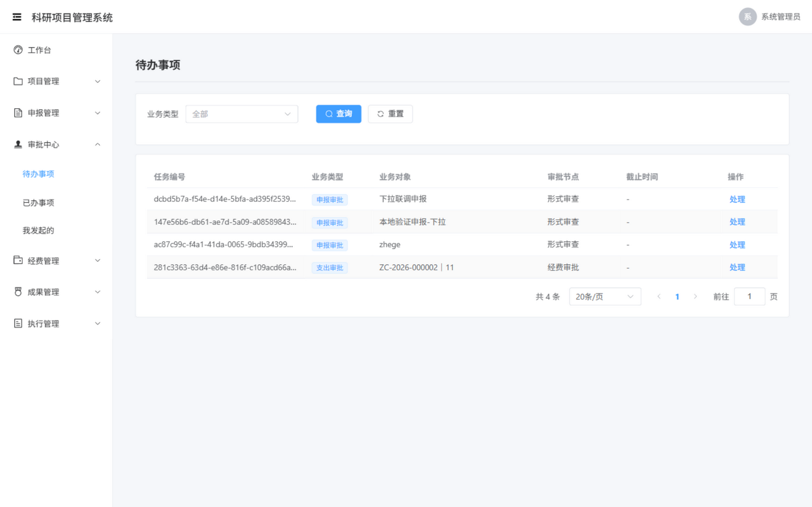

# 科研项目全生命周期管理系统（Research Project Management）

> 面向科研院所的项目全生命周期管理平台：从**项目申报 → 立项审批 → 进度执行 → 经费管控 → 成果登记 → 验收归档**，一条以项目为主线的业务链——每次申报有版本、每项审批有责任、每笔经费有口径、每个风险有处置、每项成果有出处。

[]() []() []() []() []()

## 功能总览

| 模块 | 能力要点 |
|---|---|
| **IAM 身份与权限** | 本地账号 + JWT（access/refresh 双 token 严格隔离）；RBAC + 数据范围（全院/部门/PI/项目成员/临时授权）；行级数据权限由后端统一裁决 |
| **申报管理** | 开放批次 + 动态表单（JSON Schema 模板）；草稿/提交/撤回/形式审查/决策全状态机；内容哈希 + 幂等键防重复提交 |
| **审批中心** | Flowable 7 引擎驱动；待办/已办/我发起的；通过/退回/拒绝/撤回；审批轨迹与回调日志；自审批阻断（SOD） |
| **项目管理** | 申报批准自动立项；成员/里程碑/风险/变更/交接；暂停/恢复/终止状态机守卫；里程碑延期走独立审批 |
| **执行管理** | 周期报告（月度/季度）版本化 + 审核流；交付物上传（SHA-256 校验 + MinIO）；轻任务协作 |
| **经费管理** | 预算版本化（生效版本唯一）；支出全流程（创建→审批→支付→冲销）；**资金事件只追加不可变**；财务对账（导入→校验→差异处理）；预算三态控制（阻断/警告/放行） |
| **成果管理** | 论文/专利/软件/获奖等 7 类；版本化登记；**疑似重复查重提示（只提示不自动合并）**；项目关联与贡献度 |
| **审计与可观测** | 关键动作审计与业务同事务（审计失败即回滚）；非关键审计 Outbox 异步补写（幂等 + 指数退避）；全链路 TraceId 贯穿日志/审计/响应 |

## 技术栈

- **后端**：Java 21 · Spring Boot 3.5 · MyBatis-Plus · Flyway · Flowable 7（审批编排）· 16 个 Maven 模块的模块化单体（DDD 四层）
- **前端**：Vue 3 · TypeScript(strict) · Element Plus · Pinia · Vite
- **存储**：PostgreSQL 16（业务事实唯一来源）· Redis（权限快照缓存，可降级）· MinIO（对象存储）
- **异步**：事务内 Outbox + Spring `@Scheduled` 后台任务（不引入 MQ）
- **测试**：**1068 个测试全部通过**——134+ Mockito 单测 × 全模块 + 真 PostgreSQL（嵌入式 Zonky PG16）+ 真 Flowable 集成测试 + 行级数据权限 SQL 集成测试

## 快速开始（5 分钟）

```bash
# 1. 拉起基础设施（PostgreSQL 16 + Redis + MinIO，需 Docker）
docker compose up -d

# 2. 启动后端（首次会自动执行 Flyway 迁移并初始化权限与管理员账号）
cd backend && ./mvnw spring-boot:run

# 3. 启动前端（新终端）
cd frontend && npm install && npm run dev

# 4. 访问 http://localhost:5173
```

**演示账号**（密码均为 `Admin@123`）：

| 工号 | 角色 | 用途 |
|---|---|---|
| `admin` | 系统管理员 | 全部菜单与审批决策 |
| `T2026001` | 管理员（陈晓明） | 审批人视角 |
| `T2026002` | **PI 项目负责人（李静）** | 受限菜单：可见申报/预算/支出，**不可见对账管理等财务入口** |

> 完整步骤（含无 Docker 的原生安装、数据初始化、常见问题）见 **[本地运行指南](docs/本地运行指南.md)**。

## 系统截图

**PI 视角工作台**（菜单已按权限过滤）：



**审批中心待办**：



## 架构一览

```
┌────────────────────────── frontend (Vue 3 + Element Plus) ──────────────────────────┐
│  登录 · 工作台 · 申报 · 审批中心(待办/已办/我发起/轨迹) · 项目 · 执行 · 经费 · 成果     │
└───────────────────────────────────────┬─────────────────────────────────────────────┘
                                        │ /api/v1 (JWT · X-Trace-Id)
┌───────────────────────────────────────▼─────────────────────────────────────────────┐
│                     rpm-boot（装配层：安全链 · 过滤器 · API 聚合）                     │
├────────┬────────┬────────┬────────┬────────┬────────┬────────┬────────┬────────────┤
│ rpm-iam│ 申报   │ 工作流  │ 项目   │ 执行    │ 经费    │ 成果    │ 文件   │ 审计       │
│ 认证   │ 申请   │ Flowable│ 立项   │ 报告    │ 预算    │ 查重    │ MinIO  │ Outbox    │
│ 权限   │ 版本化 │ 模板/实例│ 状态机 │ 交付物  │ 不可变  │ 关联    │ 签名   │ 同事务    │
├────────┴────────┴────────┴────────┴────────┴────────┴────────┴────────┴────────────┤
│  rpm-common（Result/错误码/幂等/编号规则/BaseEntity） · 各模块只经端口(Port)跨模块协作  │
└──────────────┬──────────────────────┬──────────────────────────┬────────────────────┘
        PostgreSQL 16               Redis 7                    MinIO
     （Flyway 13 个迁移，        （权限快照 5min TTL，        （对象存储 +
       业务事实唯一来源）          失败降级回源 DB）             ≤300s 预签名下载）
```

## 仓库结构

```
├── backend/                  # 后端：16 个 Maven 模块（形态 A 模块化单体）
│   ├── rpm-boot/             # 装配与启动：安全链、过滤器、API 聚合、集成测试
│   ├── rpm-iam/              # 认证、RBAC、数据范围、字段脱敏
│   ├── rpm-application/      # 申报批次、动态表单、版本、提交幂等
│   ├── rpm-workflow/         # Flowable 适配、审批模板/实例/任务、回调
│   ├── rpm-project/          # 项目、成员、里程碑、风险、变更、交接
│   ├── rpm-execution/        # 周期报告、交付物、轻任务
│   ├── rpm-funding/          # 预算、支出、资金事件(不可变)、对账
│   ├── rpm-output/           # 成果登记、查重、审核、项目关联
│   ├── rpm-file/             # 文件校验(魔数/白名单)、授权、预签名
│   ├── rpm-audit/            # 审计同事务写入 + Outbox 异步补写
│   └── ...                   # common/organization/notification 等
├── frontend/                 # 前端：Vue 3 + TS + Element Plus（29 个视图）
├── demo/                     # 演示种子数据（组织/人员/项目/申报/工作流/对账）
├── docs/
│   ├── 设计决策说明.md        # ⭐ 为什么做这些、不做哪些（核心交付物）
│   ├── 本地运行指南.md        # 人类步骤 + 可直接投喂 AI 的运行提示词
│   ├── 01-需求/              # 产品需求文档（含范围取舍与评审结论）
│   ├── 02-技术方案/          # 9 份设计文档 + 前端设计 5 份 + 验证用例清单
│   └── images/               # 系统截图
├── docker-compose.yml        # 一键拉起 PostgreSQL + Redis + MinIO（含建桶）
└── backend/Dockerfile        # 多阶段构建（JDK21 构建 → JRE 运行，非 root）
```

## 关键工程决策（摘）

> 完整论述见 **[设计决策说明](docs/设计决策说明.md)**。

- **科管系统的第一性是安全与可追溯**：数据权限后端统一裁决（列表/详情/附件/导出同一 SQL 片段）；关键动作审计与业务同事务；资金记录数据库触发器级不可变。
- **模块化单体而非微服务**：千人级院内系统，先保证事务一致与低运维成本，以 Maven 模块 + 端口防腐预留拆分路径。
- **不引入 MQ**：PostgreSQL 事务内 Outbox + 进程内调度已满足可靠投递语义，私有化环境少一个组件就少一类故障。
- **流程引擎选 Flowable 而非自研状态机**：审批编排是科管系统变化最频繁的部分，模板版本化 + 条件路由是刚需。

## 运行验证

```bash
# 后端全量测试（含真 PG + 真 Flowable 集成测试，约 4 分钟）
cd backend && ./mvnw test

# 前端类型检查 + 生产构建
cd frontend && npm run build
```

## 文档索引

| 文档 | 内容 |
|---|---|
| [设计决策说明](docs/设计决策说明.md) | 范围取舍、架构决策、安全设计、已知边界 |
| [本地运行指南](docs/本地运行指南.md) | 人类可执行步骤 + AI 一键运行提示词 |
| [产品需求文档](docs/01-需求/产品需求文档.md) | 业务范围、角色权限、评审结论 |
| [技术方案](docs/02-技术方案/) | 总体架构 / 数据模型 / 权限工作流 / 接口设计 / 验证用例 |
