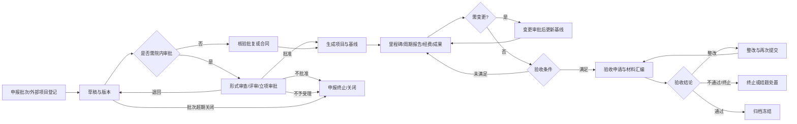
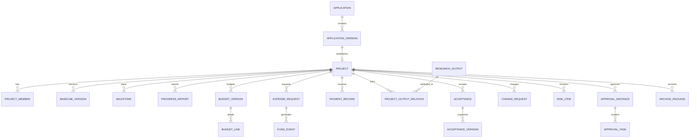

# 科研项目全生命周期管理系统需求文档

> 版本：V2.1（评审整改稿）  
> 日期：2026-11-17  
> 文档性质：业务需求、范围决策与技术约束说明，不等同于详细交互稿、数据库物理设计或开发排期承诺。  
> 推荐方案：单院多部门、PC Web、私有化部署、Spring Boot 模块化单体优先、Vue 3 + Element Plus、PostgreSQL。

---

## 0. 阅读指引、事实与假设

### 0.1 本文回答的四个问题

1. 系统解决什么问题，最重要的业务闭环是什么？
2. 第一版做哪些、不做哪些，为什么这样取舍？
3. 不同角色能做什么、能看哪些数据，如何防止越权与利益冲突？
4. 在需求模糊时，哪些结论是事实，哪些是假设，后续如何修正？

### 0.2 已知事实、产品决策与待验证假设

| 类型 | 内容 | 对设计的影响 |
|---|---|---|
| 已知事实 | 覆盖申报、立项、进度、经费、成果、验收全过程 | 必须围绕同一项目主线，不能建设互不相通的六个台账 |
| 已知事实 | 后端 Java（Spring Boot / Spring Cloud），前端 Vue 2/3 + Element UI/Plus，数据库 PostgreSQL | 新技术选型在上述范围内进行；推荐 Vue 3 + Element Plus |
| 产品决策 | 先服务一个科研院所及其下属部门，而非直接做跨院所 SaaS | V1 不引入租户计费、跨租户隔离和复杂租户配置 |
| 产品决策 | 管理“项目责任、过程证据和经费口径”，不管理实验本身 | 不做电子实验记录、科研计算、仪器控制 |
| 产品决策 | 已有财务、身份和消息平台时优先集成 | 不另造总账、支付、IM、统一认证平台 |
| 待验证假设 A1 | 约 1,000～3,000 名用户、峰值 300 在线、年新增项目不超过 2,000 个 | 支持模块化单体优先；规模超出阈值再拆服务 |
| 待验证假设 A2 | 以纵向、横向和院级项目为主，存在不同审批链和预算科目模板 | 采用项目类型驱动的表单、流程和预算模板 |
| 待验证假设 A3 | 财务系统能提供预算控制或支付结果；接口条件暂不确定 | V1 支持标准模板导入导出和对账，接口是增强项而非上线前提 |
| 待验证假设 A4 | 大部分填报发生在 PC，领导与审批人存在移动审批需求 | V1 响应式 Web 覆盖轻审批，不开发原生 App |
| 待验证假设 A5 | 涉密项目不进入普通业务系统，或另有符合保密要求的独立环境 | 默认部署非涉密数据；涉密边界须由院方安全部门确认 |

**假设处理原则：**本文给出可落地的默认方案，不以“待客户确认”为由留下设计空洞。标为假设的内容须在需求评审时验证；一旦变化，只修改对应决策，不推翻整个业务主线。

### 0.3 评审优先确认问题与结论（2026-11-17 需求评审）

| 优先级 | 问题 | 默认处理 | 不确认的影响 | 评审结论（2026-11-17） |
|---|---|---|---|---|
| P0 | 哪些项目类型、哪些部门进入一期？ | 先选一个项目类型、一个试点部门 | 表单和流程组合失控 | ✅ 试点类型＝纵向项目（D-14）；试点部门由院方在阶段 0 指定（建议选申报量大、流程稳定的部门） |
| P0 | 外部项目是否必须走申报审批，还是以合同/批复登记后直接立项？ | 两类入口均支持，由项目类型配置 | 外部项目会被迫重复审批 | ✅ 维持默认：两类入口均支持、按类型配置；试点期以纵向申报入口为主 |
| P0 | 财务系统能否提供支付、到账、余额和凭证数据？ | 不能则先导入，支付结果以财务记录为准 | 经费”实时”口径无法承诺 | ✅ 维持默认（假设 A3）：先导入对账，接口为增强项 |
| P0 | 预算不足时是禁止提交、禁止审批，还是允许特批？ | 默认阻止提交，特批需独立权限 | 占用规则与财务控制无法验收 | ✅ 禁止负余额模型（D-13）：特批＝独立权限的快速预算调整/支出审批通道，任何时点可用余额 ≥ 0 |
| P0 | SSO 统一认证采用哪种协议？ | 支持 LDAP/AD/OIDC/CAS 至少一种 | 认证联调无法启动 | ✅ OIDC（D-15）；LDAP/AD 仅作组织数据同步补充 |
| P1 | 专家评审是否需要双盲？ | V1 默认对申请人隐藏专家身份，不做绝对匿名承诺 | 评审材料脱敏范围不同 | 维持默认：单盲/有限披露 |
| P1 | 项目变更、延期、终止分别由谁审批？ | 沿用项目类型对应变更模板 | 状态机无法定版 | 维持默认（纵向类型变更模板先行配置） |
| P1 | 档案保存年限及等保、审计要求是什么？ | 业务审计日志默认不少于 10 年，安全日志不少于 6 个月 | 存储、归档与运维成本不同 | 维持默认，最终以院方制度为准 |
| P1 | 是否需多院区、多法人或多币种？ | 默认单法人、人民币，多组织留扩展字段 | 会计与汇总口径会明显变化 | 维持默认：单法人、人民币 |

---

## 1. 系统定位与决策路径

### 1.1 一句话定义

为科研院所的科研人员、科研管理、财务和决策人员建立一条以项目为主线的业务链，让**每次申报有版本、每项审批有责任、每笔经费有口径、每个风险有处置、每项成果有出处、每次验收有证据**。

### 1.2 问题不是“缺一个项目 CRUD”

传统 Excel、邮件和纸质流程的主要损失不是录入慢，而是：

- **同一项目多个版本：**申报书、预算、执行周期和成果清单在各处不一致。
- **流程不可见：**申请人不知道卡在何处，管理者只能通过催问获知进展。
- **经费口径混淆：**申请中、已审批、已支付和财务入账混称“已用经费”。
- **管理动作滞后：**到期、长期未报、预算异常到结题时才暴露。
- **验收重复劳动：**过程材料散落，结题时重新收集且难以核验。

因此系统首先是一个“项目过程与责任系统”，其次才是报表系统。

### 1.3 决策路径：从矛盾到方案

| 顺序 | 需要回答的问题 | 本文结论 | 被否决的直觉方案 |
|---|---|---|---|
| 1 | 先建数据中心，还是先跑通业务？ | 先跑通“申报—执行—验收”，在流程中自然沉淀数据 | 先建大而全科研数据仓库，业务后补 |
| 2 | 哪条链不可截断？ | 项目、审批、经费、成果、验收必须共享同一项目标识和版本 | 六个模块各自维护台账 |
| 3 | 管理越细越好吗？ | 管到里程碑、交付物、周期报告与关键变更，不默认管到每日任务 | 强制 WBS、甘特图和每日打卡 |
| 4 | 数据由谁负责？ | 项目事实由业务责任人维护，支付事实由财务系统/财务人员确认 | 管理员拥有所有业务数据的任意修改权 |
| 5 | 第一版就平台化吗？ | 配置项目类型、流程模板和字典，不开放通用低代码平台 | 自定义任意字段、任意脚本和 BPMN 设计器全部一期交付 |
| 6 | 技术上先微服务还是先交付？ | 模块化单体优先，按边界保留 Spring Cloud 演进能力 | 七至十个服务、多库和分布式事务起步 |
| 7 | 如何证明项目成功？ | 看完整线上闭环率、一次录入复用率、超期发现及时率和对账差异 | 只看注册人数、访问量和功能数量 |

### 1.4 核心价值与成功定义

- **对科研人员：**一次录入、多环节复用；随时知道下一步和待补材料。
- **对科研管理部门：**从收表和催表转向规则配置、异常处置和项目服务。
- **对财务部门：**预算、在审占用和实际支付可区分、可对账。
- **对领导：**看到项目组合、风险和趋势，而不是只看项目总数。
- **对审计与验收：**能还原某时点看到的数据、作出的审批和对应的材料版本。

**北极星指标：完整线上闭环率。**试点范围内，从申报/登记到验收归档均在线完成、关键过程证据齐全的项目数，占同期应闭环项目数的比例。它同时约束业务覆盖、数据质量和用户采纳，避免只上线不闭环。

---

## 2. 目标用户、典型场景与业务原则

### 2.1 用户与使用频率

| 用户 | 首要目标 | 典型频率 | 设计重点 |
|---|---|---|---|
| 项目负责人（PI） | 完成申报、组织执行、控制预算、顺利验收 | 申报期集中；执行期每周/每月 | 少填、可复用、草稿、清晰待办 |
| 项目成员/科研助理 | 承担任务、提交交付物、登记成果、协办支出 | 每周/每月 | 仅看参与项目，允许分工协办 |
| 部门科研秘书 | 本部门初审、材料完整性检查、进度跟踪 | 每周，申报期高频 | 批量处理、退回补正、部门视图 |
| 科研管理人员 | 项目受理、立项、监管、变更、验收 | 每个工作日 | 全局台账、规则配置、风险处置 |
| 财务人员 | 预算复核、支出控制、支付回写、对账 | 每个工作日 | 科目映射、金额口径、批量对账 |
| 院所领导 | 重大事项审批、组合分析、风险督办 | 每周/每月 | 简洁摘要、可下钻、默认只读 |
| 内外部评审专家 | 在授权期内评审指定材料 | 按批次 | 最小披露、利益冲突、意见留痕 |
| 审计/档案人员 | 核验过程证据、接收归档材料 | 按项目/审计批次 | 只读快照、导出清单、完整性校验 |
| 系统管理员 | 账号、角色、参数、运行维护 | 按需 | 管系统不管业务，不默认读取敏感正文 |

### 2.2 使用原则

1. **岗位角色与项目身份叠加。**同一人可以是 A 项目负责人、B 项目成员、部门初审人，权限按具体项目计算。
2. **功能权限不等于数据权限。**拥有“项目查看”菜单不代表能看全部项目。
3. **提交与审批分离。**业务单据使用明确的状态机；审批实例只是驱动状态变化的一种手段。
4. **原始记录不覆盖。**申报、预算、合同、成果、验收均保留版本；审批后修改走退回或变更。
5. **业务约束由后端保证。**隐藏按钮、禁用输入框不是安全控制。
6. **尽量自动汇总，不自动伪造。**结题报告可自动汇编数据，但研究结论、专家意见、财务结果必须由责任人确认。
7. **例外是一等场景。**撤回、退回、逾期、人员离岗、预算不足、接口失败、验收不通过都要可处理。

---

## 3. 范围与版本取舍

### 3.1 一期目标（MVP）

一期不追求覆盖所有科研业务，而要证明：一个试点项目从进入系统到归档，全过程不需要线下补一套 Excel 台账。

| 范围 | 一期必做 | 一句话验收 |
|---|---|---|
| 基础与工作台 | 组织、用户、角色、SSO/本地认证、待办、通知 | 用户只看到与自身相关的项目、审批和风险 |
| 项目入口 | 申报草稿、附件、版本、提交、形式审查、审批/登记立项 | 立项数据来自已批准版本，无需二次录入 |
| 项目执行 | 里程碑、周期报告、交付物、问题与风险、基本变更 | 逾期可发现、可通知、可记录处置结果 |
| 经费 | 预算版本、支出申请、在审占用、支付导入、余额、对账 | 任一余额均可追溯到预算、申请和支付明细 |
| 成果 | 成果登记、证明材料、多项目关联、查重提示、审核 | 验收清单能定位到已审核成果及证据 |
| 验收归档 | 验收申请、自动汇编、审核、结论、整改、只读归档包 | 不通过可整改，通过后冻结基线并生成档案清单 |
| 报表 | 项目、进度、经费、成果四类基础报表与授权导出 | 汇总可下钻至业务明细，口径和更新时间可见 |
| 系统治理 | 参数、模板、编号、日志、数据导入、备份恢复配合 | 关键操作可追责，管理员不能无痕修改业务事实 |

### 3.2 二期增强

- 财务、OA/统一待办、企业微信/钉钉等标准接口与自动重试。
- 项目类型专用字段扩展、更多流程条件、批量受理和专家评审批次。
- 移动 H5 的审批、进度查看和消息处理。
- 全文检索、更多统计维度、档案系统接口。
- 经数据验证有效的风险评分；AI 仅用于材料辅助检查和摘要，不自动审批。

### 3.3 明确不做与原因

| 不做项 | 为什么不做 | 何时重新考虑 |
|---|---|---|
| 财务总账、发票查验、网银支付、会计凭证生成 | 属于财务系统核心职责，重复建设会造成双账 | 院方没有财务系统且明确立项建设财务产品 |
| 电子实验记录、科研数据分析、仪器预约与实验室安全 | 用户、流程、数据结构和合规要求不同，纳入会稀释项目主线 | 作为独立产品，通过项目编号关联 |
| 原生 iOS/Android App、内部 IM | 使用频率和一期价值不足；消息可复用现有平台 | 移动任务量、离线需求达到明确阈值后 |
| 复杂 WBS、甘特图、资源负荷、每日工时 | 对多数科研项目填报成本高，容易形成“为了系统而填系统” | 工程化课题或人力成本核算确有要求时按项目类型启用 |
| 通用低代码表单、脚本规则、开放 BPMN 设计器 | 配置权过大会带来流程不可验证、升级困难和审计风险 | 已积累稳定模板且有专业流程管理员后 |
| 通用 BI 平台和大屏 | 一期先回答固定管理问题，避免用可视化代替治理 | 指标口径稳定且自助分析需求持续增长后 |
| AI 自动评审、自动批准、自动验收 | 责任不可转移，训练数据与可解释性不足 | 仅可做辅助；任何自动决策需专项合规和验证 |
| 多租户订阅、计费、公开注册 | 默认单院内部系统，无商业 SaaS 需求 | 明确转为跨机构运营产品后重新做隔离设计 |
| 涉密数据与普通数据混合存储 | 不能靠普通“权限按钮”解决保密边界 | 由保密管理部门确定独立系统、网络和介质方案 |
| 论文写作、查重、文献检索和引文数据库 | 已有专业服务，且授权接口与数据版权不同 | 获得合法接口后做成果元数据核验 |

### 3.4 产品化与 AI 的定位

- **过程可观测：**项目从静态档案变为可干预过程，风险必须有责任人、处理期限和处置记录，而不只是红色标签。
- **降低管理成本：**自动汇集项目摘要、验收材料和经费差异，使过去只在检查前做的工作可以按需进行。
- **不做“专家智能体替代专家”：**专家判断和利益冲突是制度问题，模拟专家意见不能作为真实审批依据。
- **可验证优先于智能化：**所有自动生成的内容都标注来源、数据时间和生成版本；数字可下钻，文本需人工确认。

---

## 4. 业务对象与端到端流程

### 4.1 核心对象及权威来源

| 对象 | 说明 | 权威来源/责任人 |
|---|---|---|
| 申报批次/指南 | 申报时间、适用范围、材料模板、评审规则 | 科研管理部门 |
| 申报书及版本 | 项目申请信息、团队、研究方案、初始预算和附件 | PI；批准后成为立项基线来源 |
| 项目 | 已获批准或登记成立的管理对象，使用全院唯一项目编号 | 科研管理部门 |
| 项目成员 | 人员、项目角色、参与时间和权限 | PI 维护，科研管理部门审核关键变更 |
| 审批实例 | 某业务版本的一次审批过程、节点和意见 | 工作流模块；不能替代业务单据 |
| 里程碑/交付物 | 关键计划节点、责任人和可核验交付结果 | PI，管理部门确认基线 |
| 周期报告 | 某报告期的工作、偏差、问题、下期计划 | PI/授权成员提交 |
| 预算及版本 | 总额、科目明细、来源、控制规则和生效区间 | 批准后的预算版本 |
| 支出申请 | 资金用途、科目、金额、凭证及审批过程 | 申请人；不是实际支付事实 |
| 资金流水/支付记录 | 到账、支付、退回、冲正及财务凭证号 | 财务接口或财务确认导入 |
| 成果及关联 | 成果元数据、证明、权属及与项目的贡献关系 | 完成人登记，科研管理部门审核 |
| 变更单 | 对负责人、周期、预算、目标等基线的受控调整 | 申请人发起，批准后生效 |
| 验收及整改 | 验收材料版本、专家/部门意见、结论、整改记录 | 科研管理部门/验收组织方 |
| 风险与处置 | 来源规则、级别、责任人、状态、处理证据 | 系统发现，责任人闭环 |
| 归档包 | 已冻结业务快照、文件、校验值和目录 | 档案责任人确认接收 |

### 4.2 主流程



### 4.3 关键业务规则

- 申报获批不自动等同于“已有可执行预算”；预算生效还需满足对应资金来源和财务确认规则。
- 批准版本生成项目基线，后续不得直接覆盖申报原文。
- 项目可有多个审批实例，但同一业务对象同一时刻最多一个生效中的同类审批。
- 同一时刻只有一个生效的预算版本和一个执行基线版本；历史版本永久可查。
- 变更审批中仍沿用旧基线，除非规则明确允许“先行执行”；批准后在生效日期切换。
- 验收申请引用材料快照，后续新增成果或支付不会悄悄改变在审验收包。
- 项目编号不复用；外部批复号、合同号、财务项目号分别保存，不混为一个字段。

---

## 5. 功能需求

优先级说明：**P0** 为一期闭环必需，**P1** 为一期默认实施、可按裁剪准则降级，**P2** 为后续增强。

**P1 裁剪准则（D-16，2026-11-17 评审确认）：**P1 默认纳入一期实施；满足以下任一条件的 P1 项可降级至后续版本——①外部依赖未就绪（接口、平台、数据源）；②试点项目类型不涉及；③经评审会裁决的一期容量/工期冲突（须记录裁决理由）。降级必须给出明确降级方案（无该功能时的业务处理方式）并回写本文档。适用现状：仅 FUND-10 因条件②降级（试点类型＝纵向项目，横向到账/回款特性不涉及；降级方案：横向项目纳入时实施，期间到账信息随财务导入凭证登记、不单独建账）；其余 P1（含 PORT-05、APPLY-07、RES-07、EXEC-07、CHG-05）均按一期实施。

### 5.1 统一门户、工作台与消息

| 编号 | 优先级 | 需求 | 验收口径 |
|---|---|---|---|
| PORT-01 | P0 | 按身份聚合我的项目、待办、草稿、退回件、风险和通知 | 切换身份不改变底层授权；每项待办可定位到具体单据和版本 |
| PORT-02 | P0 | 项目列表支持编号、名称、类型、部门、负责人、状态、年度组合筛选 | 查询结果受数据权限约束；导出沿用相同条件与权限 |
| PORT-03 | P0 | 项目详情统一展示概况、进度、经费、成果、审批、变更、风险、档案 | 各页签使用同一项目主键和基线，不出现相互矛盾的金额/周期 |
| PORT-04 | P0 | 站内消息覆盖待办、退回、批准、临近到期、逾期、接口异常 | 消息含对象、动作、时间；处理后更新已读但不删除业务记录 |
| PORT-05 | P1 | 支持链接到外部消息平台，提供免登或受控登录跳转 | 链接失效或用户无权限时明确提示，不泄露项目摘要 |

**为什么做：**用户不应逐个模块寻找“该我做什么”。工作台是流程落地入口，而非额外大屏。

### 5.2 申报、评审与立项

| 编号 | 优先级 | 需求 | 验收口径 |
|---|---|---|---|
| APPLY-01 | P0 | 按项目类型生成申报表单；支持草稿、暂存校验、附件和协作填写 | 草稿可反复保存；提交时执行完整校验；协作权限可单独授予 |
| APPLY-02 | P0 | 每次提交生成不可变版本，记录版本号、提交人、时间和文件校验值 | 可比较关键字段及附件差异；审批始终指向固定版本 |
| APPLY-03 | P0 | 形式审查支持通过、退回补正、不予受理及原因 | 退回列出问题项；补正后生成新版本，保留此前意见 |
| APPLY-04 | P0 | 审批模板按项目类型、经费区间、部门等受控条件路由 | 审批节点、处理人、时限可追踪；禁止提交人审批本人申请 |
| APPLY-05 | P0 | 支持外部项目以批复/合同登记入口立项 | 不必伪造内部评审；外部证明材料和核验人必填 |
| APPLY-06 | P0 | 批准后生成唯一项目编号，并复制批准数据形成项目基线 | 重复回调/点击不重复建项目；编号不重复 |
| APPLY-07 | P1 | 支持专家分配、回避声明、评分表、意见提交和结果汇总 | 专家只见授权批次材料；汇总规则固定且留痕 |
| APPLY-08 | P0 | 支持申报撤回、不批准和超期关闭 | 未产生项目时状态清晰；撤回后原版本不可修改 |

**专家评审边界：**V1 先做“单盲/有限披露”和专家间意见隔离。若需双盲，必须提供材料脱敏检查，不能只隐藏页面上的姓名。

### 5.3 项目执行、进度与风险

| 编号 | 优先级 | 需求 | 验收口径 |
|---|---|---|---|
| EXEC-01 | P0 | 立项时形成里程碑基线，包含计划日期、责任人、交付要求和完成判定 | 未定义完成判定的里程碑不能直接标记完成 |
| EXEC-02 | P0 | 支持里程碑进展、完成、延期申请及实际完成时间 | 延期不覆盖原计划；同时保存原计划、当前计划和审批记录 |
| EXEC-03 | P0 | 按月/季度生成周期报告任务，支持填报、审核、退回和催报 | 每项目每周期仅一份当前报告；补报和迟报被标记 |
| EXEC-04 | P0 | 交付物上传并关联里程碑/报告，可在线预览常见文件或下载 | 文件版本、上传人、校验值、访问权限可追溯 |
| EXEC-05 | P0 | 问题、风险和依赖事项可登记、指派、设期限、处理和关闭 | 关闭需填写结果；逾期风险可重新升级 |
| EXEC-06 | P0 | 规则触发临近到期、逾期未报、里程碑延期、长期无更新等预警 | 风险不是只发消息；必须生成可处置记录 |
| EXEC-07 | P1 | 轻量任务分派给成员，关联交付物 | 不要求任务依赖图；成员只能更新授权任务 |

**为什么采用“里程碑 + 周期报告”：**它兼顾科研不确定性与管理可核验性。PI 可以解释偏差，管理部门能识别异常，又不用维护不切实际的每日计划。

### 5.4 经费预算、支出、支付与对账

#### 5.4.1 金额口径

| 名称 | 定义 | 是否减少可用余额 |
|---|---|---|
| 生效预算 | 当前已批准且已生效的项目/科目预算 | 否，是控制上限 |
| 在审占用 | 已提交且未终审结束的支出申请金额，按科目占用 | 是 |
| 已批未付 | 已批准但尚未收到有效支付结果的金额 | 是；仍属于占用，不重复计算 |
| 实际支付 | 经财务接口或授权导入确认的净支付金额 | 已从占用转为实际支出，不再次扣减 |
| 可用余额 | 生效预算 - 当前有效占用（在审 + 已批未付）- 当前实际净支付 | 结果值 |
| 账面结余 | 按财务到账、支付及调整口径计算的余额 | 不直接替代预算可用余额 |

> 当前有效占用与当前实际净支付均由资金事件汇总得出，已经反映撤回释放、支付冲正和剩余取消，不能在公式外再次加回释放/冲正金额。数据库以互斥状态与资金事件为准，页面公式以同一数据快照计算。金额使用 `numeric(18,2)`，内部计算不得使用浮点数。

#### 5.4.2 功能需求

| 编号 | 优先级 | 需求 | 验收口径 |
|---|---|---|---|
| FUND-01 | P0 | 按项目类型套用预算科目模板，支持总额、明细、来源、说明和控制级别 | 保存时校验明细合计；可配置科目禁止超支或允许特批 |
| FUND-02 | P0 | 预算调整通过变更审批生成新版本 | 已生效版本不直接修改；调整前后差额、原因和批准人可查 |
| FUND-03 | P0 | 支出申请关联项目、科目、合同/事项（可选）、收款信息和附件 | 仅财务必需字段按权限可见；支持申请人代填但保留实际经办人 |
| FUND-04 | P0 | 提交时检查项目状态、预算版本、可用余额、必填材料和本人回避 | 默认余额不足不能提交；特批采用禁止负余额模型（D-13）：特批为独立权限的快速预算调整/支出审批通道，任何时点可用余额 ≥ 0；特批记录权限人、理由与审批实例 |
| FUND-05 | P0 | 提交、撤回、退回、拒绝、取消分别产生占用或释放事件 | 同一事件重放不会重复占用或释放 |
| FUND-06 | P0 | 批准后推送或导出至财务；接收支付、部分支付、退回和冲正结果 | 以外部单号 + 事件类型幂等；部分支付不提前全额转支出 |
| FUND-07 | P0 | 无接口时提供受控 Excel/CSV 导入、字段校验、错误报告和批次复核 | 导入文件、行级错误、操作人、复核人和结果可追踪 |
| FUND-08 | P0 | 支持按项目、科目、期间查看预算、占用、支付和余额并下钻 | 所有数字来自明细；显示数据截止时间 |
| FUND-09 | P0 | 对账比较本系统支付与财务支付，识别缺失、金额不符、重复和状态滞后 | 差异有责任人、处理说明和关闭记录；不能手工改成一致 |
| FUND-10 | P1（D-16 条件②降级二期） | 到账登记及合同回款计划，适用横向项目 | 到账与预算、支出分开展示；逾期应收可预警；降级方案：横向项目纳入时实施，期间到账信息随财务导入凭证登记、不单独建账 |
| FUND-11 | P1 | 经费进度与时间进度偏差预警，阈值按项目类型配置 | 预警解释口径，不自动认定违规 |

**核心取舍：**本系统做预算控制和业务协同，支付事实以财务为准。接口未就绪时必须显示“截至某批次”，不能宣称实时经费。

### 5.5 成果管理

| 编号 | 优先级 | 需求 | 验收口径 |
|---|---|---|---|
| RES-01 | P0 | 支持论文、专利、软著、标准、获奖、报告等类型及扩展元数据 | 公共字段统一，类型差异字段有校验规则 |
| RES-02 | P0 | 上传证明材料，记录完成人、单位、日期、编号/DOI 等标识 | 必填项随成果状态和类型变化，不强求草稿一次填全 |
| RES-03 | P0 | 一个成果可关联多个项目，一个项目可关联多个成果 | 关联需说明贡献/用途；归属比例仅用于指定统计，不作为法定权属 |
| RES-04 | P0 | 成果审核支持通过、退回、撤回、撤销关联 | 撤销不物理删除历史验收引用 |
| RES-05 | P0 | 按 DOI、专利号、名称和完成人进行疑似重复提示 | V1 采用精确匹配：DOI/专利号/登记号全等、名称全等（去首尾空格）、完成人+名称组合相同即提示；模糊匹配为后续增强；重复提示不擅自合并，由授权人员确认 |
| RES-06 | P0 | 验收可引用成果的固定版本和证据快照 | 后续成果修订不影响在审或历史验收包 |
| RES-07 | P1 | 全院成果库检索和基础统计 | 未公开成果、敏感附件按权限隔离 |

**不默认采用“所有成果关联比例之和必须为 100%”：**一篇成果可支撑多个项目，统计贡献与法定权属不是一回事。仅在特定报表要求分摊时，单独校验该报表的分摊口径。

### 5.6 变更、暂停、终止与人员交接

| 编号 | 优先级 | 需求 | 验收口径 |
|---|---|---|---|
| CHG-01 | P0 | 变更类型覆盖负责人、成员、周期、目标/里程碑、预算、合作单位等 | 每类定义需审字段、审批模板、生效日期和附件要求 |
| CHG-02 | P0 | 变更中保留旧基线，批准后原子切换新基线 | 审批中执行数据仍按旧规则；历史报表能还原当时基线 |
| CHG-03 | P0 | 负责人离岗可发起交接，处理待办、项目权限和未结事项 | 原人员权限按生效时间收回，不能把历史操作人改写为新人 |
| CHG-04 | P0 | 支持暂停、恢复和终止，说明原因、日期和后续经费/成果处理 | 非执行状态禁止相应业务提交；已发生记录保留 |
| CHG-05 | P1 | 重大目标变化触发重新确定验收标准 | 验收引用最新已生效目标，同时保留原始目标供审计 |

### 5.7 验收、整改与归档

| 编号 | 优先级 | 需求 | 验收口径 |
|---|---|---|---|
| ACC-01 | P0 | 按项目类型检查验收条件，并允许有权限的例外说明 | 未满足项、豁免人、理由和审批均可见 |
| ACC-02 | P0 | 自动汇编项目概况、目标完成、里程碑、经费、成果、变更和过程报告 | 每项注明来源；自动生成内容可下钻核验 |
| ACC-03 | P0 | PI 填写研究总结、偏差说明、后续计划并确认材料版本 | 提交后生成不可变验收快照 |
| ACC-04 | P0 | 验收支持材料审查、专家意见（可选）、财务核验和结论 | 结论至少含通过、整改后复审、不通过；不允许只填自由文本 |
| ACC-05 | P0 | 整改生成问题清单、责任人、期限和再次提交版本 | 原意见不会被新提交覆盖 |
| ACC-06 | P0 | 验收通过后项目转已结题，冻结核心业务新增/修改 | 补录或更正走专门的档案更正流程，不直接解锁全部数据 |
| ACC-07 | P0 | 生成归档目录、文件包/索引、版本清单和 SHA-256 校验值 | 能检测缺文件与篡改；记录归档接收人和时间 |
| ACC-08 | P1 | 不通过/终止项目也生成处置与归档记录 | 非“通过”不等于数据可删除 |

### 5.8 统计、风险视图与导出

| 编号 | 优先级 | 需求 | 验收口径 |
|---|---|---|---|
| RPT-01 | P0 | 项目数量、状态、类型、部门、负责人和执行周期统计 | 明确统计时点和项目计数去重规则 |
| RPT-02 | P0 | 里程碑按期率、报告及时率、逾期项目、风险处置统计 | 延期批准与未批准逾期分开统计 |
| RPT-03 | P0 | 预算、占用、支付、余额、执行率和对账差异统计 | 指标可下钻；不混用到账与预算 |
| RPT-04 | P0 | 按类型、年度、部门、项目统计成果 | 多项目成果同时提供“成果去重数”和“项目关联数” |
| RPT-05 | P0 | 授权导出，记录导出人、条件、字段、时间和文件有效期 | 大数据量异步导出；敏感字段脱敏；不允许借导出越权 |
| RPT-06 | P1 | 领导风险视图按影响、逾期、经费偏差等排序 | 每个指标可解释，不生成无依据的“健康分” |
| RPT-07 | P2 | 自助分析和自定义报表 | 固定指标稳定后实施，单独评估数据权限和性能 |

### 5.9 基础配置与系统管理

| 编号 | 优先级 | 需求 | 验收口径 |
|---|---|---|---|
| SYS-01 | P0 | 项目类型、部门、岗位、人员、项目身份和角色管理 | 人员唯一标识稳定；离岗禁用与授权回收同步生效；同一人的多项目身份按项目分别计算权限 |
| SYS-02 | P0 | 申报批次、编号规则、预算科目、报告周期、通知规则、文件类型和阈值管理 | 配置变更有生效时间与变更记录；编号规则生成的编号不重复、不复用；阈值变更不影响已产生的预警 |
| SYS-03 | P0 | 审批模板发布、版本、生效时间、条件校验和历史实例兼容 | 模板发布后不可原地修改；在途实例沿用原版本，新实例使用新版本；审批人为空或配置不完整时阻止发布 |
| SYS-04 | P0 | 数据字典受控扩展；一期不提供任意脚本配置 | 扩展操作有授权与留痕；系统内不存在可配置脚本表达式的入口 |
| SYS-05 | P0 | 接口、导入批次、失败任务、重试与人工补偿入口 | 失败任务可见、可重试、可授权人工补偿；重试与补偿幂等，不重复建单/记账 |
| SYS-06 | P0 | 登录日志、操作日志、审批日志、导出日志和配置变更日志 | 覆盖 §8.4 要求的字段；追加式记录不可无痕修改；日志访问本身留痕 |
| SYS-07 | P1 | 脱敏数据查询、临时授权、权限到期回收和定期权限复核 | 临时授权含范围、原因、起止时间和授权人，到期自动失效；定期复核有任务与记录 |

---

## 6. 角色、权限与责任体系

### 6.1 模型：RBAC + ABAC + 临时授权

最终许可由以下条件共同决定：

```text
允许操作 = 功能权限（角色）
        ∩ 数据范围（本人/参与项目/部门/授权项目集）
        ∩ 业务状态（草稿、执行中、已结题等）
        ∩ 字段权限（财务敏感、专家身份、附件密级）
        ∩ 职责分离与利益冲突规则
        ∩ 授权有效期
```

**不直接把 PostgreSQL RLS 当作完整权限系统：**RLS 可作为需要数据库直连或高敏表的补充防线，但 Spring 事务通常使用共享数据库账号，不能假设数据库连接用户等于当前登录人。V1 必须由统一授权服务、仓储层数据范围和字段脱敏共同实施，并通过集成测试验证；文件下载、导出和异步任务使用同一授权逻辑。

### 6.2 核心角色与边界

| 角色 | 主要能力 | 默认数据范围 | 明确禁止 |
|---|---|---|---|
| PI | 申报、执行、预算/支出、成果、变更、验收 | 本人负责项目 | 审批本人事项；查看他人项目敏感信息 |
| 项目成员 | 查看被授权内容、填报任务/报告、登记成果 | 参与项目 | 默认查看收款账户、其他成员敏感信息 |
| 科研助理/经办人 | 在授权范围内代录、整理材料、办理支出 | 被授权项目及事项 | 代 PI 作最终真实性确认，除非明确合法授权 |
| 部门科研秘书 | 部门初审、进度跟踪、材料补正 | 本部门项目 | 越权终审或查看无必要的财务敏感字段 |
| 科研管理人员 | 受理、立项、监管、变更、验收、成果审核 | 授权项目类型/部门或全院 | 任意改写已审批事实 |
| 财务人员 | 预算复核、支付导入、财务核验、对账 | 授权财务项目 | 修改研究内容、代替业务验收 |
| 院所领导 | 重大节点审批、组合统计、风险督办 | 授权全院/分管范围 | 默认编辑业务明细 |
| 专家 | 在评审期内查看指定版本并提交意见 | 指定项目/批次 | 查看其他专家身份意见、下载未授权材料 |
| 审计人员 | 只读查看审批、资金、版本与日志证据 | 审计授权范围、限期 | 修改业务或导出超范围数据 |
| 档案人员 | 验收后档案核验、接收、更正流程 | 授权归档项目 | 参与原业务审批或修改原始意见 |
| 系统管理员 | 账号、角色、配置、运行监控 | 元数据与必要运行信息 | 默认浏览项目正文、导出财务信息、替他人审批 |

### 6.3 关键权限矩阵

符号：`●` 可办理，`○` 只读，`△` 条件授权，`—` 无权限。所有权限仍受项目状态与数据范围约束。

| 能力 | PI | 成员/助理 | 部门秘书 | 科研管理 | 财务 | 领导 | 专家 | 系统管理员 | 审计 | 档案 |
|---|---|---|---|---|---|---|---|---|---|---|
| 编辑申报草稿 | ● | △ | — | — | — | — | — | — | — | — |
| 提交申报 | ● | △ | — | — | — | — | — | — | — | — |
| 形式审查/受理 | — | — | △ | ● | — | — | — | — | — | — |
| 立项审批 | — | — | △ | ● | △ | △ | — | — | — | — |
| 查看项目基本信息 | ● | ● | ○ | ○ | ○ | ○ | △ | 默认无正文 | ○（授权范围） | ○（授权归档项目） |
| 填报进度/交付物 | ● | △ | — | ○ | — | ○ | — | — | — | — |
| 审核周期报告 | — | — | △ | ● | — | ○ | — | — | ○ | — |
| 编制预算/发起调整 | ● | △ | — | ○ | ○ | ○ | — | — | — | — |
| 发起支出申请 | ● | △ | — | — | — | — | — | — | — | — |
| 支出业务/财务审批 | — | — | △ | ● | ● | △ | — | — | ○ | — |
| 确认支付/导入对账 | ○ | — | — | ○ | ● | ○ | — | — | ○ | — |
| 登记成果 | ● | ● | — | ○ | — | ○ | — | — | ○ | — |
| 审核成果/关联 | — | — | △ | ● | — | ○ | — | — | ○ | — |
| 提交验收 | ● | △ | — | — | — | — | — | — | — | — |
| 组织验收/确认结论 | — | — | △ | ● | △ | △ | △ | — | ○ | — |
| 档案核验、接收与更正 | — | — | — | △（发起归档） | — | — | — | — | ○ | ● |
| 查看审计证据 | ○ | △ | △ | ○ | ○ | ○ | — | 仅系统日志 | ●（本职，限范围限期） | ○（归档相关日志） |
| 配置角色与流程模板 | — | — | — | △ | — | — | — | ● | — | — |
| 发布流程/权限模板 | — | — | — | ●（业务模板） | — | — | — | △（受控发布） | — | — |

> 矩阵未展开授权有效期与字段级差异（见 §6.4、§6.5）；"成员/助理"列中科研助理/经办人按 §6.2"可代录、不可代最终真实性确认"执行。含有效期维度的完整数据权限矩阵按 §16.1 配套材料产出。

### 6.4 职责分离与利益冲突

1. 同一审批实例中，申请人不得审批本人提交的事项；系统按人员而非账号名称判断。
2. PI 与财务终审不可为同一人；重大项目可增加科研管理与领导会签。
3. 专家与申请人存在同部门、合作、亲属或其他申报利益关系时须回避；至少支持主动声明和管理员移除。
4. 流程配置与模板发布分离，关键配置变更保留双人复核或审批记录。
5. 临时授权必须有范围、原因、起止时间和授权人，到期自动失效。
6. 代理审批需显式委托，记录代理人与被代理人；不得共享账号。
7. 管理员“模拟登录”默认不开放；排障 impersonation 如确需使用，应只读、限时、二次授权并醒目标记。

### 6.5 字段与附件权限

- 项目基本概况与财务、个人信息、评审意见、合同附件分别授权。
- 专家身份、未公开评审意见、身份证件、银行账号、联系方式默认脱敏。
- 文件不能通过猜测 URL 下载；使用短期签名地址或后端鉴权流，权限变化后旧地址及时失效。
- 导出、报表、搜索建议、消息预览均不能泄露用户无权看到的标题或字段。
- 安全等级较高的附件可禁止在线预览和批量导出，仅授权下载并记录日志。

---

## 7. 状态机与异常分支

### 7.1 项目生命周期与审批状态分离

**申报单状态：**`草稿 → 审批中 → 待补正 / 已批准 / 不批准 / 不予受理 / 已关闭`。撤回不是驻留状态：审批中撤回后申报单回到草稿，"已撤回"作为该提交版本的结果标记保留，再次提交产生新版本；审批中退回补正后进入待补正，补正提交同样产生新版本。不批准、不予受理（形式审查结论，对应 APPLY-03）、已关闭（申报批次超期，对应 APPLY-08）均为终态：终态申报单不可修改，重新申报按制度另起新单；已批准通过幂等事件生成项目。

**项目主状态：**

| 状态 | 含义 | 允许的关键动作 |
|---|---|---|
| 待启动 | 已立项但启动条件未齐 | 补充合同/到账/预算条件、启动、终止 |
| 执行中 | 正常执行 | 进度、支出、成果、变更、暂停、验收申请 |
| 暂停中 | 经批准暂停 | 查看、恢复申请、终止；默认禁止新增支出 |
| 验收中 | 正在验收 | 查看、整改、验收审查；普通变更受控 |
| 已结题 | 验收通过 | 只读、档案更正申请 |
| 已终止 | 未继续执行或验收不通过后终止 | 只读、处置和归档 |

**审批状态：**`待处理、处理中、已通过、已退回、已拒绝、已撤回、已取消、已超时`，不与项目主状态共用一个字段。

### 7.2 支出状态与资金事件

```text
草稿
  └─提交→ 审批中（占用预算）
             ├─撤回/拒绝→ 已结束（释放占用）
             ├─退回→ 待补正（默认仍占用；若撤回则释放）
             └─通过→ 已批未付（继续占用）
                        ├─支付事件→ 部分支付/已支付（占用转支出）
                        ├─取消→ 已取消（释放未付占用）
                        └─冲正→ 生成反向资金事件（不删除原支付）
```

- “退回补正是否继续占用”由全院统一规则决定，默认占用，避免补正期间重复使用余额。
- 支出部分支付后取消，只能释放剩余未付金额。
- 支付回写晚于取消时进入异常队列，由财务处理，不自动吞掉冲突。
- 所有占用、释放、支付和冲正均为不可变资金事件，余额由当前状态计算并可重建核对。

### 7.3 验收结论与再次提交

- 通过：冻结验收快照，进入已结题与归档。
- 整改后复审：项目保持验收中，生成整改任务；再次提交产生新版本。
- 不通过：记录处置决定，可进入终止、重新整改（如制度允许）或其他受控流程。
- 撤回：仅在当前审批节点允许时执行，已有意见保留。

### 7.4 通用异常处理要求

| 异常 | 系统行为 |
|---|---|
| 两人同时编辑/提交 | 使用版本号或乐观锁；后者收到冲突提示，不覆盖前者 |
| 重复点击、网络重试、外部重复回调 | 幂等键去重；返回原处理结果，不重复建单/扣款/立项 |
| 审批人为空或已离岗 | 阻止模板发布或在路由时进入异常待办，指定授权人处理 |
| 审批模板在实例中途更新 | 老实例沿用原模板版本，新实例使用新版本 |
| 文件上传成功但业务提交失败 | 标记未引用文件，允许继续提交，定期清理有保留期的孤立文件 |
| 财务/OA 接口不可用 | 本地事务先落“待同步”，异步重试；超过阈值告警并允许授权补偿 |
| 导入部分行失败 | 成功/失败行可追踪；金额关键批次建议整批复核后生效 |
| 结题后发现错误 | 发起档案更正，不直接改历史审批与验收快照 |
| 项目删除请求 | 业务事实原则上不物理删除；草稿可按保留策略清理，其余作废/终止 |

---

## 8. 数据需求、口径与审计

### 8.1 核心实体关系（概念模型）



### 8.2 数据设计要求

- 主键优先 UUID 或分布式可生成 ID；业务编号独立且唯一，不使用有含义字段做主键。
- 表字段包含创建/更新时间、创建/更新人、版本号；关键记录保存生效与失效时间。
- 时间统一使用 `timestamptz` 存储，按 Asia/Shanghai 展示；报告期、项目起止日期用 `date`。
- 金额使用 `numeric(18,2)`；比例明确存 0～1 或 0～100，不在不同模块混用。
- 状态、类型和来源使用受控代码，显示名称可配置；不直接用中文名称关联。
- 文件元数据与对象存储分离，记录原始名称、大小、MIME、校验值、上传人、权限和版本。
- 项目类型差异字段可使用 PostgreSQL `jsonb`，但高频筛选、金额、负责人、日期和审批依据必须结构化。
- 历史版本采用显式版本表/快照，不能只保存一串 JSON 修改日志后失去查询能力。
- 财务事件、审批意见、归档记录采用追加式记录，禁止普通更新和物理删除。

### 8.3 核心指标口径

| 指标 | 默认口径 |
|---|---|
| 在研项目数 | 统计时点处于待启动、执行中、暂停中、验收中的去重项目数；页面可按需拆分 |
| 申报成功率 | 已批准申报数 /（已批准申报数 + 不批准申报数）；审批中、待补正和撤回不进入分母，撤回另列 |
| 里程碑按期完成率 | 实际完成日期不晚于当前有效批准计划日期的已完成里程碑数 / 已完成里程碑数；原始计划口径另列 |
| 报告及时率 | 在要求截止时间内首次提交的有效报告数 / 到期应提交报告数 |
| 预算执行率 | 实际净支付 / 当前生效预算；另列含占用执行率，二者不得混称 |
| 成果去重数 | 按成果唯一 ID 去重；项目关联数按项目—成果关系计数，二者同时标注 |
| 超期未结题率 | 超过当前有效批准结题日期且未结题/终止的项目数 / 到期应结题项目数 |
| 数据及时性 | 各数据源最新成功同步/导入时间；无数据不等于零 |

### 8.4 审计证据

每次关键操作至少记录：操作者、代理/真实身份、时间、来源 IP/终端、对象、业务版本、动作、前后关键值摘要、原因、关联审批、请求追踪号。

- 不记录完整密码、Token、银行账号等敏感明文。
- 审批意见和财务事件不可由管理员在后台无痕修改。
- 审计日志访问本身也要记录；日志保留策略与档案制度一致。
- 关键导出文件可带水印、有效期和校验值，下载链接不能长期公开。

---

## 9. 技术约束与架构决策

### 9.1 推荐技术组合

| 层次 | 推荐 | 决策说明 |
|---|---|---|
| 前端 | Vue 3 + Vite + TypeScript + Element Plus + Pinia | 新项目优先长期维护、类型安全和组件生态；不选 Vue 2 + Element UI |
| 后端 | 当前受支持且相互兼容的 Spring Boot 稳定版本 + Spring Security + MyBatis/MyBatis-Plus 或 JPA | 版本在架构设计时依据 JDK、国产环境兼容和安全支持周期锁定，不在需求阶段写死小版本 |
| 微服务组件 | Spring Cloud 作为演进工具箱，按需使用 Gateway、OpenFeign 等 | 不为了“用了 Spring Cloud”而强制多服务、多注册中心 |
| 数据库 | PostgreSQL（采用院方能支持的安全稳定大版本） | 强事务、约束和复杂查询适合预算与项目关系；版本以实际支持矩阵为准 |
| 工作流 | Flowable 内嵌模块或同等能力引擎，承载审批任务与路由 | 避免自研节点流转；业务状态、权限和资金仍由业务模块掌握 |
| 缓存/会话 | Redis 按需用于会话、短期缓存和分布式协调 | 不作为预算、审批、项目状态的事实来源 |
| 文件 | MinIO 或院方兼容 S3 的对象存储 | 私有化、文件版本与校验；数据库不保存大二进制 |
| 异步任务 | 先用 PostgreSQL 事务内 outbox + 后台任务；规模或集成复杂度达到阈值再引入 MQ | 降低一期运维组件数，同时保证本地事务与待发送事件一致 |
| 部署 | 院内 Linux 服务器/虚拟化或容器平台，HTTPS，统一备份监控 | 是否容器化由现有运维能力决定，不把 Kubernetes 当一期前提 |

Vue 2 已于 2023-12-31 结束官方维护，故不用于新系统；仅在必须复用无法迁移的旧前端时作为隔离例外。参考：[Vue 2 EOL 官方说明](https://v2.vuejs.org/eol/)。

### 9.2 为什么模块化单体优先，而非微服务优先

| 方案 | 收益 | 代价 | 结论 |
|---|---|---|---|
| 单 Spring Boot 应用，按领域模块划分，单 PostgreSQL | 本地事务、调用简单、部署与排查成本低，适合一期团队与规模 | 模块边界需靠架构测试和代码规范维护 | **推荐一期** |
| 一开始拆项目、经费、审批、成果、报表等多服务多库 | 可独立部署和扩缩容 | 分布式事务、数据一致性、链路排障和运维成本大幅上升 | **否决为一期默认** |
| 完全无边界大单体 | 初期开发看似快 | 后续难拆、业务规则互相绕过 | **否决** |

建议模块：`iam`、`organization`、`project`、`application`、`workflow-adapter`、`execution`、`funding`、`output`、`acceptance`、`reporting`、`notification`、`integration`、`audit`、`file`。模块通过应用服务接口和领域事件协作，禁止跨模块直接修改他人表。

物理部署可先为 `Web/API 应用 + 后台任务实例 + PostgreSQL/Redis/对象存储`。Gateway 可统一入口，但不是为内部模块调用增加网络跳转。

### 9.3 拆服务的触发条件

满足下列任一条件且经容量/团队评估后再拆，而不是按微服务数量证明先进性：

- 某模块有独立且显著的容量需求，例如报表扫描持续影响核心交易，垂直扩容和读写分离仍不足。
- 两个以上独立团队需要独立发布，模块边界和 API 已稳定，协调成本已超过分布式成本。
- 外部集成或文件预览需要独立故障隔离/安全区。
- 峰值持续超过容量基线，或项目/文件规模达到本文规模的数倍并有实测依据。

优先拆出报表只读、通知、文件预览、外部集成等低事务耦合模块；项目与经费在跨服务一致性问题未解决前不贸然拆库。

### 9.4 工作流配置决策

- 一期支持受控模板：节点、处理人规则、会签/或签、金额条件、时限、退回策略、代理和版本发布。
- 业务单据自行决定“批准后发生什么”；Flowable 不直接更新预算余额或项目基线。
- 审批历史实例绑定模板版本，模板不可在发布后原地修改。
- 不向普通管理员开放任意 BPMN、Groovy/脚本表达式；规则只能使用白名单字段与比较符。
- 二期确有复杂跨系统流程时，再开放受控设计器与仿真验证。

### 9.5 数据一致性策略

- 立项、预算生效、支出占用、验收冻结在同一数据库事务内完成。
- 审批通过事件与业务变更保持幂等，使用业务键、版本和唯一约束兜底。
- 对外系统采用 outbox、重试、死信/异常队列和人工补偿，不承诺跨系统强实时分布式事务。
- 所有外部接口有数据截止时间、外部业务键和错误码；对账处理最终差异。
- 报表一期直接基于只读查询/物化视图或报表快照，避免无必要建设数据仓库。

---

## 10. 非功能需求

以下为首轮容量与质量基线，须在 A1 规模确认后通过性能测试修订，不能当作已测结果。

### 10.1 性能与容量

| 项目 | 建议验收目标 |
|---|---|
| 普通查询 | 在约定测试数据、A1 假设的 300 峰值在线用户模型下（按在线用户数与请求混合比建模；思考时间、接口分布与数据规模在性能测试方案中定稿并评审），95% 服务端响应 ≤ 1 秒，99% ≤ 2 秒 |
| 关键提交 | 95% ≤ 2 秒；外部系统处理转为异步，不占用用户请求等待 |
| 列表导出 | 小数据同步；超过约定阈值走异步，10 万行任务可观察进度和结果 |
| 文件 | 单文件默认上限 200 MB，可按项目类型调整；支持分片/断点续传作为大文件增强 |
| 容量 | 至少覆盖 5 年、10,000 个项目及对应过程数据的测试模型，不以估算代替压测 |
| 数据准确 | 金额、状态、占用与权限相关测试 100% 通过，不允许为性能跳过事务校验 |

### 10.2 可用性与恢复

- 一期建议月度可用性 ≥ 99.5%（计划维护窗口是否计入须在 SLA 中明确）。
- 建议 RPO ≤ 15 分钟、RTO ≤ 4 小时；通过 WAL/增量备份 + 定期全量备份实现，而非“每日备份却承诺 RPO 15 分钟”。
- 每季度至少一次恢复演练，验证数据库与文件对象可共同恢复，记录实际 RPO/RTO。
- 外部财务/OA 不可用不应导致已保存业务丢失；显示同步状态并支持补偿。
- 发布前完成数据库迁移备份、兼容性验证和回退预案。

### 10.3 安全与合规

- 支持 LDAP/AD/OIDC/CAS 中至少一种院方现有 SSO；本地账号仅作受控备用。
- 全站 HTTPS；密码使用成熟慢哈希；Token 可撤销，敏感操作按需二次认证。
- 防 SQL 注入、XSS、CSRF、越权、恶意文件、暴力破解和批量接口滥用。
- 上传校验扩展名、MIME、大小和内容；病毒扫描按院方要求配置，下载使用安全文件名。
- 传输与存储加密、密钥独立管理；个人与财务敏感字段脱敏展示，密钥不得写入代码库。
- 默认遵循最小必要收集，不提供公开注册；人员离岗及时禁用账号和回收授权。
- 安全日志留存不少于 6 个月，业务/财务/档案记录建议不少于 10 年；最终以适用制度为准。
- 项目上线前由院方确认网络安全等级保护、个人信息保护、科研档案、保密及数据出境要求。

### 10.4 易用性、兼容与可维护性

- PC 优先，适配 1366×768 及以上；支持院方当前受支持的 Chrome/Edge，国产浏览器清单在评审时确认。
- 表单分步、自动保存、明确必填原因；退回意见能定位到字段/附件。
- 所有列表有空、加载、失败、无权限状态；批量操作显示影响范围并二次确认。
- 核心流程支持键盘操作，颜色不是唯一风险提示；对比度、焦点和错误提示可辨识。
- 默认中文，一期不做多语言和离线编辑；日期、金额和时区格式化集中处理。
- 统一错误码、请求追踪号、结构化日志和指标监控；敏感信息不得进入日志。
- 数据库变更版本化管理；权限、状态机、预算和幂等具备自动化回归测试。

---

## 11. 外部集成需求

| 系统 | 交换内容 | 首选方式 | 降级方案 | 关键约束 |
|---|---|---|---|---|
| 统一身份/组织 | 账号、部门、岗位、在离职、认证 | OIDC/CAS/LDAP + 定时同步 | 受控组织导入 | 人员唯一标识稳定；离岗及时禁用 |
| 财务系统 | 预算/项目映射、已批支出、支付、到账、冲正、凭证 | API + 异步事件/定时对账 | 模板导出导入 | 外部单号幂等；支付以财务为准 |
| OA/统一待办 | 待办标题、链接、状态、处理结果 | API 双向同步 | 仅消息链接 | 避免两个系统重复审批同一节点 |
| 企业微信/钉钉/邮件 | 待办、催办、预警、失败通知 | 官方接口 | 站内信 | 消息不含敏感正文；失败可重试 |
| 档案系统 | 归档目录、文件、版本、校验值、接收状态 | API/标准包 | 导出归档包 | 接收回执与更正流程可追踪 |
| 文档预览 | Office/PDF 预览 | 院方预览服务或隔离预览组件 | 鉴权下载 | 不公开原始文件地址 |

**接口上线门：**字段映射、唯一键、时间口径、幂等、重放、超时、对账、权限、测试环境和责任人未明确前，不进入自动双向同步。

---

## 12. 验收标准与测试场景

### 12.1 业务上线条件

1. 至少一个试点项目类型完成真实业务闭环，且不存在必须线下维护的第二套核心台账。
2. P0 功能、权限、状态机和异常分支通过验收；P1 未完成项有明确降级方案。
3. 历史项目迁移有数量、金额、附件和抽样核对报告；迁移失败项有责任清单。
4. 完成权限穿透测试，包括直接 URL、接口重放、文件下载、导出和异步任务。
5. 完成预算并发、重复回调、支付冲正、审批模板升级、接口中断和恢复演练。
6. 财务/档案/科研管理三方确认数据口径，不只由开发团队自测页面。

### 12.2 必测端到端场景

| 编号 | 场景 | 预期结果 |
|---|---|---|
| E2E-01 | 草稿提交后退回补正，再次提交并批准 | 两个版本及意见均保留；只生成一个项目和基线 |
| E2E-02 | 外部批复项目登记立项 | 不经过不必要的专家评审；批复材料可审计 |
| E2E-03 | 两人同时提交超余额支出 | 最多一笔按规则占用成功，另一笔明确失败或走特批 |
| E2E-04 | 支出退回、撤回、部分支付、取消和冲正 | 各时点占用、支付、余额正确，重复事件不改变结果 |
| E2E-05 | 财务接口中断后恢复并重放消息 | 无丢失、无重复支付记录，差异可通过对账解释 |
| E2E-06 | 项目延期和负责人变更 | 原基线不变更，批准后新基线生效；待办与权限正确交接 |
| E2E-07 | 成果关联两个项目并被一个验收引用 | 统计口径正确；后续修订不改变历史验收快照 |
| E2E-08 | 验收退回整改后复审通过 | 原意见、整改、两次材料版本完整；结题后冻结 |
| E2E-09 | PI 同时是审批角色且申请本人项目 | 系统阻止自审，不因拥有角色绕过利益冲突 |
| E2E-10 | 用户离岗、专家授权到期、临时代理结束 | 权限及时失效，历史操作与意见保持原身份 |
| E2E-11 | 越权访问列表 API、附件 URL 和导出任务 | 后端拒绝且不泄露元数据，记录安全日志 |
| E2E-12 | 结题后申请档案更正 | 通过独立流程追加更正，不覆盖原始档案 |

E2E-10 说明：离岗账号禁用、专家授权到期为 P0 必测；其中"临时代理结束"断言依赖 SYS-07（P1），若其按 P1 裁剪准则降级，按降级方案验证。

### 12.3 业务成效指标（先测基线，再定承诺）

| 指标 | 建议一期目标 | 测量方式 |
|---|---|---|
| 完整线上闭环率 | 试点范围内 ≥ 90% | 有完整关键节点和证据的闭环项目 / 应闭环项目 |
| 核心数据复用率 | 立项、验收中的基础字段 100% 来自已有数据 | 字段血缘检查，禁止重复手填 |
| 进度报告及时率 | 相比上线前基线提升 ≥ 20% | 首次有效提交时间与截止时间比较 |
| 风险发现提前量 | 到期前提醒覆盖率 100%，逾期当日识别 | 规则日志与项目时间比对 |
| 经费一致性 | 已对账支付金额一致率 ≥ 99.5%，其余全部有差异单 | 对账批次；不得靠人工改数达标 |
| 材料汇编效率 | 验收资料准备中位耗时相比基线下降 ≥ 50% | 试点前后同类项目抽样 |
| 用户采纳 | 试点目标用户月活跃率 ≥ 80% | 以完成有效业务行为计，不仅统计登录 |
| 审批周期 | 上线后按项目类型比较中位数和 P90，不设未经验证的统一”减半” | 剔除申请人补正时间，并同时展示等待时间 |

**基线测量要求：**相对提升类指标（进度报告及时率、材料汇编效率）须在阶段 0（§13.1）产出《基线测量计划》并完成基线测定：明确测量时点（上线前最近一个完整申报/验收周期）、样本定义与数量、剔除与归因规则；基线由业务方签认后，达标线随之冻结。

---

## 13. 实施策略与迁移

### 13.1 分阶段实施

| 阶段 | 主要产出 | 退出条件 |
|---|---|---|
| 0. 业务核验（约 2～3 周） | 试点类型、流程图、字段/科目、权限、财务口径、指标基线 | P0 假设有结论，关键部门签字确认 |
| 1. 最小主线 | 组织权限、申报立项、项目基线、基础审批、文件与日志 | 申报到项目生成真实跑通 |
| 2. 执行与经费 | 里程碑、报告、预算、占用、支付导入、对账、成果 | 金额并发与异常场景通过 |
| 3. 验收与试点 | 变更、验收、整改、归档、报表、迁移、培训 | 至少一个真实闭环，完成安全与恢复验证 |
| 4. 推广与集成 | 更多项目类型、自动接口、移动轻审批、运营优化 | 按数据评估二期，不一次性全院硬切换 |

工期须待团队人数、既有平台、接口条件和试点范围明确后估算；不以“3～4 个月”作为无依据承诺。

### 13.2 历史数据迁移

- 分层迁移：在研项目优先，历史已结题项目可先迁移只读摘要与档案索引。
- 每批迁移先映射、清洗、试导入、核对、签认，再正式导入。
- 项目、人员、部门、财务项目号必须有映射表；无法匹配项进入异常清单。
- 金额按预算、支付、余额分别核对，不能仅核对项目总数。
- 附件记录来源和校验值，重复/缺失文件有处置结论。
- 迁移记录带“历史迁移”来源，不伪造原始审批时间和操作人。

### 13.3 推广策略

- 选择一个流程相对稳定、管理意愿强的部门试点，保留清晰旧流程退出日期。
- PI、科研秘书、财务、领导分别培训，不用一套大而全操作手册覆盖所有人。
- 上线初期跟踪退回原因、填写耗时、失败任务和用户求助，优先减少无效填报。
- 制度先行：明确线上批准与电子材料的效力、电子签章要求、例外流程和档案责任。

---

## 14. 风险与关键假设

| 编号 | 风险/假设 | 等级 | 验证或缓解方式 |
|---|---|---|---|
| R1 | 各部门流程与科目差异大，一期做成配置竞赛 | 高 | 限制试点类型；先模板化再平台化；新增需求必须说明适用项目类型 |
| R2 | 财务接口不可用或口径不一致，导致经费不可信 | 高 | 先确认支付事实源；导入与对账兜底；页面展示数据时间 |
| R3 | 为减少填报而设计过多字段，最终用户绕过系统 | 高 | 试点测量填报耗时；非决策必需字段不进 P0；支持代录和复用 |
| R4 | 权限只控制菜单，接口、附件或导出越权 | 高 | 统一授权、字段/文件控制、穿透测试、定期权限复核 |
| R5 | 电子材料与审批缺乏制度认可，线上外仍保留纸质双轨 | 高 | 上线前确认制度、签章、档案效力；设定旧流程退出策略 |
| R6 | 涉密或敏感项目误入普通系统 | 高 | 项目入口安全分类；禁止标识；必要时独立环境，不做混合承诺 |
| R7 | 过早微服务化造成交付和运维复杂 | 中高 | 模块化单体、本地事务、架构边界检查，以触发条件拆服务 |
| R8 | 历史 Excel 质量差，迁移后汇总不可信 | 中高 | 分批迁移、异常清单、抽样签认，历史与在线数据标识来源 |
| R9 | 报表很多但指标定义不一致 | 中 | 指标字典、可下钻、固定统计时点、业务与财务共同签认 |
| R10 | 预警泛滥导致用户忽略 | 中 | 分级、去重、合并通知；跟踪处置率和误报率调整阈值 |
| R11 | 审批人离岗、组织调整造成流程悬空 | 中 | 路由异常队列、岗位审批、委托和交接机制 |
| R12 | 容量假设 A1 明显偏低 | 中 | 评审时确认规模并压测；优先垂直扩容、只读报表拆分，再评估微服务 |

**最大单点风险不是技术，而是“线上流程没有成为唯一有效流程”。**如果审批、财务支付和档案仍各自维护一套事实源，再多页面也只会增加一份录入工作。因此一期必须先获得跨部门流程与数据责任共识。

---

## 15. 核心设计决策记录

| 决策 | 为什么这样做 | 明确牺牲什么 | 重新评估条件 |
|---|---|---|---|
| D-01 以项目主线而非模块烟囱组织功能 | 验收、报表需要全过程数据，重复录入会破坏一致性 | 各模块不能完全独立定义项目字段 | 某业务确能独立存在且无共享数据需求 |
| D-02 一期限定试点类型，配置模板而非低代码 | 降低组合复杂度和不可审计脚本风险 | 对新类型适配需要实施参与 | 模板稳定且有专业平台管理员 |
| D-03 里程碑 + 周期报告，不强制 WBS/工时 | 符合科研不确定性，降低填报成本 | 不提供工程级资源排程与精细人力成本 | 项目类型确有强计划/核算要求 |
| D-04 经费以事件与对账为准，不替财务记账 | 区分承诺、占用与实际支付，避免双账 | 无接口时不是实时数据 | 财务平台能力变化只改变同步方式，不改变事实边界 |
| D-05 项目、审批、支付分别建状态机 | 三者生命周期不同，避免退回/支付状态污染项目状态 | 模型和测试工作量增加 | 无；这是正确性底线 |
| D-06 业务版本与审批模板版本不可变 | 能还原当时审批依据，避免中途换规则 | 存储与版本管理更复杂 | 无；审计核心不能省略 |
| D-07 RBAC 与 ABAC 结合，系统管理员不等于业务超级用户 | 项目身份、部门、状态与利益冲突无法仅靠角色表达 | 授权逻辑和测试更复杂 | 无；只能简化实现，不能放弃边界 |
| D-08 模块化单体优先，Spring Cloud 按需 | 一期规模与团队不需要分布式成本，本地事务更可靠 | 独立扩缩容能力暂时较弱 | 达到 §9.3 的实测/团队触发条件 |
| D-09 Vue 3 + Element Plus | 官方长期维护和新项目生态更合适 | 旧 Vue 2 组件不能直接复用 | 仅在必须嵌入旧系统时隔离保留 Vue 2 |
| D-10 报表可解释优先于大屏和 AI | 管理者需要可追溯决策，而非不可验证的分数 | 演示效果可能不如炫彩大屏 | 指标稳定、数据质量达标后增加智能分析 |
| D-11 验收快照与归档冻结 | 防止在审/历史材料被后续编辑污染 | 更正流程不如直接编辑方便 | 无；通过追加更正解决 |
| D-12 不把 RLS 当唯一权限手段 | Java 共享连接池下登录用户与 DB 用户并不天然一致 | 需额外实现应用授权与测试 | 数据库直连场景可增加 RLS 作为防线 |
| D-13 特批采用禁止负余额模型（2026-11-17） | 特批若允许负余额，将破坏可用余额公式、报表与对账口径的一致性 | 极端紧急支出需先走快速预算调整通道 | 院方制度明确允许特批透支且财务对账口径同步定义时 |
| D-14 一期试点项目类型＝纵向项目（2026-11-17） | 纵向审批链最完整，最能验证申报—审批—立项—经费主线 | 横向、院级类型模板延后配置 | 纵向试点闭环完成后按推广计划扩展 |
| D-15 SSO 协议锁定 OIDC（2026-11-17） | 与技术栈兼容、标准化程度高，技术方案已按 OIDC 编写配置示例 | 旧 CAS 体系需额外适配 | 院方现有身份平台仅支持 CAS/LDAP 时 |
| D-16 P1 按裁剪准则自动降级（2026-11-17） | "应尽量完成"不可判定，范围裁量不能落在实现方 | 无 | 无；准则随范围变更评审修订 |
| D-17 申报状态机补全"不予受理/已关闭"终态（2026-11-17） | APPLY-03/APPLY-08 定义的动作此前无状态落点，已引发实现分歧 | 状态机增加两个终态 | 无 |

---

## 16. 需求追踪与交付物边界

### 16.1 本需求进入设计前必须产出的配套材料

- 试点项目类型的字段清单、附件清单和审批模板。
- 项目主状态、申报、支出、变更、验收的状态迁移表及权限表。
- 预算科目、财务支付接口/导入模板和对账字段映射。
- 指标字典、报表原型和数据权限矩阵。
- 页面交互文档、API 契约、物理数据库设计和迁移映射表。
- 测试数据集、权限穿透用例、资金事件用例、性能与恢复测试方案。

### 16.2 变更控制

- 新增需求必须说明：服务对象、业务问题、适用项目类型、频率、数据责任人和验收方法。
- 与 P0 闭环无关的需求默认进入后续版本，不因“领导可能想看”直接进入一期。
- 任何新增字段必须说明谁填、谁看、用于哪个判断；三者均无法回答则不收集。
- 任何新增报表必须能下钻并定义口径；任何新增预警必须有处置责任人和关闭条件。
- 范围变更同步更新权限、状态机、数据口径和测试，不只修改页面。

---

## 附录 A：术语

| 术语 | 含义 |
|---|---|
| PI | 项目负责人，对项目真实性和执行负首要责任 |
| 基线 | 经批准、用于执行与衡量偏差的项目/预算/里程碑版本 |
| 快照 | 某时点不可变的数据与材料集合，用于审批、验收和归档 |
| 在审占用 | 为避免多笔申请同时使用同一预算而预留的额度，不是实际支出 |
| 资金事件 | 占用、释放、支付、退回、冲正等追加式记录 |
| 业务状态机 | 规定对象在某状态下允许哪些动作及迁移条件的规则 |
| RBAC | 基于角色的功能权限 |
| ABAC | 基于项目、部门、状态、归属等属性的数据与操作约束 |
| 幂等 | 同一请求或事件重复到达时，业务效果只发生一次 |
| RPO/RTO | 可接受的数据丢失时间点目标 / 服务恢复时间目标 |

## 附录 B：本文档结论摘要

1. **一期目标不是“功能大全”，而是完成可核验的项目闭环。**
2. **进度管关键节点，经费管真实口径，成果管证据关联，验收管版本快照。**
3. **权限必须覆盖角色、数据、状态、字段、利益冲突和有效期。**
4. **技术上采用 Vue 3 + Element Plus、Spring Boot 模块化单体优先、PostgreSQL 强事务与版本化数据。**
5. **Spring Cloud、MQ、可视化 BPMN、BI 和 AI 都按真实规模与成熟度启用，不作为一期炫技项。**
6. **最大风险是双轨运行和数据责任不清，应优先于页面开发解决。**

---

**文档状态：V2.1 评审整改稿（2026-11-17）。本轮需求评审已回写 §0.3 结论（试点类型＝纵向、特批禁止负余额、SSO＝OIDC、P1 裁剪准则）；待阶段 0 锁定试点部门并产出 §16.1 配套材料后冻结需求基线。**
