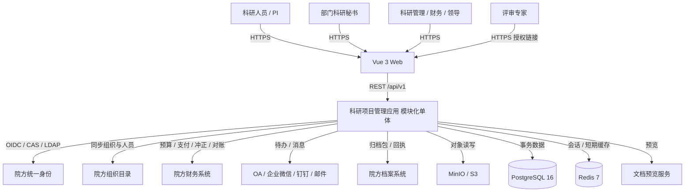
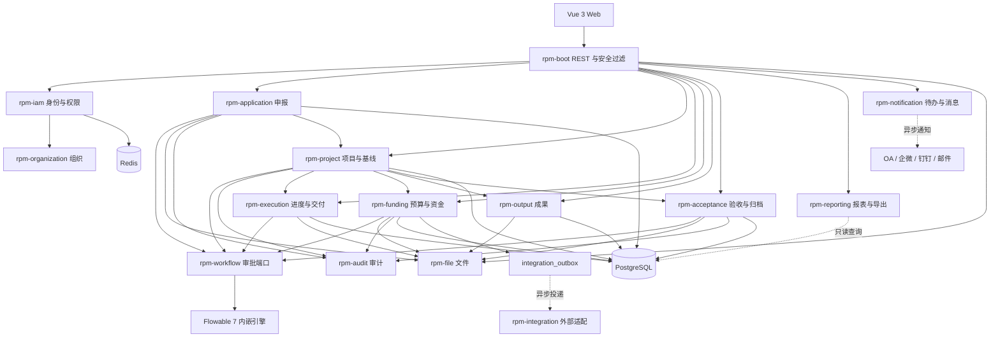
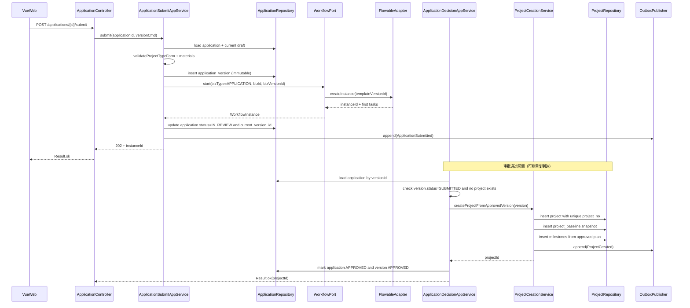
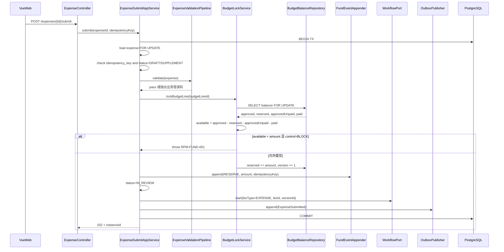
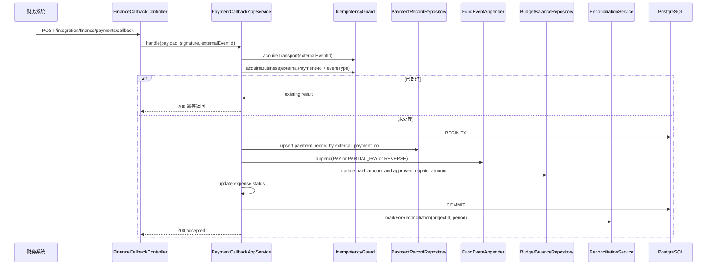
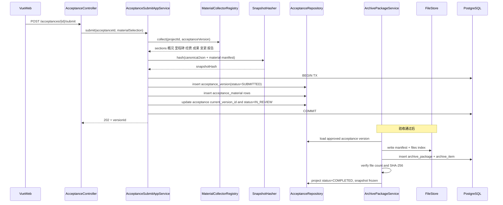
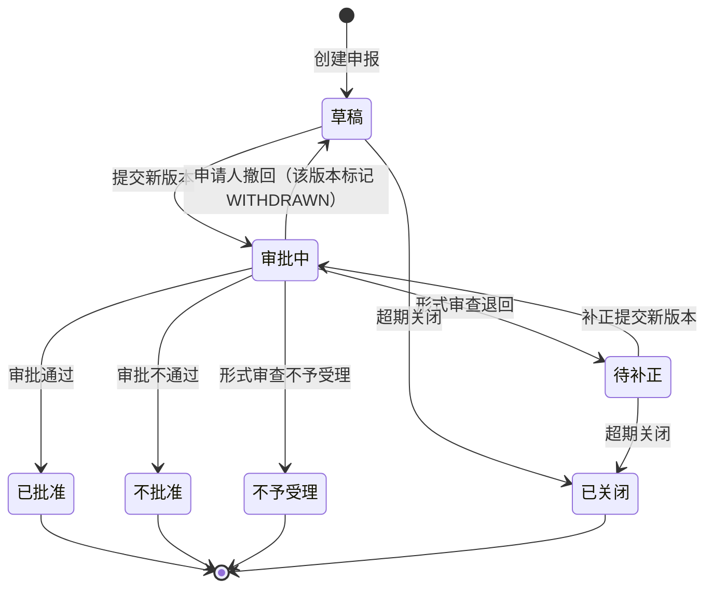
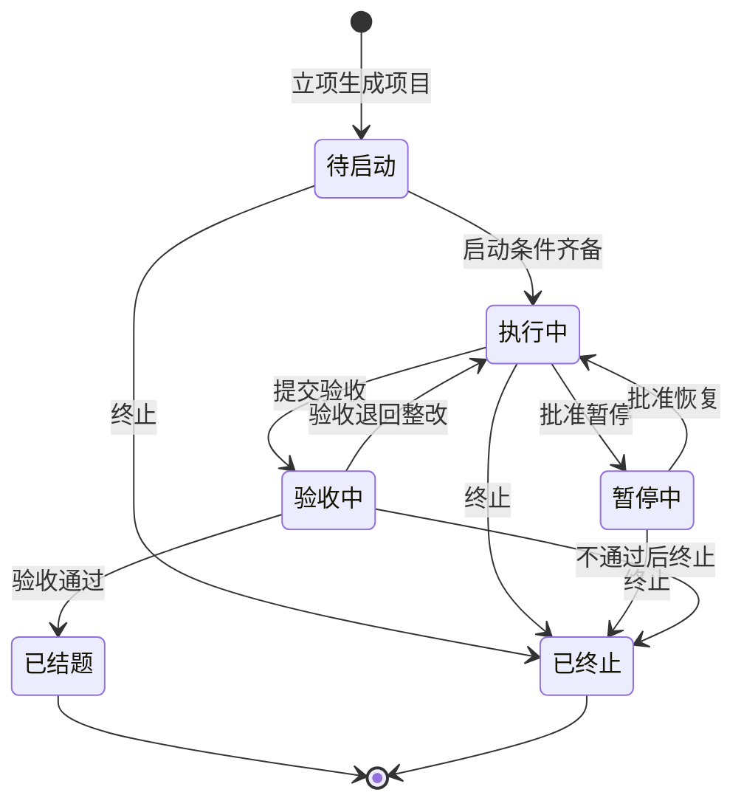
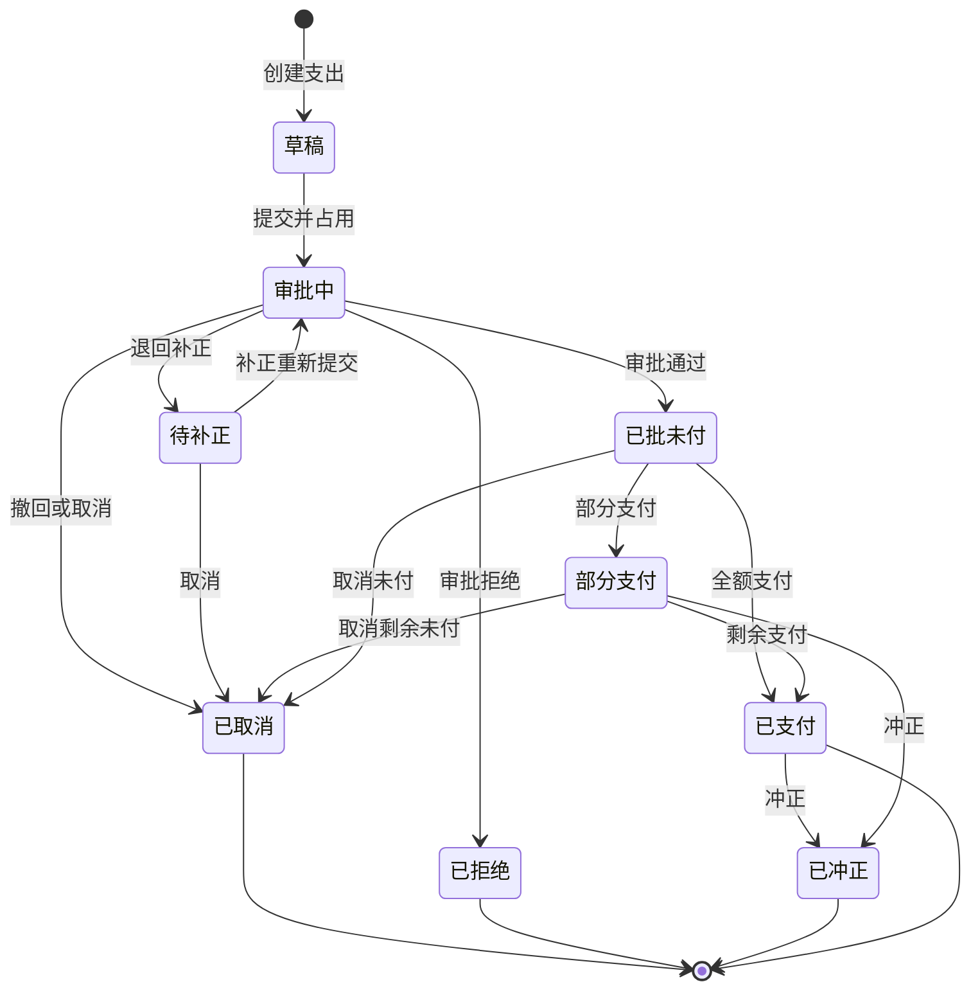
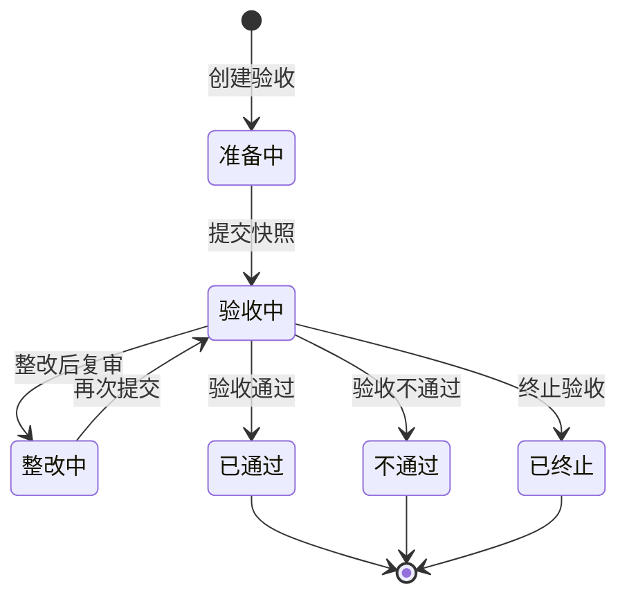

# 科研项目管理系统 — 总体设计与架构

> 文档索引：`README.md`
> 需求基线：《科研项目全生命周期管理系统需求文档》V2.0 评审稿（2026-11-17）
> 服务形态：**形态 A（单体服务）**，模块化单体，不拆微服务
> 技术基线：Java 21 + Spring Boot 3.5.x + PostgreSQL 16 + Flowable 7 + Vue 3 + Element Plus
> 本文覆盖：需求理解、业务规则、系统架构、关键时序、状态机、设计模式

---

## 第一章 需求理解

### 1.1 核心问题陈述

科研院所的科研人员、科研管理、财务和决策人员缺少一条以项目为主线的可信业务链：申报书、预算、执行周期和成果清单在 Excel、邮件和纸质材料中各自维护，同一项目存在多个不一致版本；审批进度只能靠催问；经费“申请中、已审批、已支付、已入账”混称；到期、逾期和预算异常往往到结题才暴露；验收时需要重新收集散落材料。本系统要解决的不是“缺一个项目 CRUD”，而是让**每次申报有版本、每项审批有责任、每笔经费有口径、每个风险有处置、每项成果有出处、每次验收有证据**。

### 1.2 关键业务规则（可测试断言）

> 编号 `BR-xx` 供技术方案、任务拆解和验证用例回溯；来源为需求文档章节或功能编号。任何实现不得绕过这些断言。
> 验证用例清单见 `07-验证用例清单.md`；每条 `BR-xx` 均有主用例和补充用例。

| 编号 | 可测试断言 | 来源 |
|---|---|---|
| BR-01 | 项目详情所有页签（概况、进度、经费、成果、审批、变更、风险、档案）必须使用同一 `project.id` 和当前生效 `baseline.id`，同一页面不得出现互相矛盾的金额或周期 | PRD §4.2、PORT-03 |
| BR-02 | 申报每次提交生成新的不可变 `application_version`，审批实例绑定固定 `version_id`；批准后不得覆盖申报原文 | PRD §4.3、APPLY-02 |
| BR-03 | 同一 `application_version_id` 的批准事件重复到达时，只生成一个项目和一个基线；`project_no` 全局唯一 | PRD §4.3、APPLY-06、§7.4 |
| BR-04 | 外部项目可经批复/合同登记立项，不强制内部评审；批复号、合同号、核验人、证明材料必填 | PRD §5.2 APPLY-05 |
| BR-05 | 形式审查退回必须列出问题项；补正提交生成新版本，旧版本和旧意见永久保留 | PRD §5.2 APPLY-03 |
| BR-06 | 审批模板按项目类型、经费区间、部门等受控条件路由；模板发布后不可原地修改；提交人不得审批本人事项 | PRD §5.2 APPLY-04、§6.4 |
| BR-07 | 项目主状态与审批状态使用不同字段；非执行状态按规则禁止新增支出、进度报告或变更提交 | PRD §7.1 |
| BR-08 | 立项时形成里程碑基线；未定义完成判定的里程碑不能标记完成；延期保存原计划、当前计划和审批记录 | PRD §5.3 EXEC-01/02 |
| BR-09 | 每项目每周期仅一份当前周期报告；退回保留旧版本；补报和迟报必须有标记 | PRD §5.3 EXEC-03 |
| BR-10 | 风险关闭必须填写处置结果和证据；逾期风险可重新升级；风险不能只是发一条消息 | PRD §5.3 EXEC-05/06 |
| BR-11 | 变更审批中沿用旧基线；批准后按生效日期原子切换新基线；历史报表能还原当时基线 | PRD §4.3、CHG-02 |
| BR-12 | 负责人交接必须转移待办、项目权限和未结事项；历史操作人不得被改写为新人 | PRD §5.6 CHG-03 |
| BR-13 | 金额口径固定：生效预算为上限；在审占用、已批未付、实际净支付按定义扣减；当前有效占用和实际支付不得在公式外再次加回释放/冲正金额 | PRD §5.4.1 |
| BR-14 | 预算调整必须走变更审批生成新版本；已生效版本不得直接修改；预算明细合计必须等于总额 | PRD §5.4 FUND-01/02 |
| BR-15 | 支出提交必须校验项目状态、预算版本、可用余额、必填材料和本人回避；余额不足默认阻止提交，特批需独立权限和理由 | PRD §5.4 FUND-04 |
| BR-16 | 提交、撤回、退回、拒绝、取消、支付、冲正均产生不可变 `fund_event`；同一事件重放不得重复占用、释放或支付 | PRD §7.2、FUND-05/06 |
| BR-17 | 两人并发提交超余额支出时，BLOCK 策略下最多一笔占用成功，另一笔明确失败或转特批；任何路径不得出现负可用余额 | PRD §12.2 E2E-03 |
| BR-18 | 支付事实以财务为准；部分支付不得提前全额转支出；支付回写晚于取消时进入异常队列，不自动吞掉冲突 | PRD §7.2、FUND-06 |
| BR-19 | 对账差异必须记录责任人、处理说明和关闭记录；禁止通过手工改数把差异改成一致 | PRD §5.4 FUND-09 |
| BR-20 | 一个成果可关联多个项目，一个项目可关联多个成果；关联必须说明贡献；撤销关联不得删除历史验收引用 | PRD §5.5 RES-03/04 |
| BR-21 | 按 DOI、专利号、名称、完成人给出疑似重复提示；系统不得自动合并成果 | PRD §5.5 RES-05 |
| BR-22 | 验收提交必须引用固定材料版本和哈希；后续新增成果或支付不得改变在审验收包 | PRD §4.3、ACC-03/06 |
| BR-23 | 验收条件未满足项、豁免人、理由和审批必须可见；通过后冻结核心业务新增和修改 | PRD §5.7 ACC-01/06 |
| BR-24 | 整改必须生成问题清单、责任人、期限和再次提交版本；原验收意见不得被新版本覆盖 | PRD §5.7 ACC-05 |
| BR-25 | 归档包必须包含目录、文件、版本清单和 SHA-256 校验值；能检测缺文件和篡改；记录归档接收人和时间 | PRD §5.7 ACC-07 |
| BR-26 | 结题后发现错误必须走独立档案更正流程追加记录，不得覆盖原始审批和验收快照 | PRD §7.4、ACC-06 |
| BR-27 | 最终许可 = 功能权限 ∩ 数据范围 ∩ 业务状态 ∩ 字段权限 ∩ 职责分离/利益冲突 ∩ 授权有效期；系统管理员默认无业务正文权限 | PRD §6.1/6.2 |
| BR-28 | 列表、详情、附件下载、导出和异步任务必须使用同一授权逻辑；切换身份不改变底层授权 | PRD §6.1、PORT-01 |
| BR-29 | 申请人不得审批本人事项；专家与申请人存在同部门、合作、亲属等关系时必须回避；代理审批必须显式委托 | PRD §6.4 |
| BR-30 | 临时授权必须包含范围、原因、起止时间和授权人；到期自动失效 | PRD §6.4 |
| BR-31 | 文件不得通过猜测 URL 下载；必须使用后端鉴权流或短期签名；权限变化后旧地址及时失效 | PRD §6.5、§10.3 |
| BR-32 | 关键操作审计至少记录操作者、代理/真实身份、时间、IP、对象、业务版本、动作、前后摘要、原因、关联审批和请求追踪号；日志不可无痕修改 | PRD §8.4 |
| BR-33 | 报表口径固定：在研项目数、申报成功率、里程碑按期率、报告及时率、预算执行率、成果去重数、超期未结题率、数据及时性按 PRD §8.3 定义 | PRD §8.3 |
| BR-34 | 授权导出必须记录导出人、条件、字段、时间和文件有效期；大数据量异步；敏感字段脱敏；不得借导出越权 | PRD §5.8 RPT-05 |
| BR-35 | 站内消息覆盖待办、退回、批准、到期、逾期和接口异常；消息含对象、动作、时间；已读不删除业务记录 | PRD §5.1 PORT-04 |
| BR-36 | 所有外部调用必须设置连接/读取超时、幂等键、重试和降级；财务/OA 不可用不得丢失已保存业务，必须显示同步状态 | PRD §10.2、§11；公共规则（CLAUDE.md《外部 HTTP 调用规则》）RULE-H1~H3 |
| BR-37 | 审批人为空或离岗时阻止模板发布或进入异常待办；旧实例沿用旧模板版本，新实例使用新版本 | PRD §7.4、§9.4 |
| BR-38 | 上传文件必须校验扩展名、MIME、大小和内容；病毒扫描按院方要求配置；孤立文件按保留期清理 | PRD §10.3 |
| BR-39 | 300 峰值在线用户模型下普通查询 P95 ≤ 1s、P99 ≤ 2s；关键提交 P95 ≤ 2s；超阈值导出异步；容量覆盖 5 年、10,000 个项目 | PRD §10.1 |
| BR-40 | 月度可用性 ≥ 99.5%；RPO ≤ 15 分钟、RTO ≤ 4 小时；每季度至少一次恢复演练；发布前完成备份、兼容验证和回退预案 | PRD §10.2 |
| BR-41 | 全站 HTTPS；密码使用成熟慢哈希；Token 可撤销；防 SQL 注入、XSS、CSRF、越权、恶意文件、暴力破解和批量接口滥用；敏感字段脱敏 | PRD §10.3 |
| BR-42 | 项目类型、表单、审批模板、预算科目、报告周期和通知规则可配置；一期不开放任意脚本和 BPMN 设计器；模板版本化 | PRD SYS-02～SYS-04、§9.4 |
| BR-43 | 项目编号不复用；外部批复号、合同号、财务项目号分别保存，不混为一个字段 | PRD §4.3 |
| BR-44 | 验收结论至少包含通过、整改后复审、不通过；不允许只填自由文本；不通过/终止也生成处置与归档记录 | PRD §5.7 ACC-04/08 |

### 1.3 不在本次范围内

| 不做项 | 原因 | 重新考虑条件 |
|---|---|---|
| 财务总账、发票查验、网银支付、会计凭证 | 财务系统核心职责，重复建设造成双账 | 院方无财务系统且明确立项 |
| 电子实验记录、科研数据分析、仪器预约、实验室安全 | 用户、流程、数据结构不同 | 作为独立产品，通过项目编号关联 |
| 原生 iOS/Android App、内部 IM | 一期价值不足，消息可复用现有平台 | 移动任务量或离线需求达到阈值 |
| 复杂 WBS、甘特图、资源负荷、每日工时 | 填报成本高，偏离科研不确定性 | 工程化课题或人力成本核算有要求 |
| 通用低代码、开放 BPMN 设计器、任意脚本 | 流程不可验证、升级和审计风险 | 模板稳定且有专业流程管理员 |
| 通用 BI 平台和大屏（`RPT-07`） | 先用固定报表回答管理问题 | 指标口径稳定且自助分析需求持续 |
| 到账登记与合同回款（`FUND-10`） | PRD V2.1 D-16 条件②降级：一期试点为纵向项目（D-14），横向到账/回款特性不涉及；到账与预算余额分账，不混用 | 横向项目纳入试点/推广，或财务回款接口就绪 |
| AI 自动评审、自动批准、自动验收 | 责任不可转移，训练数据和可解释性不足 | 仅做辅助，自动决策需专项合规验证 |
| 多租户、订阅计费、公开注册 | 单院内部系统 | 明确转为跨机构运营产品 |
| 涉密数据与普通数据混合存储 | 不能靠普通权限按钮解决保密边界 | 由保密部门确定独立环境 |

### 1.4 范围边界与关键假设

| 假设 | 默认处理 | 变化时的影响 |
|---|---|---|
| A1：1,000～3,000 用户、峰值 300 在线、年新增 ≤2,000 项目 | 模块化单体 + 单 PostgreSQL | 超出阈值先垂直扩容/读写分离，再按 §9.3 拆服务 |
| A2：纵向、横向、院级项目并存，审批链和预算科目不同 | 项目类型驱动表单、流程和预算模板 | 新增类型走配置，不改代码 |
| A3：财务系统可能只提供导出或延迟接口 | 一期同时支持 API 和 Excel/CSV 导入；支付以财务为准 | 接口能力变化只改同步方式，不改事实边界 |
| A4：大部分填报在 PC，领导有移动审批需求 | 响应式 Web 覆盖轻审批 | 原生 App 进入二期评估 |
| A5：涉密项目不进入普通系统 | 默认只部署非涉密数据 | 涉密边界由院方安全部门确认 |

---

## 第二章 系统架构设计

### 2.1 系统上下文图（C4 Level 1）



边界说明：

- 本系统不建设统一认证、财务总账、OA、IM 和档案系统，只做集成。
- 所有外部系统调用都在 `rpm-integration` 中通过端口适配，业务模块不直接依赖 SDK。
- 财务支付结果是经费事实源；本系统保存业务申请和资金事件，不替财务记账。

### 2.2 模块协作图（C4 Level 2）



职责一句话：

| 模块 | 职责 |
|---|---|
| `rpm-iam` | 认证会话、角色、功能权限、数据范围、字段脱敏、临时授权 |
| `rpm-organization` | 组织树、部门、岗位、人员归属 |
| `rpm-application` | 申报批次、申报书、版本、形式审查、外部项目登记 |
| `rpm-workflow` | 审批模板、实例、任务、委托、利益冲突校验、Flowable 适配 |
| `rpm-project` | 项目主档、成员、基线、里程碑、变更、交接、风险 |
| `rpm-execution` | 周期报告、交付物、轻任务 |
| `rpm-funding` | 预算版本、支出申请、资金事件、支付、对账 |
| `rpm-output` | 成果、证据、项目关联、查重、审核 |
| `rpm-acceptance` | 验收条件、材料快照、评审、整改、归档包 |
| `rpm-reporting` | 固定报表、物化视图、导出任务 |
| `rpm-notification` | 站内信、待办、通知规则与去重 |
| `rpm-integration` | SSO、财务、OA、档案、预览适配；outbox 投递 |
| `rpm-audit` | 审计日志、访问日志、导出日志 |
| `rpm-file` | 文件元数据、对象存储、下载鉴权、病毒扫描钩子 |
| `rpm-boot` | 启动、配置、Web 装配，不含业务规则 |

### 2.3 关键流程时序图

#### 2.3.1 申报提交 → 审批批准 → 幂等立项



标注：

- 事务边界：`createProjectFromApprovedVersion` 内项目、基线、里程碑、立项事件同事务提交。
- 并发风险：重复回调由 `application_id` 唯一项目约束 + 幂等键兜底；第二个请求查询已有项目并返回。
- 超时：Flowable 本地引擎调用不跨网络；外部通知通过 outbox 异步。
- 补偿：立项失败回滚事务，审批实例保持已通过但不产生项目，进入异常待办由科研管理重试。

#### 2.3.2 支出提交 → 预算占用



标注：

- 事务边界：预算行锁、余额投影更新、资金事件、支出状态、审批实例、outbox 同事务。
- 并发风险：`SELECT ... FOR UPDATE` 串行化同一预算行的占用；不同预算行可并行。
- 超时：外部财务推送不在提交事务内；outbox 异步。
- 补偿：审批拒绝/撤回/取消产生 `RELEASE` 事件，恢复可用余额；不允许直接改 `reserved_amount`。

#### 2.3.3 支付回调 → 部分支付 → 对账



标注：

- 幂等键：`external_payment_no + event_type`；支付记录唯一索引兜底。
- 部分支付：`PAY` 事件金额小于申请金额时状态为 `PARTIALLY_PAID`；只有累计净支付等于申请金额才转 `PAID`。
- 冲正：生成反向 `REVERSE` 事件，不删除原支付；余额投影按净额重算。
- 晚到支付：若支出已取消，回调进入 `reconciliation_diff` 异常队列，不自动改变已取消状态。

#### 2.3.4 验收提交 → 快照 → 归档



标注：

- 快照不可变：`acceptance_version.snapshot` + `snapshot_hash` + `acceptance_material.sha256` 共同冻结在审材料。
- 归档完整性：文件数、SHA-256、目录清单三者任一不一致则 `archive_package.status=FAILED` 并告警。
- 后续变更：结题后新增成果/支付不进入原快照；更正走独立追加流程。

### 2.4 状态机图

#### 2.4.1 申报状态机



副作用：提交写新版本与审批实例；批准触发幂等立项；不批准/不予受理/关闭不生成项目；申请人撤回后单据回到 DRAFT、该提交版本标记 WITHDRAWN（对齐 PRD §7.1 / D-17）。

#### 2.4.2 项目主状态机



不可逆：`COMPLETED`、`TERMINATED` 不可回到执行态；结题后仅允许档案更正。

#### 2.4.3 支出状态机



资金副作用：进入 `IN_REVIEW` 产生 `RESERVE`；拒绝/撤回/取消产生 `RELEASE`；支付产生 `PAY/PARTIAL_PAY`；冲正产生 `REVERSE`。

#### 2.4.4 验收状态机



不可逆：`APPROVED` 后项目冻结；`REJECTED`/`TERMINATED` 仍生成处置与归档记录。

---

## 第三章 设计模式选型

### 引入闸门

| 候选 | 简单方案够不够 | 扩展是否真实 | 节点是否固定少量 | 结论 |
|---|---|---|---|---|
| 验收材料汇编 | 不够：6 类材料取数来源、权限和快照规则不同 | 真实：未来新增成果类型、财务核验材料 | 节点多且可扩展 | 引入模板方法 |
| 预算控制级别 | 不够：BLOCK/WARN/APPROVAL 三种行为不同 | 真实：项目类型可新增控制策略 | 运行时按预算行分派 | 引入策略模式 |
| 支出校验 | 用有序 `List<ExpenseValidator>` 足够 | 暂不真实：当前固定 5 项，新增需改需求 | 固定 5 项 | 不引入责任链，顺序管线 |
| 项目状态流转 | 枚举 + 迁移表足够 | 否：状态由 PRD 定死 | 固定 6 状态 | 不引入状态模式，`ProjectStateMachine` 表驱动 |
| 外部系统适配 | 端口 + 适配器足够 | 真实：财务/SSO/档案多实现 | 按系统分派 | 端口适配器（非 GoF 重点） |

### 3.1 模板方法模式 — `AbstractAcceptanceMaterialCollector`

**选型理由**：验收材料汇编的骨架固定为“鉴权 → 取数 → 脱敏 → 生成来源引用 → 计算摘要 → 写入快照”，但项目概况、里程碑、经费、成果、变更、周期报告六类材料的取数来源和权限不同。若每个收集器复制骨架，任一审计或脱敏规则变更要改六处，必然产生口径漂移。

**核心接口与调用方式**：

```java
public abstract class AbstractAcceptanceMaterialCollector<S> {
    public final MaterialSection collect(AcceptanceContext ctx) {
        authorize(ctx);
        S source = loadSource(ctx);
        S masked = mask(source, ctx);
        List<SourceRef> refs = buildSourceRefs(source);
        String digest = digest(masked);
        return MaterialSection.of(sectionType(), masked, refs, digest);
    }

    protected abstract String sectionType();
    protected abstract void authorize(AcceptanceContext ctx);
    protected abstract S loadSource(AcceptanceContext ctx);
    protected abstract S mask(S source, AcceptanceContext ctx);
    protected abstract List<SourceRef> buildSourceRefs(S source);
}
```

实现类：`ProjectOverviewCollector`、`MilestoneCollector`、`FundingSummaryCollector`、`OutputEvidenceCollector`、`ChangeHistoryCollector`、`ProgressReportCollector`。

组装：Spring 启动时各 `@Component` 注册到 `MaterialCollectorRegistry`；调用入口 `AcceptanceSubmitAppService → MaterialCollectorRegistry.collectAll(projectId)`。

**扩展点**：新增材料类型只需继承 `AbstractAcceptanceMaterialCollector` 并注册，不改汇编骨架和快照哈希流程。

### 3.2 策略模式 — `BudgetControlPolicy`

**选型理由**：预算行的 `control_level` 决定余额不足或执行率超阈值时的行为：`BLOCK` 在余额不足时直接拒绝；`WARN` 仅在余额足够时允许提交，并在执行率超过阈值时生成风险提示；`APPROVAL` 在余额不足时不直接提交，提示先走预算调整/特批。任何路径都不得产生负可用余额。三种行为的提示、事件和审批路由不同；用 `if/else` 会把特批权限和资金事件写散。

**核心接口与调用方式**：

```java
public interface BudgetControlPolicy {
    BudgetDecision decide(BudgetBalance balance, BigDecimal amount, ExpenseContext ctx);
}
```

实现类：`BlockBudgetPolicy`、`WarnBudgetPolicy`、`ApprovalBudgetPolicy`。

注册：`BudgetControlPolicyRegistry` 按 `control_level` 映射；调用入口 `BudgetLockService → registry.get(level).decide(...)`。

**扩展点**：新增控制级别只需实现策略并注册；`BudgetLockService` 不感知具体规则。

### 3.3 领域事件 + 事务内 Outbox

**选型理由**：立项、支出批准、支付回写、验收通过都需要通知外部系统或异步任务，但不能把外部 HTTP 调用放进数据库事务，也不能出现“业务提交成功、事件丢失”。一期不引入 MQ，使用 PostgreSQL 事务内 outbox 保证本地事务与待发送事件一致。

**核心接口**：

```java
public interface DomainEventPublisher {
    void append(DomainEvent event);
}
```

发布入口：`OutboxPublisher.append(event)` 在同一事务写入 `integration_outbox`；后台 `OutboxDispatchJob` 轮询投递。

**扩展点**：新增外部消费者只需新增投递适配器；业务模块只依赖 `DomainEventPublisher`，不依赖具体外部系统。
