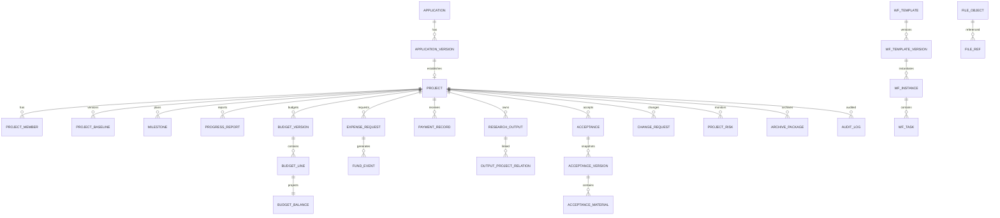

# 科研项目管理系统 — 数据模型与数据库设计

> 数据库：PostgreSQL 16.x
> 迁移工具：Flyway
> 完整基线 DDL：`../../../3-数据库/research-project-management/v1.0/V01__baseline_schema.sql`
> 代码生成时复制到 `src/main/resources/db/migration/V01__baseline_schema.sql`，再由 Flyway 执行
> 设计原则：金额可追溯、版本不可变、资金事件追加、权限可审计、历史可还原

---

## 1. 设计原则

1. 主键统一 `uuid`，业务编号独立唯一；`project_no`、`application_no`、`request_no` 等不使用有含义字段做主键。
2. 时间点统一 `timestamptz`；业务日期（项目起止、报告期、完成日期）使用 `date`；展示时区 `Asia/Shanghai`。
3. 金额统一 `numeric(18,2)`，Java 使用 `BigDecimal`；禁止浮点。
4. 所有业务表包含 `created_at`、`updated_at`、`created_by`、`updated_by`、`version`；审计日志和资金事件除外（它们只追加）。
5. 版本化对象使用独立版本表 + 不可变快照：申报、预算、审批模板、验收。已生效版本禁止 `UPDATE` 业务内容。
6. 资金只通过 `fund_event` 追加；`budget_balance` 是可重建投影，不是独立事实源。
7. 状态、类型、来源使用受控代码（`varchar` + `CHECK`），显示名称由字典配置；不直接用中文名称关联。
8. 项目类型差异字段用 `jsonb`，但高频筛选、金额、负责人、日期和审批依据必须结构化。
9. 敏感字段分列存储：可检索的掩码值 + 加密值；禁止明文身份证、银行账号、联系方式。
10. 业务事实原则上不物理删除；草稿和孤立文件按保留策略清理。

---

## 2. 概念模型



关系说明：

- `APPLICATION_VERSION` 是申报的不可变快照；批准后一个版本最多对应一个项目。
- `PROJECT_BASELINE` 保存项目/预算/里程碑基线的整体快照；`PROJECT.current_baseline_id` 指向当前生效基线。
- `BUDGET_LINE → BUDGET_BALANCE` 一对一；余额投影由 `FUND_EVENT` 重建。
- `RESEARCH_OUTPUT` 与 `PROJECT` 多对多，通过 `OUTPUT_PROJECT_RELATION` 承载贡献说明。
- `ACCEPTANCE_VERSION` 与 `ACCEPTANCE_MATERIAL` 共同构成不可变验收包。

---

## 3. 表目录

### 3.1 身份、组织与权限

| 表 | 用途 | 关键字段 | 关键索引 |
|---|---|---|---|
| `iam_user` | 人员账号 | `employee_no`、`display_name`、`dept_id`、`status`、`sso_subject` | `uk_iam_user_employee_no`、`uk_iam_user_sso_subject`、`idx_iam_user_dept_status` |
| `iam_role` | 角色 | `code`、`name`、`scope_type`、`status` | `uk_iam_role_code` |
| `iam_permission` | 功能权限点 | `code`、`module` | `uk_iam_permission_code` |
| `iam_role_permission` | 角色-权限 | `role_id`、`permission_id` | 复合主键 |
| `iam_user_role` | 用户-角色-组织 | `user_id`、`role_id`、`org_id`、`valid_from`、`valid_to` | `idx_iam_user_role_user`、`idx_iam_user_role_valid` |
| `iam_temp_grant` | 临时授权 | `grantee_id`、`resource_type`、`resource_id`、`permission_code`、`valid_from`、`valid_to` | `idx_temp_grant_grantee_valid` |
| `org_unit` | 组织树 | `parent_id`、`code`、`name`、`unit_type`、`path` | `uk_org_unit_code`、`idx_org_unit_parent` |
| `org_membership` | 人员归属 | `user_id`、`org_id`、`position_name`、`is_primary` | `idx_org_membership_user`、`idx_org_membership_org` |
| `coi_declaration` | 利益冲突声明 | `biz_type`、`biz_id`、`expert_id`、`related_user_id`、`relation_type`、`status` | `idx_coi_biz_expert` |

### 3.2 申报与审批

| 表 | 用途 | 关键字段 | 关键索引 |
|---|---|---|---|
| `apply_batch` | 申报批次 | `batch_no`、`year`、`start_at`、`end_at`、`status`、`rules` | `uk_apply_batch_no`、`idx_apply_batch_year_status` |
| `apply_form_template` | 项目类型表单模板 | `project_type`、`version_no`、`form_schema`、`status` | `uk_apply_form_type_version` |
| `application` | 申报主档 | `application_no`、`batch_id`、`project_type`、`applicant_id`、`dept_id`、`status`、`current_version_id` | `uk_application_no`、`idx_application_applicant_status`、`idx_application_batch_status` |
| `application_version` | 不可变申报版本 | `application_id`、`version_no`、`form_data`、`content_hash`、`status` | `uk_application_version_no`、`idx_application_version_status` |
| `application_member` | 申报团队成员 | `application_version_id`、`user_id`、`member_role` | `idx_application_member_version` |
| `application_review` | 形式/专家/决策意见 | `application_version_id`、`review_stage`、`reviewer_id`、`decision` | `idx_application_review_version_stage` |
| `external_project_registration` | 外部项目登记 | `application_id`、`approval_no`、`contract_no`、`funder_name`、`verified_by` | `uk_external_registration_application` |
| `wf_template` | 审批模板 | `code`、`project_type`、`condition_schema`、`status`、`current_version_id` | `uk_wf_template_code` |
| `wf_template_version` | 审批模板版本 | `template_id`、`version_no`、`definition`、`effective_from`、`status` | `uk_wf_template_version_no` |
| `wf_instance` | 审批实例 | `biz_type`、`biz_id`、`biz_version_id`、`template_version_id`、`status`、`initiator_id` | `idx_wf_instance_biz`、部分唯一索引 `uk_wf_instance_running` |
| `wf_task` | 审批任务 | `instance_id`、`node_key`、`assignee_id`、`status`、`due_at` | `idx_wf_task_assignee_status` |
| `wf_delegation` | 代理审批 | `delegator_id`、`delegate_id`、`scope`、`valid_from`、`valid_to` | `idx_wf_delegation_delegate_valid` |
| `wf_callback_log` | 审批回调幂等 | `instance_id`、`task_id`、`request_id`、`action`、`status` | 唯一 `request_id` |

### 3.3 项目、执行与风险

| 表 | 用途 | 关键字段 | 关键索引 |
|---|---|---|---|
| `project` | 项目主档 | `project_no`、`title`、`project_type`、`dept_id`、`pi_id`、`status`、`current_baseline_id`、`start_date`、`end_date` | `uk_project_no`、`idx_project_pi_status`、`idx_project_dept_status`、`idx_project_type_status` |
| `project_member` | 项目成员与身份 | `project_id`、`user_id`、`project_role`、`valid_from`、`valid_to` | `idx_project_member_project`、`idx_project_member_user` |
| `project_baseline` | 项目/里程碑基线 | `project_id`、`version_no`、`snapshot`、`snapshot_hash`、`effective_at` | `uk_project_baseline_no`、`idx_project_baseline_effective` |
| `milestone` | 里程碑 | `project_id`、`baseline_id`、`plan_date`、`current_plan_date`、`actual_date`、`completion_criteria`、`status` | `idx_milestone_project_plan`、`idx_milestone_owner_status` |
| `progress_report` | 周期报告主档 | `project_id`、`period_type`、`period_key`、`due_date`、`status`、`current_version_id` | `uk_progress_report_period`、`idx_progress_report_due_status` |
| `progress_report_version` | 报告版本 | `report_id`、`version_no`、`content`、`decision` | `uk_progress_report_version_no` |
| `deliverable` | 交付物 | `project_id`、`milestone_id`、`file_id`、`sha256`、`status` | `idx_deliverable_project`、`idx_deliverable_milestone` |
| `project_risk` | 风险与处置 | `project_id`、`source_rule`、`risk_level`、`owner_id`、`due_date`、`status` | `idx_risk_project_status`、`idx_risk_owner_due` |
| `change_request` | 变更主档 | `project_id`、`change_type`、`status`、`current_version_id`、`effective_date` | `idx_change_project_status` |
| `change_request_version` | 变更版本 | `change_request_id`、`version_no`、`payload`、`old_baseline_id`、`new_baseline_id` | `uk_change_version_no` |
| `project_handover` | 负责人交接 | `project_id`、`from_user_id`、`to_user_id`、`effective_at`、`status` | `idx_handover_project_status` |

### 3.4 经费

| 表 | 用途 | 关键字段 | 关键索引 |
|---|---|---|---|
| `budget_version` | 预算版本 | `project_id`、`version_no`、`total_amount`、`source_type`、`control_level`、`status`、`effective_from` | `uk_budget_version_no`、`idx_budget_project_status` |
| `budget_line` | 预算科目明细 | `budget_version_id`、`subject_code`、`amount`、`control_level` | `uk_budget_line_subject` |
| `budget_balance` | 预算余额投影 | `budget_line_id`、`approved_amount`、`reserved_amount`、`approved_unpaid_amount`、`paid_amount`、`version` | `uk_budget_balance_line` |
| `expense_request` | 支出申请 | `request_no`、`project_id`、`budget_version_id`、`amount`、`status`、`idempotency_key` | `uk_expense_request_no`、`uk_expense_idempotency`、`idx_expense_project_status` |
| `expense_request_version` | 支出版本 | `expense_request_id`、`version_no`、`payload`、`content_hash` | `uk_expense_version_no` |
| `fund_event` | 不可变资金事件 | `event_no`、`project_id`、`expense_request_id`、`event_type`、`amount`、`external_no`、`idempotency_key` | `uk_fund_event_no`、`uk_fund_event_idempotency`、`idx_fund_event_project_type` |
| `payment_record` | 财务支付记录 | `project_id`、`expense_request_id`、`external_payment_no`、`amount`、`status` | `uk_payment_external_no`、`idx_payment_expense` |
| `payment_import_batch` | 支付导入批次 | `batch_no`、`source_type`、`file_id`、`status`、`total_rows` | `uk_payment_import_batch_no` |
| `payment_import_row` | 导入行 | `batch_id`、`row_no`、`raw_data`、`status`、`error_code` | `idx_payment_import_row_batch` |
| `reconciliation_batch` | 对账批次 | `batch_no`、`period_start`、`period_end`、`status`、`diff_count` | `uk_reconciliation_batch_no` |
| `reconciliation_diff` | 对账差异 | `batch_id`、`project_id`、`diff_type`、`owner_id`、`status` | `idx_recon_diff_batch_status` |

### 3.5 成果、验收与归档

| 表 | 用途 | 关键字段 | 关键索引 |
|---|---|---|---|
| `research_output` | 成果主档 | `output_type`、`title`、`doi`、`patent_no`、`owner_id`、`status` | `idx_output_type_status`、`idx_output_doi`、`idx_output_patent_no` |
| `output_version` | 成果版本 | `output_id`、`version_no`、`metadata`、`content_hash` | `uk_output_version_no` |
| `output_evidence` | 成果证明 | `output_version_id`、`file_id`、`evidence_type`、`sha256` | `idx_output_evidence_version` |
| `output_project_relation` | 成果-项目关联 | `output_id`、`project_id`、`contribution_desc`、`attribution_ratio`、`status` | `uk_output_project_relation` |
| `output_review` | 成果审核 | `output_version_id`、`reviewer_id`、`decision` | `idx_output_review_version` |
| `output_duplicate_candidate` | 疑似重复 | `output_id`、`candidate_output_id`、`match_type`、`score`、`status` | `idx_output_duplicate_status` |
| `acceptance` | 验收主档 | `project_id`、`status`、`current_version_id`、`initiated_by` | `uk_acceptance_project_open`、`idx_acceptance_status` |
| `acceptance_version` | 验收快照 | `acceptance_id`、`version_no`、`snapshot`、`snapshot_hash`、`status` | `uk_acceptance_version_no` |
| `acceptance_material` | 验收材料 | `acceptance_version_id`、`material_type`、`file_id`、`sha256` | `idx_acceptance_material_version` |
| `acceptance_review` | 验收意见 | `acceptance_id`、`acceptance_version_id`、`review_role`、`decision` | `idx_acceptance_review_version` |
| `acceptance_rectification` | 整改 | `acceptance_id`、`issue_no`、`owner_id`、`due_date`、`status` | `idx_rectification_acceptance_status` |
| `archive_package` | 归档包 | `project_id`、`acceptance_id`、`status`、`manifest_hash`、`file_count` | `uk_archive_project_acceptance` |
| `archive_item` | 归档条目 | `package_id`、`item_type`、`item_id`、`file_id`、`sha256` | `idx_archive_item_package` |

### 3.6 文件、审计、通知与集成

| 表 | 用途 | 关键字段 | 关键索引 |
|---|---|---|---|
| `file_object` | 文件元数据 | `bucket`、`object_key`、`original_name`、`mime_type`、`size_bytes`、`sha256`、`status` | `uk_file_object_key`、`idx_file_object_sha256` |
| `file_ref` | 文件业务引用 | `file_id`、`biz_type`、`biz_id`、`purpose`、`access_level` | `idx_file_ref_biz` |
| `audit_log` | 审计日志（只追加） | `trace_id`、`actor_id`、`action`、`object_type`、`object_id`、`occurred_at` | `idx_audit_object_time`、`idx_audit_actor_time`、`idx_audit_trace` |
| `notification` | 站内消息 | `user_id`、`type`、`biz_type`、`biz_id`、`read_at` | `idx_notification_user_time` |
| `export_task` | 导出任务 | `user_id`、`query_snapshot`、`status`、`file_id`、`expires_at` | `idx_export_task_user_status` |
| `integration_outbox` | 事务内待发送事件 | `aggregate_type`、`aggregate_id`、`event_type`、`status`、`attempts`、`next_retry_at` | `idx_outbox_status_retry`、`uk_outbox_idempotency` |
| `integration_sync_log` | 外部同步日志 | `system_code`、`direction`、`biz_type`、`biz_id`、`external_key`、`status` | `idx_sync_log_system_time` |
| `job_run` | 后台任务执行记录 | `job_name`、`shard_key`、`status`、`started_at`、`finished_at` | `idx_job_run_name_time` |
| `job_failed_detail` | 任务失败明细 | `job_run_id`、`biz_type`、`biz_id`、`error_code`、`retryable` | `idx_job_failed_detail_run` |
| `todo_item` | 统一待办 | `user_id`、`biz_type`、`biz_id`、`biz_version_id`、`status`、`due_at` | `idx_todo_user_status_due` |

### 3.7 配置与系统管理

| 表 | 用途 | 关键字段 | 关键索引 |
|---|---|---|---|
| `project_type_config` | 项目类型配置 | `project_type`、`apply_form_template_id`、`report_period_rule_id`、`default_wf_template_id`、`acceptance_rule` | `uk_project_type_config` |
| `budget_subject_template` | 预算科目模板 | `project_type`、`subject_code`、`default_amount`、`control_level` | `uk_budget_subject_template` |
| `report_period_rule` | 报告周期规则 | `project_type`、`period_type`、`due_offset_days`、`late_grace_days` | `uk_report_period_rule` |
| `notification_rule` | 通知规则 | `rule_code`、`event_type`、`channels`、`recipient_rule`、`enabled` | `uk_notification_rule_code` |
| `system_config` | 系统阈值与开关 | `config_key`、`config_value`、`value_type`、`status` | `uk_system_config_key` |
| `data_dictionary` | 受控字典 | `dict_type`、`dict_code`、`dict_label`、`status` | `uk_data_dictionary_code` |
| `number_rule` | 编号规则 | `rule_code`、`prefix`、`date_pattern`、`sequence_name`、`reset_cycle` | `uk_number_rule_code` |

---

## 4. 核心表 DDL 说明

完整 DDL 见 `../../../3-数据库/research-project-management/v1.0/V01__baseline_schema.sql`。以下摘录关键约束，所有实现必须与 DDL 一致。

### 4.1 项目与基线

```sql
CREATE TABLE project (
    id                        uuid PRIMARY KEY DEFAULT gen_random_uuid(),
    project_no                varchar(64) NOT NULL,
    title                     varchar(512) NOT NULL,
    project_type              varchar(64) NOT NULL,
    dept_id                   uuid NOT NULL REFERENCES org_unit(id),
    pi_id                     uuid NOT NULL REFERENCES iam_user(id),
    status                    varchar(32) NOT NULL,
    source_application_version_id uuid,
    current_baseline_id       uuid,
    approved_at               timestamptz,
    start_date                date,
    end_date                  date,
    financial_project_no      varchar(128),
    external_approval_no      varchar(128),
    external_contract_no      varchar(128),
    version                   integer NOT NULL DEFAULT 0,
    created_at                timestamptz NOT NULL DEFAULT now(),
    updated_at                timestamptz NOT NULL DEFAULT now(),
    created_by                uuid,
    updated_by                uuid,
    CONSTRAINT uk_project_no UNIQUE (project_no),
    CONSTRAINT ck_project_status CHECK (status IN
        ('PENDING_START','EXECUTING','SUSPENDED','ACCEPTING','COMPLETED','TERMINATED'))
);
```

关键点：

- `project_no` 唯一；外部批复号、合同号、财务项目号分列保存。
- `source_application_version_id` 唯一索引由 `application_version` 侧约束或部分唯一索引保证“一个批准版本最多一个项目”。
- `current_baseline_id` 在 `project_baseline` 建表后通过 `ALTER TABLE` 增加外键，避免循环依赖。

### 4.2 预算余额投影

```sql
CREATE TABLE budget_balance (
    id                     uuid PRIMARY KEY DEFAULT gen_random_uuid(),
    budget_line_id         uuid NOT NULL REFERENCES budget_line(id),
    approved_amount        numeric(18,2) NOT NULL DEFAULT 0,
    reserved_amount        numeric(18,2) NOT NULL DEFAULT 0,
    approved_unpaid_amount numeric(18,2) NOT NULL DEFAULT 0,
    paid_amount            numeric(18,2) NOT NULL DEFAULT 0,
    version                integer NOT NULL DEFAULT 0,
    updated_at             timestamptz NOT NULL DEFAULT now(),
    CONSTRAINT uk_budget_balance_line UNIQUE (budget_line_id),
    CONSTRAINT ck_budget_balance_non_negative CHECK (
        approved_amount >= 0 AND reserved_amount >= 0
        AND approved_unpaid_amount >= 0 AND paid_amount >= 0
    )
);
```

可用余额计算：

```sql
SELECT approved_amount
     - reserved_amount
     - approved_unpaid_amount
     - paid_amount AS available_amount
FROM budget_balance
WHERE budget_line_id = :lineId;
```

说明：

- `budget_balance` 是 `fund_event` 的可重建投影；重建脚本按事件类型汇总：`RESERVE +`、`RELEASE -`、`APPROVE` 将占用转为已批未付、`PAY` 减少已批未付并增加支付、`REVERSE` 反向。
- 任何业务代码不得直接 `UPDATE budget_balance SET reserved_amount = ...` 而不写 `fund_event`；必须通过 `FundEventAppender`。
- 并发提交使用 `SELECT ... FOR UPDATE` 锁定对应 `budget_balance` 行，行锁范围最小。

### 4.3 资金事件

```sql
CREATE TABLE fund_event (
    id                uuid PRIMARY KEY DEFAULT gen_random_uuid(),
    event_no          varchar(64) NOT NULL,
    project_id        uuid NOT NULL REFERENCES project(id),
    expense_request_id uuid REFERENCES expense_request(id),
    budget_version_id uuid NOT NULL REFERENCES budget_version(id),
    budget_line_id    uuid NOT NULL REFERENCES budget_line(id),
    event_type        varchar(32) NOT NULL,
    amount            numeric(18,2) NOT NULL,
    occurred_at       timestamptz NOT NULL DEFAULT now(),
    external_no       varchar(128),
    idempotency_key   varchar(191) NOT NULL,
    reversal_of_event_id uuid REFERENCES fund_event(id),
    payload           jsonb NOT NULL DEFAULT '{}'::jsonb,
    created_at        timestamptz NOT NULL DEFAULT now(),
    created_by        uuid,
    CONSTRAINT uk_fund_event_no UNIQUE (event_no),
    CONSTRAINT uk_fund_event_idempotency UNIQUE (idempotency_key),
    CONSTRAINT ck_fund_event_type CHECK (event_type IN
        ('RESERVE','RELEASE','APPROVE','PAY','PARTIAL_PAY','CANCEL','REVERSE','REFUND','ADJUST')),
    CONSTRAINT ck_fund_event_amount CHECK (amount > 0)
);
```

幂等设计：

- 业务动作幂等键：`expense:{expenseId}:submit:{version}`、`expense:{expenseId}:release:{reason}`。
- 外部支付幂等键：`finance:{externalPaymentNo}:{eventType}`。
- 唯一索引直接拒绝重复事件；重复请求捕获唯一冲突后查询原事件返回。

### 4.4 验收快照

```sql
CREATE TABLE acceptance_version (
    id              uuid PRIMARY KEY DEFAULT gen_random_uuid(),
    acceptance_id   uuid NOT NULL REFERENCES acceptance(id),
    version_no      integer NOT NULL,
    snapshot        jsonb NOT NULL,
    snapshot_hash   char(64) NOT NULL,
    submitted_by    uuid NOT NULL,
    submitted_at    timestamptz NOT NULL DEFAULT now(),
    status          varchar(16) NOT NULL,
    CONSTRAINT uk_acceptance_version_no UNIQUE (acceptance_id, version_no),
    CONSTRAINT ck_acceptance_version_status CHECK (status IN
        ('SUBMITTED','APPROVED','RETURNED','SUPERSEDED'))
);
```

`snapshot_hash = SHA-256(canonical_json(snapshot) + sorted(material.sha256))`。验证时重算并比对，不一致即拒绝归档。

---

## 5. 并发、幂等与事务

| 场景 | 机制 | 失败处理 |
|---|---|---|
| 两人同时提交超余额支出 | `SELECT budget_balance ... FOR UPDATE` + 可用余额校验 | BLOCK 抛 `RPM-FUND-001`；WARN 余额不足也抛 `RPM-FUND-001`、余额足够时记录风险；APPROVAL 返回 `RPM-FUND-006` 并走预算调整/特批 |
| 重复提交/网络重试 | `idempotency_key` 唯一索引 + 状态前置校验 | 捕获唯一冲突，查询原结果返回 |
| 重复立项回调 | `source_application_version_id` 唯一约束 + 幂等键 | 查询已有项目返回，不重复建基线 |
| 重复支付回调 | `external_payment_no + event_type` 幂等键 | 返回已处理结果 |
| 同一业务对象并发审批 | `wf_instance` 部分唯一索引（仅 RUNNING）+ 任务乐观锁 | 第二个审批返回冲突或提示任务已处理 |
| 同一报告并发提交 | `progress_report` 唯一周期 + 版本号乐观锁 | 后者收到版本冲突，不覆盖前者 |
| 文件上传成功但业务失败 | 文件标记 `AVAILABLE` 但无 `file_ref`；孤立文件清理任务 | 保留期内可重试提交；超期清理 |

事务边界硬规则：

1. 外部 HTTP/RPC 不得放在数据库事务内；通过 outbox 异步。
2. 资金占用、预算投影、资金事件、支出状态、审批实例、outbox 同事务。
3. 立项的项目、基线、里程碑、立项事件同事务。
4. 验收快照、材料、哈希、主档状态同事务；归档包生成可异步，但必须基于已通过快照。

---

## 6. 索引与查询模式

| 查询 | 索引 | 说明 |
|---|---|---|
| 我的项目列表 | `idx_project_pi_status (pi_id, status, updated_at DESC)` | PI 常用 |
| 部门项目列表 | `idx_project_dept_status (dept_id, status, updated_at DESC)` | 部门秘书 |
| 项目组合筛选 | `idx_project_type_status (project_type, status)` + `idx_project_year` | 类型/年度 |
| 待办任务 | `idx_wf_task_assignee_status (assignee_id, status, due_at)` | 工作台 |
| 周期报告到期 | `idx_progress_report_due_status (due_date, status)` | 定时扫描 |
| 支出列表 | `idx_expense_project_status (project_id, status, created_at DESC)` | 项目经费页 |
| 资金事件回放 | `idx_fund_event_project_type (project_id, event_type, occurred_at)` | 余额重建/审计 |
| 对账差异 | `idx_recon_diff_batch_status (batch_id, status)` | 财务工作台 |
| 成果查重 | `idx_output_doi`、`idx_output_patent_no`、`idx_output_title_trgm` | DOI/专利号/标题模糊 |
| 审计追踪 | `idx_audit_object_time (object_type, object_id, occurred_at DESC)` | 还原历史 |
| outbox 投递 | `idx_outbox_status_retry (status, next_retry_at)` | 轮询 |

模糊检索：启用 `pg_trgm` 扩展，为 `research_output.title` 建 GIN 索引；一期不做全文检索引擎。

---

## 7. 数据量预估与归档

| 表 | 5 年预估 | 策略 |
|---|---|---|
| `project` | 10,000 | 单表 |
| `application_version` | 50,000 | 单表 |
| `progress_report_version` | 300,000 | 单表，按项目归档 |
| `fund_event` | 2,000,000 | 单表 + 年度归档；超过 5,000 万行再按年分区 |
| `payment_record` | 1,000,000 | 单表 |
| `audit_log` | 20,000,000 | 按月分区预留；V1 先单表 + 归档到冷存储 |
| `file_object` | 500,000 | 元数据单表，对象存 MinIO |
| `integration_outbox` | 5,000,000 | 已发送 90 天后归档/清理 |

归档原则：

- 业务事实不物理删除；结题项目保留只读快照和档案索引。
- 审计日志按制度保留不少于 10 年；安全日志不少于 6 个月。
- 归档到冷存储前必须校验 `archive_package.manifest_hash` 与文件 SHA-256。

---

## 8. 迁移策略

1. 所有变更必须新增 Flyway 脚本：`V{序号}__{说明}.sql`；禁止修改已执行脚本。
2. 大表变更使用“新增列 → 双写/回填 → 切换读 → 删除旧列”的兼容路径，禁止直接 `ALTER COLUMN TYPE` 锁表。
3. 历史数据迁移分层：在研项目优先；已结题项目先迁移摘要和档案索引。
4. 每批迁移必须产生异常清单、金额核对报告、附件校验报告和签认记录。
5. 迁移数据带 `source_type='MIGRATION'` 和迁移批次号；不得伪造原始审批时间和操作人。

---

## 9. 待确认项

| 编号 | 待确认 | 影响 |
|---|---|---|
| DB-01 | 院方支持的 PostgreSQL 大版本与扩展（`pg_trgm`、`pgcrypto`） | 影响 DDL 与查重索引 |
| DB-02 | 财务项目号是否可作为项目唯一业务键 | 影响外部映射表设计 |
| DB-03 | 审计日志保留年限与冷存储介质 | 影响分区和归档策略 |
| DB-04 | 文件对象存储是否强制使用院方 S3 兼容服务 | 影响 `rpm-file` 适配器 |
