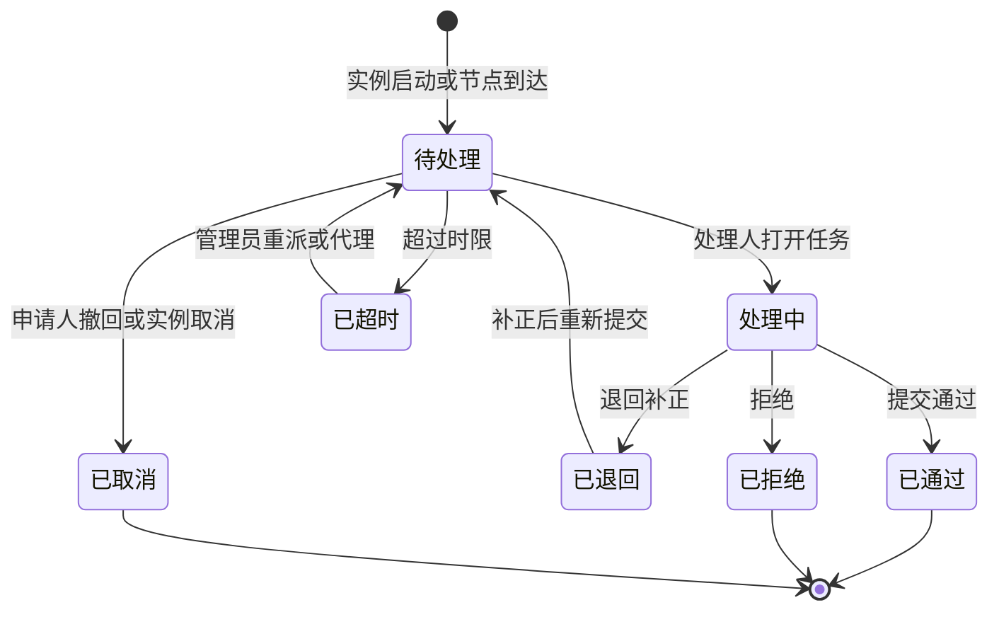

# 科研项目管理系统 — 权限、工作流与审计设计

> 目标：让“谁能看什么、能办什么、为什么能办、办过什么”可计算、可测试、可追溯
> 关键决策：RBAC + ABAC + 临时授权 + 字段脱敏；Flowable 只做审批编排，业务状态由业务模块掌握

---

## 1. 权限模型

### 1.1 最终许可公式

```text
允许操作 = 功能权限（角色）
        ∩ 数据范围（本人 / 参与项目 / 部门 / 授权项目集 / 全院）
        ∩ 业务状态（草稿 / 审批中 / 执行中 / 验收中 / 已结题 / 已终止）
        ∩ 字段权限（财务敏感 / 专家身份 / 评审意见 / 附件密级）
        ∩ 职责分离与利益冲突
        ∩ 授权有效期
```

任一条件不满足即拒绝。拒绝时返回统一错误码，不泄露资源是否存在；安全日志记录拒绝原因。

### 1.2 角色与数据范围

| 角色代码 | 角色 | 默认数据范围 | 关键限制 |
|---|---|---|---|
| `PI` | 项目负责人 | 本人负责项目 | 不得审批本人事项 |
| `MEMBER` | 项目成员 | 参与项目 | 默认不看收款账户、其他成员敏感信息 |
| `ASSISTANT` | 科研助理/经办人 | 被授权项目及事项 | 不得代替 PI 作最终真实性确认 |
| `DEPT_SECRETARY` | 部门科研秘书 | 本部门项目 | 不得越权终审或看无必要财务敏感字段 |
| `RESEARCH_ADMIN` | 科研管理人员 | 授权项目类型/部门或全院 | 不得无痕改写已审批事实 |
| `FINANCE` | 财务人员 | 授权财务项目 | 不得修改研究内容、代替业务验收 |
| `LEADER` | 院所领导 | 授权全院/分管范围 | 默认只读业务明细 |
| `EXPERT` | 评审专家 | 指定项目/批次、授权期 | 不看其他专家意见、不下载未授权材料 |
| `AUDITOR` | 审计人员 | 审计授权范围、限期 | 只读；导出受限 |
| `ARCHIVIST` | 档案人员 | 授权归档项目 | 不参与原业务审批 |
| `SYS_ADMIN` | 系统管理员 | 元数据与运行信息 | 默认无业务正文、无财务导出、不替他人审批 |

### 1.3 权限矩阵（摘要）

符号：`●` 可办理，`○` 只读，`△` 条件授权，`—` 无权限。所有权限仍受状态和数据范围约束。

| 能力 | PI | 成员/助理 | 部门秘书 | 科研管理 | 财务 | 领导 | 专家 | 管理员 |
|---|---|---|---|---|---|---|---|---|
| 编辑申报草稿 | ● | △ | — | — | — | — | — | — |
| 提交申报 | ● | △ | — | — | — | — | — | — |
| 形式审查/受理 | — | — | △ | ● | — | — | — | — |
| 立项审批 | — | — | △ | ● | △ | △ | — | — |
| 查看项目基本概况 | ● | ● | ○ | ○ | ○ | ○ | △ | 默认无正文 |
| 填报进度/交付物 | ● | △ | — | ○ | — | ○ | — | — |
| 审核周期报告 | — | — | △ | ● | — | ○ | — | — |
| 编制预算/发起调整 | ● | △ | — | ○ | ○ | ○ | — | — |
| 发起支出申请 | ● | △ | — | — | — | — | — | — |
| 支出业务/财务审批 | — | — | △ | ● | ● | △ | — | — |
| 确认支付/导入对账 | ○ | — | — | ○ | ● | ○ | — | — |
| 登记成果 | ● | ● | — | ○ | — | ○ | — | — |
| 审核成果/关联 | — | — | △ | ● | — | ○ | — | — |
| 提交验收 | ● | △ | — | — | — | — | — | — |
| 组织验收/确认结论 | — | — | △ | ● | △ | △ | △ | — |
| 查看审计证据 | ○ | △ | △ | ○ | ○ | ○ | — | 仅系统日志 |
| 配置角色与流程模板 | — | — | — | △ | — | — | — | ● |
| 发布流程/权限模板 | — | — | — | ●（业务模板） | — | — | — | △（受控发布） |

---

## 2. 授权服务设计

### 2.1 核心接口

```java
public interface AuthorizationService {
    AuthDecision check(AuthContext ctx, Action action, ResourceRef resource);
    ProjectScope resolveProjectScope(AuthContext ctx, ProjectQuery query);
    <T> T mask(T vo, AuthContext ctx, ResourceRef resource);
}

public record AuthContext(
    UUID userId,
    UUID activeRoleId,
    String employeeNo,
    Set<String> permissionCodes,
    Set<UUID> delegatedFromUserIds,
    Instant requestTime
) {}

public record AuthDecision(
    boolean allowed,
    String reasonCode,
    Set<String> maskedFields
) {}
```

实现：`DefaultAuthorizationService` 组合：

- `FunctionPermissionResolver`：角色 → 权限点，短期缓存。
- `DataScopeResolver`：项目身份、部门、临时授权、代理。
- `StateGuard`：业务状态是否允许动作。
- `FieldMaskService`：敏感字段脱敏。
- `SeparationOfDutyGuard`：自审、PI/财务冲突、专家回避。
- `GrantValidityGuard`：临时授权有效期。

调用入口：

- Controller 层使用 `@RequirePermission("project:view")` 只做功能权限粗筛。
- 应用服务入口必须调用 `authorizationService.check(...)`，并携带资源 ID。
- Repository 查询必须注入 `ProjectScope`，不能只靠 Controller 判断。

### 2.2 数据范围 SQL 形态

数据范围不拼字符串，使用参数化 `EXISTS`：

```sql
SELECT p.*
FROM project p
WHERE p.status IN (:statuses)
  AND (
      :scopeAll = true
      OR p.pi_id = :userId
      OR EXISTS (
          SELECT 1 FROM project_member m
          WHERE m.project_id = p.id
            AND m.user_id = :userId
            AND m.status = 'ACTIVE'
            AND now() BETWEEN m.valid_from AND coalesce(m.valid_to, 'infinity')
      )
      OR p.dept_id = ANY(:deptIds)
      OR p.id = ANY(:grantedProjectIds)
  )
  AND p.id = ANY(:requestedProjectIds)  -- 可选：请求已选项目
ORDER BY p.updated_at DESC
```

规则：

- `scopeAll` 只由 `RESEARCH_ADMIN`/`LEADER`/`AUDITOR` 的授权范围产生，不由前端传入。
- `grantedProjectIds` 来自 `iam_temp_grant`，每次查询校验有效期。
- 导出任务保存 `scopeSnapshot`，执行时重新授权；授权失效则任务失败并通知。

### 2.3 项目身份解析

项目身份不等于全局角色：

| 身份 | 来源 | 生效条件 |
|---|---|---|
| PI | `project.pi_id` / 基线变更 | 项目当前生效负责人 |
| 成员 | `project_member` | 当前时间在 `valid_from~valid_to`，状态 ACTIVE |
| 部门秘书 | `iam_user_role` + `org_id` | 项目 `dept_id` 在授权部门树内 |
| 科研管理 | `iam_user_role` + 项目类型/部门范围 | 角色授权范围覆盖项目 |
| 财务 | `iam_user_role` + 财务项目范围 | 项目有财务项目号或授权范围 |
| 专家 | `wf_task` / 评审批次授权 | 授权期 + 指定版本 |
| 审计/档案 | `iam_temp_grant` | 限期、只读 |

### 2.4 字段脱敏

```java
public interface FieldMaskService {
    <T> T mask(T target, AuthContext ctx, Set<String> policyCodes);
}
```

默认脱敏字段：

| 字段组 | 默认可见 | 脱敏方式 |
|---|---|---|
| 银行账号/收款信息 | 申请人、财务 | 只显示后 4 位 |
| 身份证件 | 本人、授权管理员 | 只显示前 1 后 1 |
| 联系方式 | 本人、项目 PI、部门秘书 | 中间 4 位掩码 |
| 专家身份 | 科研管理、专家本人 | 对申请人隐藏姓名/单位 |
| 未公开评审意见 | 评审组织方、审计 | 对其他专家隐藏 |
| 财务敏感金额 | 财务、PI、授权领导 | 按字段策略返回 null 或区间 |

脱敏在服务端完成，返回 DTO 中不包含明文；前端不得依赖隐藏字段。

### 2.5 临时授权与代理

`iam_temp_grant`：

- 必须记录 `grantee_id`、`resource_type`、`resource_id`、`permission_code`、`reason`、`valid_from`、`valid_to`、`granted_by`。
- 到期自动失效；定时任务将过期记录标记 `EXPIRED`。
- 授权范围不能超过授权人自身权限；越权授权直接拒绝。
- 批量授权必须二次确认并记录审计。

`wf_delegation`：

- 代理审批必须显式委托，记录 `delegator_id`、`delegate_id`、`scope`、有效期。
- 任务处理时记录 `on_behalf_of`；历史操作人保持原身份。
- 禁止共享账号；禁止无委托的“代点”。

### 2.6 职责分离与利益冲突

```java
public interface SeparationOfDutyGuard {
    void checkApproval(ApprovalContext ctx);
    void checkExpert(ExpertContext ctx);
}
```

规则：

1. 同一审批实例中，`applicant_id` 不得等于 `approver_id`；按人员 ID 判断，不按账号名。
2. PI 与财务终审不得为同一人；重大项目按模板增加会签。
3. 专家与申请人同部门、存在合作、亲属或其他申报利益关系时必须回避；至少支持主动声明和管理员移除。
4. 流程配置与模板发布分离；关键配置变更保留双人复核或审批记录。
5. 管理员“模拟登录”默认不开放；排障 impersonation 必须只读、限时、二次授权并醒目标记。

---

## 3. 工作流设计

### 3.1 边界

- Flowable 负责：节点流转、任务分配、会签/或签、时限、退回、代理、模板版本。
- 业务模块负责：批准后发生什么（生成项目、占用预算、切换基线、冻结验收）。
- Flowable 不得直接更新预算余额、项目状态或验收快照；只发出审批结果。
- 业务单据状态与审批状态分字段；审批实例只是驱动状态变化的一种手段。

### 3.2 端口与适配器

```java
public interface WorkflowPort {
    WorkflowInstance start(StartWorkflowCmd cmd);
    void completeTask(CompleteTaskCmd cmd);
    void cancelInstance(CancelWorkflowCmd cmd);
    List<WorkflowTaskView> findMyTasks(UUID userId, TaskQuery query);
}

public interface ApprovalResultHandler {
    String bizType();
    void onApproved(ApprovalResult result);
    void onRejected(ApprovalResult result);
    void onReturned(ApprovalResult result);
    void onWithdrawn(ApprovalResult result);
}
```

实现：

- `FlowableWorkflowAdapter implements WorkflowPort`
- `ApplicationApprovalHandler`、`ExpenseApprovalHandler`、`ChangeApprovalHandler`、`AcceptanceApprovalHandler`
- `ApprovalResultHandlerRegistry` 按 `bizType` 分派

调用链：

```text
WorkflowTaskController
  → WorkflowTaskAppService.complete()
  → WorkflowPort.completeTask()
  → FlowableWorkflowAdapter
  → ApprovalResultHandlerRegistry.get(bizType)
  → XxxApprovalHandler.onApproved/onRejected/onReturned
```

### 3.3 审批模板与版本

`wf_template` / `wf_template_version`：

- 模板按 `project_type`、经费区间、部门等条件路由；条件只使用白名单字段和比较符。
- 模板发布生成新版本，`effective_from` 生效；已运行实例绑定旧 `template_version_id`，不随新版本变化。
- 发布前校验：节点处理人规则可解析、审批人为空/离岗有兜底、金额条件无重叠、退回策略完整。
- 一期不开放任意 BPMN、Groovy/脚本表达式；二期经评估再开放受控设计器。

条件字段白名单：

| 字段 | 类型 | 运算符 |
|---|---|---|
| `project_type` | string | EQ, IN |
| `dept_id` | uuid | EQ, IN |
| `budget_total` | decimal | GT, GTE, LT, LTE, BETWEEN |
| `expense_amount` | decimal | GT, GTE, LT, LTE, BETWEEN |
| `duration_months` | integer | GT, GTE, LT, LTE, BETWEEN |
| `is_external` | boolean | EQ |
| `applicant_title` | string | EQ, IN |

### 3.4 任务生命周期



并发控制：

- `wf_task` 使用 `version` 乐观锁；同一任务只能被一个处理人完成。
- `wf_instance` 部分唯一索引 `(biz_type, biz_id, biz_version_id) WHERE status='RUNNING'` 防止同一业务版本重复发起审批。
- 完成任务的回调必须幂等：`instanceId + taskId + action + requestId` 唯一。

### 3.5 审批结果回写

`ApprovalResult` 包含：

```json
{
  "instance_id": "uuid",
  "biz_type": "EXPENSE",
  "biz_id": "uuid",
  "biz_version_id": "uuid",
  "action": "APPROVED",
  "operator_id": "uuid",
  "on_behalf_of": null,
  "comment": "同意",
  "occurred_at": "2026-11-17T10:00:00+08:00",
  "request_id": "uuid"
}
```

处理规则：

1. `ApprovalResultHandler` 先校验业务版本仍是当前审批版本；不是则记录 `STALE_APPROVAL` 并拒绝。
2. 批准动作在本地事务内完成：状态推进、资金事件、基线切换、项目生成、outbox。
3. 重复回调通过 `wf_callback_log` 或业务幂等键去重；返回首次结果。
4. 业务处理失败不改变审批实例状态；进入异常待办，由科研管理重试/人工补偿。

### 3.6 审批异常

| 异常 | 处理 |
|---|---|
| 审批人为空 | 模板发布时阻止；运行时进入 `EXCEPTION` 待办，指派授权人 |
| 审批人离岗 | 任务转交岗位/上级；记录原处理人和转交原因 |
| 模板中途更新 | 老实例沿用旧模板版本，新实例用新版本 |
| 重复审批回调 | 幂等键去重，返回首次结果 |
| 审批超时 | 标记 `TIMEOUT`，按模板策略升级/重派/通知 |
| 业务处理失败 | 审批保持已通过，业务进入异常队列，人工补偿 |

---

## 4. 审计设计

### 4.1 审计事件

```java
public record AuditEvent(
    String traceId,
    UUID actorId,
    UUID onBehalfOf,
    String action,
    String objectType,
    UUID objectId,
    Integer objectVersion,
    String beforeDigest,
    String afterDigest,
    String reason,
    String ip,
    String userAgent,
    Instant occurredAt
) {}
```

必审动作：

- 登录、登出、失败登录、权限拒绝。
- 申报提交、审批、退回、撤回、立项。
- 预算生效/调整、支出提交/审批/取消、支付回写/冲正、对账差异关闭。
- 成果审核、验收结论、归档接收、档案更正。
- 导出、批量授权、临时授权、模板发布、角色变更。
- 文件下载（敏感附件）。

### 4.2 记录方式

- `@Audited(action="...", objectType="...")` 标注关键应用服务方法。
- 审计切面读取方法参数/返回值生成 `beforeDigest` / `afterDigest`，不记录完整敏感明文。
- 资金、审批、验收等关键动作在事务内显式调用 `AuditRecorder.record(...)`，确保业务成功才留痕。
- `audit_log` 只允许 `INSERT`；数据库账号不授予 `UPDATE/DELETE`。应用层不提供修改接口。
- 审计日志访问本身也记录；日志查询按角色限权。

### 4.3 审计与业务一致性

| 场景 | 处理 |
|---|---|
| 业务事务回滚 | 审计事件不写入，避免“未发生却有日志” |
| 业务成功但审计写入失败 | 业务事务回滚（关键动作）；或写入本地 `audit_outbox` 后异步补写（非关键动作） |
| 管理员修改配置 | 记录前后值摘要、原因、审批单号 |
| 历史操作人 | 记录真实操作者 + `on_behalf_of`，不改写历史 |

---

## 5. 安全与文件访问

1. 全站 HTTPS；会话 Cookie `HttpOnly + Secure + SameSite=Lax`；Token 可撤销。
2. 密码使用 Argon2id 或 BCrypt（成本参数按院方基线）；禁止明文/MD5/SHA1。
3. CSRF：前后端分离使用 SameSite + CSRF Token 双保险；写接口校验 Origin。
4. 防注入：MyBatis 参数化；禁止字符串拼接 SQL；导出查询同样参数化。
5. 文件上传：校验扩展名、MIME、大小、魔数；病毒扫描异步；上传后先 `QUARANTINED`，扫描通过转 `AVAILABLE`。
6. 文件下载：`FileAccessService.authorize(fileId, userId, resource)`；通过后返回一次性短期签名或流式响应；签名 TTL ≤ 5 分钟。
7. 导出：任务保存查询条件和字段清单；执行时重新授权；文件带水印/有效期；下载链接不长期公开。
8. 安全日志：登录、权限拒绝、导出、批量操作、管理员操作留存不少于 6 个月；业务审计不少于 10 年。

---

## 6. 测试与验收要点

| 测试 | 断言 |
|---|---|
| 权限穿透 | 直接 URL、列表 API、附件 URL、导出任务、异步任务全部拒绝越权，且不泄露元数据 |
| 自审阻断 | PI 同时是审批角色时，审批本人申报返回 `RPM-WF-003` |
| 专家回避 | 同部门专家未声明时不能提交评审意见 |
| 临时授权到期 | 过期后立即失去访问；历史操作保留原身份 |
| 模板版本 | 发布新版本后，老实例仍按旧版本流转 |
| 并发审批 | 同一任务两个请求只有一个成功，另一个返回冲突 |
| 审计完整性 | 关键动作均有审计记录；日志不可更新/删除 |
