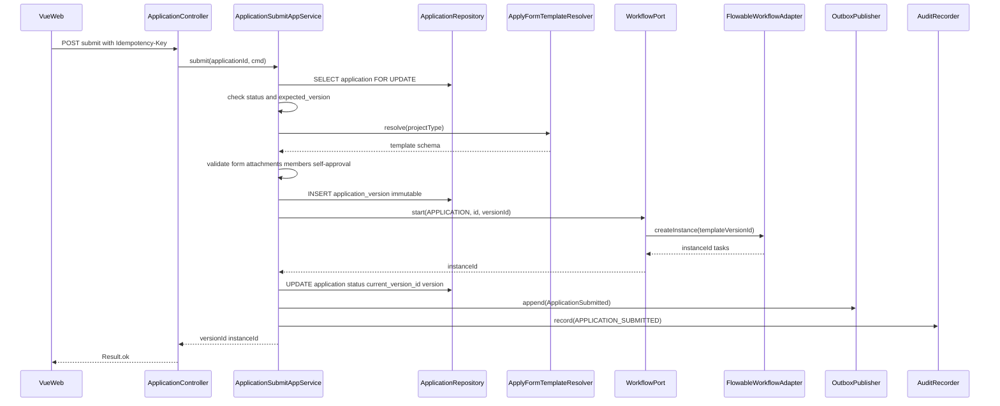
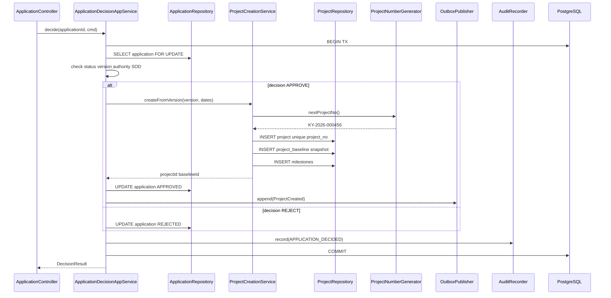
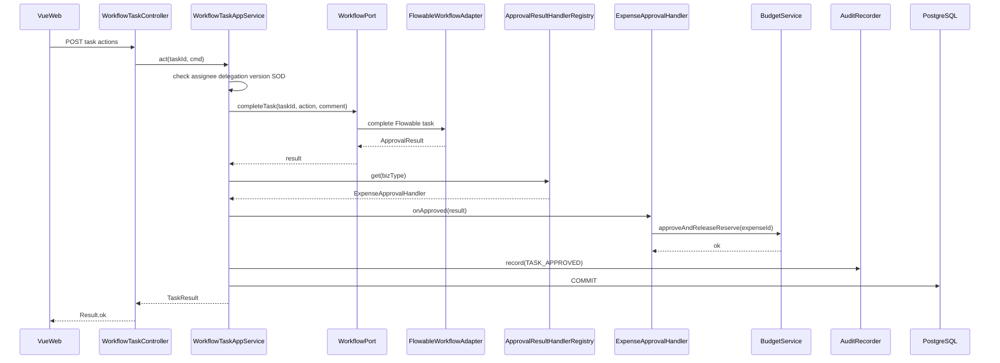

# 科研项目管理系统 — 核心业务接口设计（申报、项目、审批）

> 覆盖：统一接口约定、申报与立项、项目执行、审批任务、变更与交接
> 经费、成果、验收接口见 `05-经费成果验收接口设计.md`
> 所有接口必须执行 `AuthorizationService.check(...)`，本文不再逐条重复数据范围规则

---

## 1. 全局接口约定

### 1.1 基础约定

| 项 | 约定 |
|---|---|
| Base URL | `/api/v1` |
| 认证 | 院方 OIDC/CAS/LDAP 换取本地会话；请求头 `Authorization: Bearer <token>` |
| 内容类型 | `application/json; charset=utf-8`；文件上传 `multipart/form-data` |
| 时间格式 | ISO 8601 带时区，如 `2026-11-17T10:00:00+08:00` |
| 金额 | JSON number，最多 2 位小数；后端 `BigDecimal` |
| 分页 | `page` 从 1 开始，`size` 默认 20，最大 200 |
| 幂等 | 写接口支持 `Idempotency-Key` 请求头；关键业务动作使用业务幂等键 |
| 追踪 | 响应头 `X-Trace-Id`；日志与审计统一使用 |
| 并发 | 更新接口携带 `version`；冲突返回 `RPM-COMMON-409` |

### 1.2 统一响应

```json
{
  "code": "OK",
  "message": "success",
  "data": {},
  "trace_id": "4f6c2f0e9a7b4d1c",
  "timestamp": "2026-11-17T10:00:00+08:00"
}
```

分页响应：

```json
{
  "code": "OK",
  "data": {
    "items": [],
    "page": 1,
    "size": 20,
    "total": 0
  },
  "trace_id": "4f6c2f0e9a7b4d1c"
}
```

### 1.3 错误码

| 错误码 | HTTP | 含义 | 前端处理 |
|---|---|---|---|
| `RPM-COMMON-400` | 400 | 参数校验失败 | 定位字段并提示 |
| `RPM-COMMON-401` | 401 | 未登录或会话失效 | 跳转登录 |
| `RPM-COMMON-403` | 403 | 无权限 | 展示无权限态，不泄露资源 |
| `RPM-COMMON-404` | 404 | 资源不存在 | 返回列表或空态 |
| `RPM-COMMON-409` | 409 | 版本冲突或重复操作 | 刷新后重试 |
| `RPM-COMMON-422` | 422 | 业务规则不满足 | 展示具体原因 |
| `RPM-COMMON-429` | 429 | 请求过于频繁 | 稍后重试 |
| `RPM-COMMON-500` | 500 | 未预期服务端错误 | 展示 TraceID，联系支持 |
| `RPM-APPLY-001` | 422 | 申报表单校验失败 | 定位问题项 |
| `RPM-APPLY-002` | 409 | 申报版本冲突 | 刷新最新版本 |
| `RPM-APPLY-003` | 422 | 批次已关闭 | 不可提交 |
| `RPM-APPLY-004` | 422 | 当前状态不允许该动作 | 刷新状态 |
| `RPM-APPLY-005` | 422 | 外部项目证明材料缺失 | 补充材料 |
| `RPM-WF-001` | 422 | 未找到可用审批模板 | 联系科研管理 |
| `RPM-WF-002` | 422 | 审批节点无处理人 | 联系科研管理 |
| `RPM-WF-003` | 422 | 禁止审批本人事项 | 更换审批人 |
| `RPM-WF-004` | 409 | 任务已被处理 | 刷新待办 |
| `RPM-WF-005` | 409 | 审批版本已过期 | 刷新业务单据 |
| `RPM-WF-006` | 422 | 存在未处理的利益冲突 | 声明回避或更换专家 |
| `RPM-PROJ-001` | 404 | 项目不存在 | 返回列表 |
| `RPM-PROJ-002` | 422 | 项目状态不允许该动作 | 刷新状态 |
| `RPM-PROJ-003` | 409 | 项目编号重复 | 重试生成或联系管理员 |
| `RPM-PROJ-004` | 422 | 项目基线缺失 | 联系科研管理 |
| `RPM-PROJ-005` | 422 | 成员变更冲突 | 刷新成员列表 |
| `RPM-PROJ-006` | 422 | 交接条件不满足 | 补齐待办和未结事项 |
| `RPM-EXEC-001` | 409 | 同一周期报告已存在 | 打开当前报告 |
| `RPM-EXEC-002` | 422 | 报告已逾期 | 标记迟报后提交 |
| `RPM-EXEC-003` | 422 | 里程碑缺少完成判定 | 先补充判定标准 |
| `RPM-EXEC-004` | 422 | 交付物文件无效 | 重新上传 |
| `RPM-FUND-001` | 422 | 可用余额不足 | 调整金额或走预算调整 |
| `RPM-FUND-002` | 422 | 预算版本未生效或科目不匹配 | 刷新预算版本 |
| `RPM-FUND-003` | 409 | 重复资金事件且载荷不一致 | 刷新后重新发起 |
| `RPM-FUND-004` | 422 | 预算明细或科目不合法 | 修正预算明细 |
| `RPM-FUND-005` | 422 | 支出状态不允许该动作 | 刷新状态 |
| `RPM-FUND-006` | 422 | 需先走预算调整或特批 | 发起预算调整 |
| `RPM-FUND-007` | 409 | 预算版本并发生效冲突 | 刷新预算列表 |
| `RPM-FUND-008` | 422 | 存在未关闭对账差异 | 先处理差异 |
| `RPM-FUND-009` | 422 | 支付金额、币种或外部单号异常 | 查看差异单 |
| `RPM-OUT-001` | 200 | 疑似重复提示，成果仍保存 | 人工确认，不自动合并 |
| `RPM-OUT-002` | 422 | 成果证据缺失 | 补充证明材料 |
| `RPM-OUT-003` | 422 | 成果项目关联无效 | 检查项目与贡献说明 |
| `RPM-OUT-004` | 422 | 成果审核状态不允许 | 刷新成果状态 |
| `RPM-ACC-001` | 422 | 验收条件未满足 | 补齐材料或申请豁免 |
| `RPM-ACC-002` | 422 | 验收快照哈希不一致 | 重新生成快照 |
| `RPM-ACC-003` | 422 | 验收状态不允许该动作 | 刷新验收状态 |
| `RPM-ACC-004` | 422 | 归档完整性校验失败 | 检查缺失或篡改文件 |
| `RPM-ACC-005` | 422 | 验收意见不完整 | 补齐专家或财务意见 |
| `RPM-ACC-006` | 422 | 项目已冻结或结论非法 | 走档案更正流程 |
| `RPM-ACC-007` | 409 | 归档包已接收 | 不可重复接收 |
| `RPM-INT-001` | 503 | 外部系统超时或不可用 | 显示同步状态并重试 |
| `RPM-INT-002` | 401 | 回调签名校验失败 | 拒绝请求并告警 |
| `RPM-INT-003` | 422 | 回调报文或事件类型非法 | 记录同步日志 |
| `RPM-INT-004` | 409 | 外部单号冲突 | 进入对账差异 |
| `RPM-RPT-001` | 422 | 导出条件过宽或字段非法 | 缩小范围或移除字段 |
| `RPM-RPT-002` | 410 | 导出文件已过期 | 重新生成导出 |
| `RPM-FILE-001` | 422 | 文件未就绪或未通过扫描 | 等待扫描或重新上传 |
| `RPM-FILE-002` | 422 | 文件类型、大小或内容不合法 | 更换文件 |
| `RPM-SYS-001` | 422 | 模板条件冲突或不可解析 | 修正模板条件 |
| `RPM-SYS-002` | 422 | 配置值非法 | 修正配置 |
| `RPM-SYS-003` | 409 | 审批模板发布冲突 | 刷新模板后重试 |
| `RPM-PORT-001` | 410 | 链接无效、过期或已消费（通用文案，不泄露目标） | 重新获取链接 |
| `RPM-PORT-002` | 403 | 链接目标无权限（通用文案，不泄露摘要） | 联系资源责任人 |
| `RPM-APPLY-006` | 422 | 专家回避声明未完成或冲突未处置 | 先完成声明或等待处置 |
| `RPM-APPLY-007` | 422 | 评分表项缺失、分值越界或总分与模板重算不符 | 按模板修正评分 |
| `RPM-APPLY-008` | 422 | 汇总条件不满足（有效提交不足） | 等待更多专家提交 |
| `RPM-EXEC-005` | 404 | 任务不存在或非被授权人 | 确认任务归属 |
| `RPM-EXEC-006` | 422 | 任务状态迁移不合法 | 刷新任务状态 |
| `RPM-ACC-008` | 422 | 存在未确认的验收标准重定任务 | 先完成验收标准重定 |

> `RPM-OUT-001` 是 HTTP 200 的非阻断业务警告，不是失败响应；前端必须在保存成功后展示疑似重复提示。

---

## 2. 接口目录

### 2.1 工作台与项目

| 方法 | 路径 | 用途 | 权限 |
|---|---|---|---|
| GET | `/auth/me` | 当前用户、角色、权限、身份 | 登录用户 |
| GET | `/workbench` | 我的项目、待办、草稿、退回件、风险、通知 | 登录用户 |
| GET | `/projects` | 项目列表与组合筛选 | `project:view` |
| GET | `/projects/{projectId}` | 项目详情（按页签懒加载） | `project:view` |
| GET | `/projects/{projectId}/members` | 项目成员 | `project:view` |
| POST | `/projects/{projectId}/members` | 新增/变更成员（走变更或直接维护） | `project:member:manage` |
| GET | `/projects/{projectId}/milestones` | 里程碑列表 | `project:view` |
| POST | `/projects/{projectId}/milestones` | 新增/调整里程碑 | `project:milestone:manage` |
| GET | `/projects/{projectId}/risks` | 风险列表 | `project:view` |
| POST | `/projects/{projectId}/risks` | 登记风险 | `project:risk:create` |
| POST | `/risks/{riskId}/close` | 关闭风险 | `project:risk:close` |
| POST | `/projects/{projectId}/handover` | 负责人交接 | `project:handover` |
| POST | `/projects/{projectId}/pause` | 暂停项目 | `project:state:change` |
| POST | `/projects/{projectId}/resume` | 恢复项目 | `project:state:change` |
| POST | `/projects/{projectId}/terminate` | 终止项目 | `project:state:change` |

### 2.2 申报与立项

| 方法 | 路径 | 用途 | 权限 |
|---|---|---|---|
| GET | `/apply-batches` | 可选申报批次 | 登录用户 |
| GET | `/apply-form-templates/{projectType}` | 当前有效表单模板 | 登录用户 |
| POST | `/applications` | 创建申报草稿 | `application:create` |
| PUT | `/applications/{applicationId}/draft` | 保存草稿 | `application:edit` |
| GET | `/applications/{applicationId}` | 申报详情 | `application:view` |
| POST | `/applications/{applicationId}/submit` | 提交申报并启动审批 | `application:submit` |
| POST | `/applications/{applicationId}/withdraw` | 撤回申报 | `application:withdraw` |
| POST | `/applications/{applicationId}/formal-review` | 形式审查 | `application:formal-review` |
| POST | `/applications/{applicationId}/decision` | 立项决策/批准 | `application:decide` |
| POST | `/applications/external-registration` | 外部项目登记立项 | `application:external-register` |
| GET | `/applications/{applicationId}/versions/{versionNo}` | 查看固定版本 | `application:view` |
| GET | `/applications/{applicationId}/versions/compare` | 版本差异 | `application:view` |

### 2.3 执行与审批

| 方法 | 路径 | 用途 | 权限 |
|---|---|---|---|
| GET | `/projects/{projectId}/progress-reports` | 周期报告列表 | `execution:view` |
| POST | `/projects/{projectId}/progress-reports` | 创建报告草稿 | `execution:report:edit` |
| POST | `/progress-reports/{reportId}/submit` | 提交报告 | `execution:report:submit` |
| POST | `/progress-reports/{reportId}/review` | 审核/退回报告 | `execution:report:review` |
| GET | `/projects/{projectId}/deliverables` | 交付物列表 | `execution:view` |
| POST | `/projects/{projectId}/deliverables` | 上传交付物 | `execution:deliverable:upload` |
| POST | `/projects/{projectId}/changes` | 发起变更 | `project:change:create` |
| POST | `/changes/{changeId}/submit` | 提交变更审批 | `project:change:submit` |
| GET | `/workflow/tasks` | 我的待办 | 登录用户 |
| POST | `/workflow/tasks/{taskId}/actions` | 通过/退回/拒绝 | 任务处理人 |
| GET | `/workflow/instances/{instanceId}` | 审批轨迹 | 业务可见人 |

---

## 3. 详细接口

### 3.1 `POST /applications` — 创建申报草稿（简单接口）

**描述**：创建一张申报草稿，绑定申报批次和项目类型，返回 `application_id`。

**Request**：

```json
{
  "batch_id": "5f1c0d1e-3b3a-4a1f-9d3b-1a2b3c4d5e6f",
  "project_type": "YEAR_PLAN",
  "title": "面向复杂工况的智能感知方法研究",
  "dept_id": "0b7f5b7e-2a1c-4c2e-8d4f-9a0b1c2d3e4f"
}
```

**校验**：

| 字段 | 规则 |
|---|---|
| `batch_id` | 必填，批次存在且状态为 `OPEN` |
| `project_type` | 必填，存在有效表单模板 |
| `title` | 1～512 字符，去首尾空格 |
| `dept_id` | 必填，属于当前用户组织范围 |

**Response**：

```json
{
  "code": "OK",
  "data": {
    "application_id": "c1a2b3d4-e5f6-4a7b-8c9d-0e1f2a3b4c5d",
    "application_no": "APP-2026-000123",
    "status": "DRAFT",
    "version": 0
  }
}
```

**实现步骤**：

1. `ApplicationController.create(cmd)` 校验登录态与 `application:create`。
2. `ApplicationCreateAppService.create(cmd)` 校验批次开放、项目类型模板存在、部门在授权范围。
3. 生成 `application_no`（数据库序列 + 年度前缀），插入 `application` 草稿记录。
4. 写入审计事件 `APPLICATION_CREATED`。
5. 返回草稿 DTO。

**核心调用链**：`ApplicationController → ApplicationCreateAppService → ApplicationRepository → NumberGenerator → AuditRecorder`

**错误码**：`RPM-COMMON-403`、`RPM-APPLY-003`、`RPM-APPLY-001`。

---

### 3.2 `POST /applications/{applicationId}/submit` — 提交申报（复杂接口）

**描述**：把当前草稿固化为不可变版本，启动审批实例，并把申报状态推进到 `IN_REVIEW`。相同 `Idempotency-Key` 重复请求返回首次结果。

**Request**：

```json
{
  "expected_version": 3,
  "comment": "请审阅",
  "collaborators": [
    {"user_id": "a1b2c3d4-e5f6-4a7b-8c9d-0e1f2a3b4c5d", "role": "CO_AUTHOR"}
  ]
}
```

**校验**：

| 字段 | 规则 |
|---|---|
| `expected_version` | 必填，必须等于 `application.version`，否则 `RPM-APPLY-002` |
| 表单 | 按项目类型模板执行必填、类型、长度、金额、日期校验 |
| 附件 | 必填附件齐全；文件状态 `AVAILABLE`；病毒扫描通过 |
| 成员 | 成员必须为有效用户；PI 唯一；协作权限合法 |
| 状态 | 仅 `DRAFT`/`SUPPLEMENT` 可提交 |
| 自审 | 校验审批模板首节点不包含申请人本人；运行时再次校验 |

**Response**：

```json
{
  "code": "OK",
  "data": {
    "application_id": "c1a2b3d4-e5f6-4a7b-8c9d-0e1f2a3b4c5d",
    "version_id": "1f2e3d4c-5b6a-4978-8a9b-0c1d2e3f4a5b",
    "version_no": 4,
    "status": "IN_REVIEW",
    "workflow_instance_id": "9a8b7c6d-5e4f-4a3b-8c2d-1e0f9a8b7c6d"
  }
}
```

**错误码**：`RPM-APPLY-001`、`RPM-APPLY-002`、`RPM-APPLY-004`、`RPM-WF-001`、`RPM-WF-003`。

**幂等设计**：`Idempotency-Key` 写入 `application_version.submit_idempotency_key` 唯一索引；重复请求返回首次 `version_id` 与 `workflow_instance_id`。

**实现步骤**：

1. `ApplicationController.submit(applicationId, cmd)` 读取 `Idempotency-Key`。
2. `ApplicationSubmitAppService.submit(...)` 开启事务，`SELECT application FOR UPDATE`。
3. 校验状态、`expected_version`、表单、附件、成员、自审规则。
4. 生成 `application_version`：`version_no = max+1`，`form_data` 为规范化 JSON，`content_hash` 为 SHA-256，状态 `SUBMITTED`。
5. 写入 `application_member` 快照和 `application_review` 初始记录。
6. `WorkflowPort.start(...)` 选择模板版本，创建 `wf_instance` 和首节点 `wf_task`。
7. 更新 `application.current_version_id`、`status=IN_REVIEW`、`version+1`。
8. `OutboxPublisher.append(ApplicationSubmitted)`；写审计；提交事务。
9. 返回版本和审批实例。

**实现时序图**：



**核心伪代码**：

```pseudocode
function submitApplication(applicationId, cmd, idempotencyKey):
    existing = applicationVersionRepo.findByIdempotencyKey(idempotencyKey)
    if existing: return existing.summary()

    BEGIN TX
        app = applicationRepo.selectForUpdate(applicationId)
        authz.check(currentUser, "application:submit", app)
        require(app.status in [DRAFT, SUPPLEMENT])
        require(app.version == cmd.expectedVersion, RPM_APPLY_002)

        template = formTemplateResolver.resolve(app.projectType)
        formValidator.validate(template, cmd.formData)
        attachmentGuard.requireReady(cmd.attachments)
        memberGuard.validate(cmd.members, app.applicantId)
        sodGuard.assertNotSelfApproval(app.applicantId, workflowPreview(template))

        version = applicationVersionRepo.insert(
            app.id, app.nextVersionNo(), canonicalJson(cmd.formData),
            sha256(canonicalJson(cmd.formData)), idempotencyKey, SUBMITTED)
        applicationMemberRepo.insertSnapshot(version.id, cmd.members)

        instance = workflowPort.start(APPLICATION, app.id, version.id)
        app.markInReview(version.id)
        applicationRepo.update(app)

        outbox.append(ApplicationSubmitted(app.id, version.id, instance.id))
        audit.record(APPLICATION_SUBMITTED, app.id, version.id)
    COMMIT

    return SubmitResult(version.id, instance.id)
```

---

### 3.3 `POST /applications/{applicationId}/formal-review` — 形式审查（中等接口）

**描述**：部门秘书或科研管理对提交版本做形式审查，通过则进入下一节点，退回则进入 `SUPPLEMENT` 并记录问题项。

**Request**：

```json
{
  "version_id": "1f2e3d4c-5b6a-4978-8a9b-0c1d2e3f4a5b",
  "decision": "RETURN",
  "issues": [
    {"field": "budget.total", "message": "预算总额与明细合计不一致"},
    {"field": "attachment.ethics", "message": "缺少伦理审查附件"}
  ],
  "comment": "请补正后重新提交"
}
```

**校验**：当前用户有 `application:formal-review`；版本必须是当前提交版本；`RETURN` 时 `issues` 非空；不得审查本人申报。

**实现步骤**：

1. `ApplicationReviewAppService.formalReview(...)` 校验权限、版本和自审。
2. `RETURN`：写 `application_review`，状态 `SUPPLEMENT`，生成补正待办并通知申请人。
3. `PASS`：完成当前 `wf_task`，推进下一节点；写审计。
4. 任何动作都不修改已提交版本内容。

**核心调用链**：`ApplicationController → ApplicationReviewAppService → WorkflowPort.completeTask → ApplicationRepository → NotificationPort`

---

### 3.4 `POST /applications/{applicationId}/decision` — 立项决策/批准（复杂接口）

**描述**：科研管理做出批准/不批准决策；批准时幂等生成项目、基线和里程碑，项目编号唯一。

**Request**：

```json
{
  "version_id": "1f2e3d4c-5b6a-4978-8a9b-0c1d2e3f4a5b",
  "decision": "APPROVE",
  "comment": "同意立项",
  "approved_start_date": "2026-12-01",
  "approved_end_date": "2029-11-30"
}
```

**Response**：

```json
{
  "code": "OK",
  "data": {
    "application_id": "c1a2b3d4-e5f6-4a7b-8c9d-0e1f2a3b4c5d",
    "project_id": "8d7c6b5a-4e3f-4a2b-9c1d-0e2f3a4b5c6d",
    "project_no": "KY-2026-000456",
    "baseline_id": "2a3b4c5d-6e7f-4a8b-9c0d-1e2f3a4b5c6d"
  }
}
```

**校验**：版本必须是当前批准版本；申报状态 `IN_REVIEW`；项目尚未生成；批准日期合法；外部项目登记必须有批复/合同和核验人。

**实现步骤**：

1. `ApplicationDecisionAppService.decide(...)` 开启事务，锁定 `application`。
2. 校验状态、版本、决策权限、自审/职责分离。
3. `APPROVE`：
   - `ProjectCreationService.createFromVersion(version, dates)`。
   - 生成 `project_no`（唯一序列），插入 `project`（状态 `PENDING_START`）。
   - 复制批准版本快照到 `project_baseline`，插入 `milestone`。
   - 更新 `application.status=APPROVED`、版本 `APPROVED`。
   - 写 `ApplicationApproved`/`ProjectCreated` outbox 和审计。
4. `REJECT`：状态 `REJECTED`，不生成项目；写审计和通知。
5. 重复回调：查询 `source_application_version_id` 已有项目则直接返回。

**实现时序图**：



**核心伪代码**：

```pseudocode
function decide(applicationId, cmd):
    BEGIN TX
        app = applicationRepo.selectForUpdate(applicationId)
        authz.check(currentUser, "application:decide", app)
        require(app.currentVersionId == cmd.versionId)
        require(app.status == IN_REVIEW)

        if cmd.decision == APPROVE:
            existing = projectRepo.findBySourceVersion(cmd.versionId)
            if existing: return existing

            no = projectNumberGenerator.next()
            project = Project.createFromApproved(app, cmd.dates, no)
            projectRepo.insert(project)
            baseline = baselineFactory.fromApprovedVersion(app.version)
            projectRepo.insertBaseline(baseline)
            projectRepo.insertMilestones(project.id, baseline.id, app.version)
            app.markApproved()
            outbox.append(ProjectCreated(project.id, baseline.id))
        else:
            app.markRejected(cmd.comment)

        applicationRepo.update(app)
        audit.record(APPLICATION_DECIDED, app.id, cmd.versionId)
    COMMIT
    return DecisionResult(project.id, project.projectNo, baseline.id)
```

---

### 3.5 `POST /applications/external-registration` — 外部项目登记立项（中等接口）

**描述**：外部项目凭批复/合同登记立项，不强制内部评审；必须填写外部证明和核验人。

**Request**：

```json
{
  "project_type": "EXTERNAL_CONTRACT",
  "title": "横向合作项目",
  "dept_id": "0b7f5b7e-2a1c-4c2e-8d4f-9a0b1c2d3e4f",
  "funder_name": "某研究院",
  "approval_no": "批复-2026-001",
  "contract_no": "HT-2026-0088",
  "approved_amount": 1200000.00,
  "start_date": "2026-12-01",
  "end_date": "2028-11-30",
  "verified_by": "a1b2c3d4-e5f6-4a7b-8c9d-0e1f2a3b4c5d",
  "evidence_file_ids": ["file-uuid-1", "file-uuid-2"]
}
```

**校验**：批复号/合同号至少一个；`verified_by` 必填且有科研管理权限；证据文件必须 `AVAILABLE`；不得创建重复项目。

**实现步骤**：

1. `ExternalProjectAppService.register(...)` 校验权限和材料。
2. 创建 `application`（类型 `EXTERNAL`，状态 `APPROVED`）和 `application_version` 快照。
3. 写入 `external_project_registration`。
4. 调用 `ProjectCreationService.createFromVersion` 生成项目和基线。
5. 写审计和 `ProjectCreated` outbox。

**核心调用链**：`ExternalProjectController → ExternalProjectAppService → ApplicationRepository → ProjectCreationService → ProjectRepository`

---

### 3.6 `GET /projects` — 项目列表（简单接口，强数据权限）

**描述**：按编号、名称、类型、部门、负责人、状态、年度组合筛选；结果受数据权限约束。

**Query**：

```text
?keyword=&projectType=YEAR_PLAN&deptId=&piId=&status=EXECUTING&year=2026&page=1&size=20
```

**Response**：

```json
{
  "code": "OK",
  "data": {
    "items": [
      {
        "project_id": "8d7c6b5a-4e3f-4a2b-9c1d-0e2f3a4b5c6d",
        "project_no": "KY-2026-000456",
        "title": "面向复杂工况的智能感知方法研究",
        "project_type": "YEAR_PLAN",
        "dept_name": "智能感知研究所",
        "pi_name": "张三",
        "status": "EXECUTING",
        "start_date": "2026-12-01",
        "end_date": "2029-11-30",
        "budget_total": 1200000.00,
        "paid_amount": 300000.00,
        "risk_level": "MEDIUM"
      }
    ],
    "page": 1,
    "size": 20,
    "total": 1
  }
}
```

**实现步骤**：

1. `ProjectQueryController.list(query)` 获取 `AuthContext`。
2. `ProjectQueryAppService.list(query)` 调用 `authorizationService.resolveProjectScope(...)`。
3. `ProjectQueryRepository.search(query, scope)` 使用参数化 SQL + `EXISTS` 数据范围。
4. 批量填充部门、PI、预算汇总、风险等级，避免 N+1。
5. 返回分页 DTO；导出复用同一 `scope`。

**核心调用链**：`ProjectQueryController → ProjectQueryAppService → AuthorizationService → ProjectQueryRepository`

---

### 3.7 `GET /projects/{projectId}` — 项目详情（简单接口）

**描述**：返回项目概况和页签摘要；每个页签使用同一 `project.id` 与 `baseline.id`。

**Response（摘要）**：

```json
{
  "code": "OK",
  "data": {
    "project_id": "8d7c6b5a-4e3f-4a2b-9c1d-0e2f3a4b5c6d",
    "project_no": "KY-2026-000456",
    "baseline_id": "2a3b4c5d-6e7f-4a8b-9c0d-1e2f3a4b5c6d",
    "baseline_version": 1,
    "status": "EXECUTING",
    "summary": {
      "milestone_total": 6,
      "milestone_completed": 2,
      "report_due": 1,
      "budget_total": 1200000.00,
      "available_amount": 700000.00,
      "output_count": 3,
      "open_risk_count": 1
    }
  }
}
```

**实现步骤**：

1. `ProjectQueryController.detail(projectId)`。
2. `AuthorizationService.check(project:view)` 并解析项目身份。
3. 查询项目 + 当前基线；并行查询摘要（里程碑、报告、经费、成果、风险）使用同一 `baseline_id`。
4. 字段脱敏后返回；无权限返回 `RPM-COMMON-403`，不返回项目是否存在。

---

### 3.8 `POST /progress-reports/{reportId}/submit` — 提交周期报告（中等接口）

**描述**：提交某报告期的工作、偏差、问题、下期计划；生成不可变版本，状态进入审核。

**Request**：

```json
{
  "expected_version": 2,
  "content": {
    "work_done": "完成传感器选型与原型搭建",
    "deviation": "样机测试晚于计划两周",
    "issues": ["供应链延迟"],
    "next_plan": "完成小试"
  },
  "deliverable_file_ids": ["file-uuid-3"]
}
```

**校验**：当前用户在项目成员内且有提交权限；报告期未锁定；`expected_version` 匹配；内容必填；逾期提交时版本 `late_flag=true`（主档状态不含 `LATE`，迟报事实统一由版本 `late_flag` 承载，见修复 #23）；附件有效。

**实现步骤**：

1. `ProgressReportController.submit(...)`。
2. `ProgressReportSubmitAppService.submit(...)` 开启事务，锁定报告。
3. 校验项目状态（执行中/验收中按规则）、成员权限、版本、内容。
4. 插入 `progress_report_version`，更新 `progress_report.current_version_id`、`status=SUBMITTED`。
5. 若当前日期 > `due_date`，版本置 `late_flag=true`（主档保持 `SUBMITTED`），生成风险/通知。
6. 启动审核任务或直接进入审核；写审计。

**核心调用链**：`ProgressReportController → ProgressReportSubmitAppService → ProjectMemberGuard → ProgressReportRepository → WorkflowPort → NotificationPort`

---

### 3.9 `POST /projects/{projectId}/changes` — 发起变更（复杂接口）

**描述**：发起负责人、成员、周期、目标/里程碑、预算、合作单位等变更；审批中沿用旧基线，批准后原子切换。

**Request**：

```json
{
  "change_type": "PERIOD",
  "effective_date": "2027-01-01",
  "payload": {
    "new_end_date": "2030-05-31",
    "reason": "设备采购周期延长"
  },
  "attachment_file_ids": ["file-uuid-4"]
}
```

**校验**：项目状态允许变更；`change_type ∈ {PERIOD, PI, MEMBER, OBJECTIVE, BUDGET, PARTNER}`，`payload` 按**受控 discriminated union** 反序列化为独立 Cmd，各类型必填字段、附件要求、审批模板、允许状态与生效动作见 `08-评审修复补充接口设计.md` §8.2 变更矩阵；结构非法返回 400，禁止自由 JSON 落库；预算变更必须走预算版本；负责人变更必须交接待办；生效日期合法；不得绕过审批直接改基线。

**实现步骤**：

1. `ChangeRequestAppService.create(...)` 校验权限、项目状态、变更模板。
2. 创建 `change_request` + `change_request_version`，状态 `IN_REVIEW`。
3. 启动审批实例；审批中 `project.current_baseline_id` 不变。
4. 批准回调 `ChangeApprovalHandler.onApproved`：
   - 锁定项目。
   - 生成新 `project_baseline`（版本 +1），复制旧基线并应用变更；旧基线置 `SUPERSEDED` 与新基线生效同事务，数据库由部分唯一索引 `uk_project_baseline_effective`（V04，修复 #7）兜底，并发/重复回调不可能产生两个 EFFECTIVE。
   - 预算变更同时生成新 `budget_version`，旧版本 `SUPERSEDED`。
   - 更新 `project.current_baseline_id`，写 `BaselineChanged` outbox。
5. 退回/拒绝：变更单结束，项目保持旧基线。

**核心伪代码**：

```pseudocode
function approveChange(changeId, approvalResult):
    BEGIN TX
        change = changeRepo.selectForUpdate(changeId)
        require(change.status == IN_REVIEW)
        project = projectRepo.selectForUpdate(change.projectId)
        oldBaseline = baselineRepo.selectForUpdate(project.currentBaselineId)

        newBaseline = oldBaseline.apply(change.payload, nextVersionNo())
        baselineRepo.insert(newBaseline)
        if change.type == BUDGET:
            budgetService.createVersionFromChange(project.id, change)
        project.switchBaseline(newBaseline.id)
        change.markApproved()
        outbox.append(BaselineChanged(project.id, oldBaseline.id, newBaseline.id))
        audit.record(BASELINE_CHANGED, project.id, newBaseline.id)
    COMMIT
```

---

### 3.10 `POST /projects/{projectId}/handover` — 负责人交接（复杂接口）

**描述**：负责人离岗时交接待办、项目权限和未结事项；历史操作人不变。

**Request**：

```json
{
  "to_user_id": "b2c3d4e5-f6a7-4b8c-9d0e-1f2a3b4c5d6e",
  "effective_at": "2026-12-01T00:00:00+08:00",
  "pending_items": [
    {"type": "TASK", "id": "task-uuid-1", "action": "TRANSFER"},
    {"type": "RISK", "id": "risk-uuid-1", "action": "TRANSFER"}
  ],
  "reason": "原负责人调岗"
}
```

**校验**：发起人有交接权限；新负责人是有效用户且未离职；`effective_at` 不早于当前；待办和风险必须全部处理；不得改写历史审批/操作人。

**实现步骤**：

1. `ProjectHandoverAppService.initiate(...)` 创建交接单，状态 `IN_REVIEW`。
2. 审批通过后 `HandoverApprovalHandler.onApproved`：
   - 锁定项目。
   - 更新 `project.pi_id`、`project_member` 有效期。
   - 转移未结 `wf_task`、`project_risk`、`todo_item`。
   - 保留原 `created_by`/审批人；新操作使用新用户 ID。
   - 写 `ProjectHandoverCompleted` 审计和通知。
3. 到期未处理的待办进入异常队列，不静默丢失。

---

### 3.11 `POST /workflow/tasks/{taskId}/actions` — 审批任务处理（复杂接口）

**描述**：对当前任务执行通过、退回、拒绝；驱动审批实例和业务状态。支持代理审批。

**Request**：

```json
{
  "action": "APPROVED",
  "comment": "同意",
  "on_behalf_of": null,
  "request_id": "9f8e7d6c-5b4a-4938-8271-6a5b4c3d2e1f"
}
```

**校验**：当前用户是任务处理人或有效代理人；任务状态 `PENDING`/`PROCESSING`；`action` 在模板允许集合；退回/拒绝必须填意见；自审/利益冲突校验；版本未过期。

**Response**：

```json
{
  "code": "OK",
  "data": {
    "task_id": "task-uuid-1",
    "instance_id": "instance-uuid-1",
    "task_status": "APPROVED",
    "instance_status": "RUNNING",
    "next_task_ids": ["task-uuid-2"]
  }
}
```

**实现步骤**：

1. `WorkflowTaskController.act(taskId, cmd)`。
2. `WorkflowTaskAppService.act(...)` 校验任务归属、代理、版本、SOD。
3. `WorkflowPort.completeTask(...)` 更新 Flowable 任务与变量。
4. `ApprovalResultHandlerRegistry.get(bizType).onXxx(result)` 执行业务副作用。
5. 写 `wf_task` 完成记录、审计、通知。
6. 重复 `request_id` 返回首次结果。

**实现时序图**：



**核心伪代码**：

```pseudocode
function act(taskId, cmd):
    BEGIN TX
        task = taskRepo.selectForUpdate(taskId)
        authz.checkTaskActor(currentUser, task, cmd.onBehalfOf)
        require(task.status in [PENDING, PROCESSING])
        require(task.version == cmd.expectedVersion)
        sodGuard.checkApproval(task, currentUser)

        result = workflowPort.completeTask(task, cmd.action, cmd.comment)
        handler = handlerRegistry.get(result.bizType)
        switch result.action:
            APPROVED: handler.onApproved(result)
            RETURNED: handler.onReturned(result)
            REJECTED: handler.onRejected(result)

        task.markCompleted(cmd.action, currentUser, cmd.comment)
        audit.record(TASK_ACTION, task.instanceId, task.id)
    COMMIT
    return TaskResult(task, result.nextTaskIds)
```

---

## 4. 接口实现检查清单

| 检查项 | 要求 |
|---|---|
| 权限 | Controller 粗筛 + 应用服务资源级校验 + Repository 数据范围 |
| 状态 | 每个动作先校验当前状态，再显式迁移 |
| 版本 | 更新携带 `version`，冲突返回 409 |
| 幂等 | 写接口有 `Idempotency-Key` 或业务幂等键 |
| 事务 | 外部调用不在事务内；资金/立项/验收同事务 |
| 审计 | 关键动作写审计，记录前后摘要和追踪号 |
| 通知 | 业务成功后异步通知，不阻塞主链路 |
| 错误 | 业务错误用独立 code，不用 HTTP 状态码代替 |
