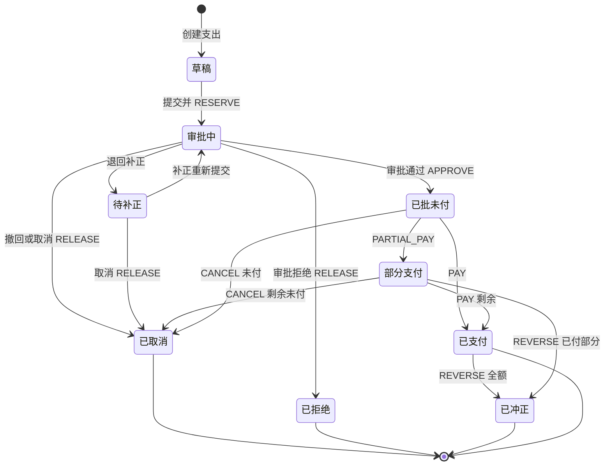
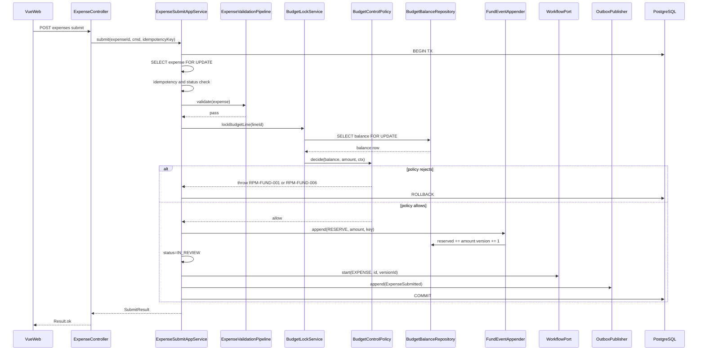
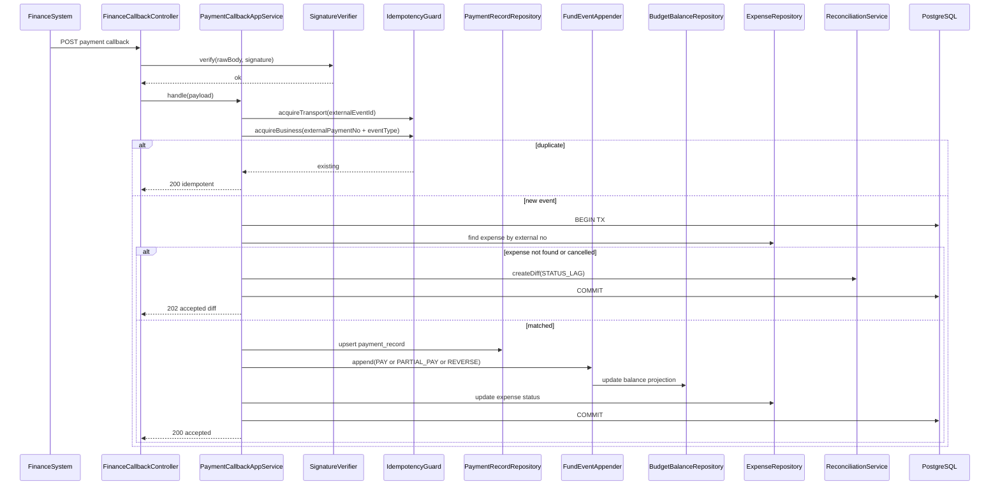
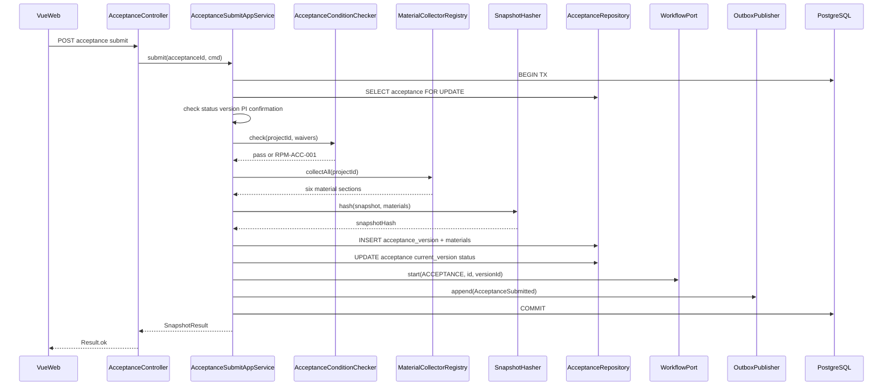
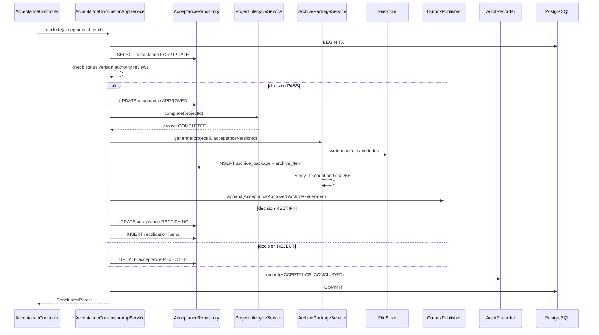

# 科研项目管理系统 — 经费、成果、验收接口设计

> 覆盖：预算与资金事件、支出与支付、对账、成果、验收、整改、归档
> 本文是资金与验收正确性的主设计；任何实现不得绕过 `fund_event` 和验收快照
> 数据表定义见 `02-数据模型与数据库设计.md`；基线 DDL 见 `../../../3-数据库/research-project-management/v1.0/V01__baseline_schema.sql`

---

## 1. 经费模型

### 1.1 口径定义

| 名称 | 定义 | 对可用余额的影响 |
|---|---|---|
| 生效预算 | 当前已批准且已生效的预算版本/科目金额 | 不减，作为控制上限 |
| 在审占用 | 已提交且未终审结束的支出申请金额，按科目占用 | 减 |
| 已批未付 | 已批准但尚未收到有效支付结果的金额 | 减，仍属占用，不重复计算 |
| 实际支付 | 财务接口或授权导入确认的净支付金额 | 已从占用转为实际支出，不再次扣减 |
| 可用余额 | 生效预算 - 当前有效占用（在审 + 已批未付）- 当前实际净支付 | 结果值 |
| 账面结余 | 按财务到账、支付及调整口径计算 | 不替代预算可用余额 |

```text
可用余额 = approved_amount
         - reserved_amount          -- 在审占用
         - approved_unpaid_amount   -- 已批未付
         - paid_amount              -- 实际净支付
```

`reserved_amount`、`approved_unpaid_amount`、`paid_amount` 都由 `fund_event` 投影得出；页面不得单独改余额。

### 1.2 资金事件语义

| 事件 | 触发 | 余额投影变化 |
|---|---|---|
| `RESERVE` | 支出提交 | `reserved_amount += amount` |
| `RELEASE` | 撤回/拒绝/取消草稿或审批中 | `reserved_amount -= amount` |
| `APPROVE` | 支出审批通过 | `reserved_amount -= amount`；`approved_unpaid_amount += amount` |
| `PAY` | 财务全额支付 | `approved_unpaid_amount -= amount`；`paid_amount += amount` |
| `PARTIAL_PAY` | 财务部分支付 | 同上，按本次金额；支出状态转 `PARTIALLY_PAID` |
| `CANCEL` | 已批未付取消剩余 | `approved_unpaid_amount -= 剩余未付` |
| `REVERSE` | 冲正/退回 | `paid_amount -= 冲正金额`，生成反向事件，不删除原事件 |
| `REFUND` | 退款到账 | `paid_amount -= 退款金额` |
| `ADJUST` | 受控调整（仅管理员+审计） | 按调整方向修正；必须关联审批和原因 |

约束：

1. 事件只追加，不更新、不删除。
2. `amount > 0`；方向由事件类型决定。
3. 幂等键唯一；重复请求返回原事件。
4. 投影更新与事件写入同事务；投影可由事件全量重建。

### 1.3 预算控制级别

| 级别 | 行为 | 说明 |
|---|---|---|
| `BLOCK` | 可用余额不足直接拒绝提交，返回 `RPM-FUND-001` | 默认，最安全 |
| `WARN` | 可用余额足够才允许提交；提交后若科目执行率超过阈值，生成风险提示 | 不允许负余额 |
| `APPROVAL` | 可用余额不足时不直接提交，返回 `RPM-FUND-006`，提示先走预算调整/特批 | 特批通过新预算版本或独立授权落地，仍不允许负余额 |

**设计裁定**：PRD 允许“禁止超支或允许特批”，本文选择“任何路径都不得出现负可用余额”。特批通过预算调整/追加审批生成新预算版本，而不是在余额表上直接加负数。

### 1.4 支出状态与资金事件



---

## 2. 经费接口目录

| 方法 | 路径 | 用途 | 权限 |
|---|---|---|---|
| GET | `/projects/{projectId}/budgets` | 预算版本与科目 | `fund:view` |
| POST | `/projects/{projectId}/budgets` | 创建预算草稿 | `fund:budget:edit` |
| POST | `/projects/{projectId}/budgets/{budgetId}/submit` | 提交预算审批 | `fund:budget:submit` |
| GET | `/projects/{projectId}/funds/summary` | 预算、占用、支付、余额汇总 | `fund:view` |
| POST | `/projects/{projectId}/expenses` | 创建支出草稿 | `fund:expense:create` |
| GET | `/projects/{projectId}/expenses` | 支出列表 | `fund:view` |
| GET | `/expenses/{expenseId}` | 支出详情 | `fund:view` |
| POST | `/expenses/{expenseId}/submit` | 提交支出并占用 | `fund:expense:submit` |
| POST | `/expenses/{expenseId}/withdraw` | 撤回支出 | `fund:expense:withdraw` |
| POST | `/expenses/{expenseId}/cancel` | 取消支出 | `fund:expense:cancel` |
| POST | `/finance/payments/import` | 上传支付导入批次 | `finance:payment:import` |
| POST | `/finance/payments/import/{batchId}/apply` | 复核并应用导入 | `finance:payment:apply` |
| POST | `/integration/finance/payments/callback` | 财务支付/冲正回调 | 签名校验 |
| GET | `/finance/reconciliations` | 对账批次 | `finance:reconcile:view` |
| POST | `/finance/reconciliations` | 创建对账批次 | `finance:reconcile:run` |
| POST | `/finance/reconciliations/{batchId}/diffs/{diffId}/close` | 关闭差异 | `finance:reconcile:close` |

---

## 3. 详细接口

### 3.1 `POST /projects/{projectId}/budgets` — 创建预算草稿（简单接口）

**Request**：

```json
{
  "source_type": "GRANT",
  "control_level": "BLOCK",
  "effective_from": "2026-12-01",
  "effective_to": "2029-11-30",
  "lines": [
    {"subject_code": "EQUIPMENT", "subject_name": "设备费", "amount": 300000.00},
    {"subject_code": "MATERIAL", "subject_name": "材料费", "amount": 250000.00},
    {"subject_code": "TRAVEL", "subject_name": "差旅费", "amount": 150000.00},
    {"subject_code": "LABOR", "subject_name": "劳务费", "amount": 500000.00}
  ],
  "total_amount": 1200000.00
}
```

**校验**：明细合计 = 总额；科目不重复；金额 > 0；项目状态允许；同一项目同一时刻最多一个生效预算版本；预算调整必须关联变更单。

**实现步骤**：

1. `BudgetController.create(...)` 校验 `fund:budget:edit`。
2. `BudgetAppService.createDraft(...)` 锁定项目，校验状态和现有生效版本。
3. 插入 `budget_version`（`DRAFT`）和 `budget_line`。
4. 为每个科目插入 `budget_balance` 初始行（金额 0，待生效时设置 `approved_amount`）。
5. 写审计；返回预算版本。

**核心调用链**：`BudgetController → BudgetAppService → ProjectRepository → BudgetRepository → AuditRecorder`

---

### 3.2 `POST /expenses/{expenseId}/submit` — 提交支出并占用（复杂接口）

**描述**：校验项目、预算、余额、材料和回避，锁定预算行，写 `RESERVE` 事件，启动审批。并发提交时最多一笔成功，余额不得为负。

**Request**：

```json
{
  "expected_version": 1,
  "budget_version_id": "3c4d5e6f-7a8b-4c9d-9e0f-1a2b3c4d5e6f",
  "budget_line_id": "4d5e6f7a-8b9c-4d0e-9f1a-2b3c4d5e6f7a",
  "amount": 80000.00,
  "purpose": "采购高性能计算节点",
  "payee": {
    "name": "某科技有限公司",
    "bank_account": "6222020202020202",
    "bank_name": "某银行某支行"
  },
  "attachment_file_ids": ["file-uuid-5"],
  "special_reason": null
}
```

**校验**：

| 项 | 规则 |
|---|---|
| 项目状态 | `EXECUTING` 或模板允许的状态；暂停/结题/终止禁止 |
| 预算版本 | 必须是当前 `EFFECTIVE` 版本且科目存在 |
| 金额 | `amount > 0`，2 位小数；不超过申请上限 |
| 可用余额 | 按控制级别判定；`BLOCK` 不足直接拒绝 |
| 材料 | 合同/发票/说明等必填附件齐全 |
| 回避 | 申请人不得是唯一审批人；收款方与申请人关系需声明 |
| 版本 | `expected_version` 匹配 |
| 幂等 | `Idempotency-Key` 唯一 |

**Response**：

```json
{
  "code": "OK",
  "data": {
    "expense_id": "5e6f7a8b-9c0d-4e1f-8a2b-3c4d5e6f7a8b",
    "status": "IN_REVIEW",
    "fund_event_id": "6f7a8b9c-0d1e-4f2a-9b3c-4d5e6f7a8b9c",
    "reserved_amount": 80000.00,
    "available_after": 700000.00,
    "workflow_instance_id": "7a8b9c0d-1e2f-4a3b-8c4d-5e6f7a8b9c0d"
  }
}
```

**错误码**：`RPM-FUND-001`（余额不足）、`RPM-FUND-002`（预算未生效）、`RPM-FUND-003`（重复事件）、`RPM-FUND-005`（支出状态不允许）、`RPM-FUND-006`（需先走预算调整）。

**实现步骤**：

1. `ExpenseController.submit(...)` 读取 `Idempotency-Key`。
2. `ExpenseSubmitAppService.submit(...)` 开启事务，`SELECT expense_request FOR UPDATE`。
3. 幂等检查：已有同 key 事件则返回首次结果；状态必须是 `DRAFT`/`SUPPLEMENT`。
4. `ExpenseValidationPipeline.validate(...)` 顺序执行：项目状态、预算版本、字段、材料、利益冲突。
5. `BudgetLockService.lockBudgetLine(lineId)`：对 `budget_balance` 行 `SELECT FOR UPDATE`。
6. `BudgetControlPolicyRegistry.get(controlLevel).decide(...)`：
   - `BLOCK` 不足 → 抛 `RPM-FUND-001`。
   - `WARN` 不足 → 抛 `RPM-FUND-001`（不允许负余额）；足够但超阈值 → 记录风险提示。
   - `APPROVAL` 不足 → 抛 `RPM-FUND-006`，提示先走预算调整。
7. `FundEventAppender.append(RESERVE, amount, idempotencyKey)`；更新 `budget_balance.reserved_amount`。
8. 更新支出 `status=IN_REVIEW`、`version+1`；启动 `WorkflowPort.start(EXPENSE, ...)`。
9. `OutboxPublisher.append(ExpenseSubmitted)`；写审计；提交事务。

**实现时序图**：



**核心伪代码**：

```pseudocode
function submitExpense(expenseId, cmd, idempotencyKey):
    existing = fundEventRepo.findByIdempotencyKey(idempotencyKey)
    if existing: return existing.summary()

    BEGIN TX
        expense = expenseRepo.selectForUpdate(expenseId)
        authz.check(currentUser, "fund:expense:submit", expense)
        require(expense.status in [DRAFT, SUPPLEMENT])
        require(expense.version == cmd.expectedVersion)

        validationPipeline.validate(expense, cmd)
        balance = budgetLockService.lockBudgetLine(cmd.budgetLineId)
        decision = policyRegistry.get(balance.controlLevel).decide(balance, cmd.amount, expense)
        if not decision.allowed: throw decision.error

        fundEventAppender.append(RESERVE, expense, cmd.amount, idempotencyKey)
        expense.markInReview()
        expenseRepo.update(expense)

        instance = workflowPort.start(EXPENSE, expense.id, expense.currentVersionId)
        outbox.append(ExpenseSubmitted(expense.id, instance.id))
        audit.record(EXPENSE_SUBMITTED, expense.id, idempotencyKey)
    COMMIT
    return SubmitResult(expense.id, instance.id, balance.availableAfter)
```

---

### 3.3 `POST /integration/finance/payments/callback` — 财务支付回调（复杂接口）

**描述**：接收财务支付、部分支付、退回、冲正结果；按外部单号 + 事件类型幂等；部分支付不提前全额转支出；晚到支付进入差异队列。

**Request**：

```json
{
  "external_event_id": "FIN-EVT-20261117-0001",
  "event_type": "PARTIAL_PAY",
  "external_payment_no": "PAY-2026-000888",
  "external_expense_no": "EXP-2026-000123",
  "project_no": "KY-2026-000456",
  "amount": 30000.00,
  "currency": "CNY",
  "paid_at": "2026-11-17T09:30:00+08:00",
  "voucher_no": "PZ-2026-001",
  "signature": "hmac-sha256-hex"
}
```

**校验**：HMAC 签名；`event_type` 合法；金额 > 0；外部单号唯一；项目/支出匹配；币种 CNY；时间合法。

**Response**：

```json
{
  "code": "OK",
  "data": {
    "accepted": true,
    "idempotent": false,
    "payment_record_id": "8b9c0d1e-2f3a-4b4c-9d5e-6f7a8b9c0d1e",
    "expense_status": "PARTIALLY_PAID",
    "paid_total": 30000.00,
    "remaining_unpaid": 50000.00
  }
}
```

**实现步骤**：

1. `FinanceCallbackController.callback(rawBody, signature)` 验签，失败返回 `RPM-INT-002`。
2. `PaymentCallbackAppService.handle(payload)` 先按 `external_event_id` 做报文级幂等，再按 `external_payment_no + event_type` 做业务事件幂等。
3. 匹配 `expense_request`（外部支出号/项目号）；匹配不到进入 `reconciliation_diff`，返回 202 并告警。
4. 开启事务：
   - 插入/更新 `payment_record`（唯一 `external_payment_no`）。
   - 计算累计已支付；写 `PAY`/`PARTIAL_PAY` 事件。
   - 更新 `budget_balance`：`approved_unpaid -= 本次金额`，`paid += 本次金额`。
   - 更新支出状态：累计支付 < 申请金额 → `PARTIALLY_PAID`；等于 → `PAID`；大于 → 差异单，不自动改状态。
5. 冲正：写 `REVERSE` 事件，`paid -= 冲正金额`；若净支付为 0 → `REVERSED`。
6. 晚到支付：若支出已 `CANCELLED`，写 `STATUS_LAG` 差异，不改变状态。
7. 写 `integration_sync_log`、审计；返回。

**实现时序图**：



**核心伪代码**：

```pseudocode
function handlePaymentCallback(payload, signature):
    verifySignature(payload, signature)
    if transportGuard.exists(payload.externalEventId):
        return transportGuard.result(payload.externalEventId)
    businessKey = payload.externalPaymentNo + ':' + payload.eventType
    if idempotencyGuard.exists(businessKey):
        return idempotencyGuard.result(businessKey)

    BEGIN TX
        expense = expenseRepo.findByExternalNoOrProjectNo(payload)
        if expense == null or expense.status == CANCELLED:
            reconciliationService.createDiff(STATUS_LAG, payload)
            syncLog.record(ACCEPTED_WITH_DIFF, payload)
        else:
            payment = paymentRepo.upsert(payload.externalPaymentNo, payload)
            eventType = resolveEventType(expense, payload)
            fundEventAppender.append(eventType, expense, payload.amount, businessKey)
            expense.applyPayment(eventType, payload.amount)
            expenseRepo.update(expense)
            syncLog.record(ACCEPTED, payload)
        audit.record(PAYMENT_CALLBACK, payload.externalPaymentNo)
    COMMIT
    return CallbackResult(payment, expense.status)
```

---

### 3.4 `POST /finance/payments/import` — 支付导入（复杂接口）

**描述**：无财务接口时，财务人员上传 Excel/CSV，系统做字段校验、行级错误报告、批次复核后再应用。

**流程**：

1. `PaymentImportController.upload(file, sourceType)` 保存文件，创建 `payment_import_batch` 状态 `UPLOADED`。
2. `PaymentImportAppService.validate(batchId)` 解析文件，逐行校验外部支付单号、支出单号/项目号、金额、支付日期、币种、凭证号。
3. 错误写入 `payment_import_row.error_code`；批次状态 `READY`（全部有效）或 `UPLOADED`（有错误，可下载错误报告）。
4. 财务复核人 `verified_by` 确认后 `POST /{batchId}/apply`。
5. 应用时以批次为幂等键，逐行写 `payment_record` 和 `fund_event`；已有外部单号跳过并记录。
6. 成功后批次 `APPLIED`；失败行保留，可修正后重试。

**幂等**：`batch_no` 唯一；`payment_record.external_payment_no` 唯一；重复应用返回首次结果。

**审计**：记录上传人、复核人、应用人、文件哈希、成功/失败行数。

---

### 3.5 `GET /projects/{projectId}/funds/summary` — 经费汇总（简单接口）

**Response**：

```json
{
  "code": "OK",
  "data": {
    "project_id": "8d7c6b5a-4e3f-4a2b-9c1d-0e2f3a4b5c6d",
    "budget_version_id": "3c4d5e6f-7a8b-4c9d-9e0f-1a2b3c4d5e6f",
    "data_as_of": "2026-11-17T10:00:00+08:00",
    "totals": {
      "approved": 1200000.00,
      "reserved": 80000.00,
      "approved_unpaid": 120000.00,
      "paid": 300000.00,
      "available": 700000.00
    },
    "lines": [
      {
        "subject_code": "EQUIPMENT",
        "subject_name": "设备费",
        "approved": 300000.00,
        "reserved": 80000.00,
        "approved_unpaid": 0.00,
        "paid": 100000.00,
        "available": 120000.00
      }
    ]
  }
}
```

**实现步骤**：

1. `FundQueryController.summary(projectId)` 校验 `fund:view` 和数据范围。
2. `FundQueryAppService.summary(...)` 读取当前生效预算版本和 `budget_balance` 投影。
3. 汇总按科目；金额从同一快照计算，返回 `data_as_of`。
4. 所有数字可下钻到 `fund_event` / `expense_request` 明细。

---

### 3.6 `POST /finance/reconciliations` — 创建对账批次（中等接口）

**描述**：比较本系统支付与财务支付，识别缺失、金额不符、重复和状态滞后。

**Request**：

```json
{
  "period_start": "2026-11-01",
  "period_end": "2026-11-30",
  "finance_batch_no": "FIN-BATCH-202611"
}
```

**实现步骤**：

1. `ReconciliationAppService.run(...)` 创建 `reconciliation_batch`（`RUNNING`）。
2. 拉取/读取财务支付批次，按外部支付单号匹配 `payment_record`。
3. 生成差异：财务有系统无 → `MISSING_PAYMENT`；金额不一致 → `AMOUNT_MISMATCH`；同一外部单号重复 → `DUPLICATE`；系统状态未跟上 → `STATUS_LAG`。
4. 更新批次 `COMPLETED`，`diff_count`；写审计。
5. 差异必须由责任人处理并关闭，不允许直接改支付记录。

**差异关闭**：`POST /finance/reconciliations/{batchId}/diffs/{diffId}/close`，要求 `resolution`、`evidence_file_ids`、`closed_by`，并写审计。

---

## 4. 成果接口

### 4.1 接口目录

| 方法 | 路径 | 用途 | 权限 |
|---|---|---|---|
| POST | `/outputs` | 登记成果 | `output:create` |
| GET | `/outputs/{outputId}` | 成果详情 | `output:view` |
| PUT | `/outputs/{outputId}/draft` | 保存成果草稿 | `output:edit` |
| POST | `/outputs/{outputId}/submit` | 提交成果审核 | `output:submit` |
| POST | `/outputs/{outputId}/relations` | 关联项目 | `output:relate` |
| DELETE | `/outputs/{outputId}/relations/{relationId}` | 撤销关联 | `output:relate` |
| POST | `/outputs/{outputId}/review` | 审核成果 | `output:review` |
| GET | `/outputs/duplicates` | 疑似重复提示 | `output:view` |
| GET | `/projects/{projectId}/outputs` | 项目成果列表 | `project:view` |

### 4.2 `POST /outputs` — 登记成果（中等接口）

**Request**：

```json
{
  "output_type": "PAPER",
  "title": "复杂工况下的多模态感知方法",
  "doi": "10.1000/example.2026.001",
  "patent_no": null,
  "completed_at": "2026-10-15",
  "owner_id": "a1b2c3d4-e5f6-4a7b-8c9d-0e1f2a3b4c5d",
  "dept_id": "0b7f5b7e-2a1c-4c2e-8d4f-9a0b1c2d3e4f",
  "metadata": {
    "journal": "某学报",
    "authors": ["张三", "李四"],
    "doi": "10.1000/example.2026.001"
  },
  "evidence_file_ids": ["file-uuid-6"]
}
```

**校验**：类型必填；公共字段统一；类型差异字段按模板校验；DOI/专利号格式；完成日期不晚于当前；证据文件有效；不得重复登记（可提示但不阻断）。

**实现步骤**：

1. `OutputController.create(...)` 校验 `output:create`。
2. `OutputAppService.createDraft(...)` 按类型模板校验元数据。
3. 插入 `research_output`（`DRAFT`）和 `output_version`（版本 1）。
4. 插入 `output_evidence` 和文件引用。
5. `OutputDuplicateService.findCandidates(...)` 生成疑似重复提示，写入 `output_duplicate_candidate`，**不自动合并**。
6. 写审计；返回成果。

**核心调用链**：`OutputController → OutputAppService → OutputTypeTemplateResolver → OutputRepository → OutputDuplicateService`

**业务码**：`RPM-OUT-001`（疑似重复，HTTP 200 警告，成果仍保存）、`RPM-OUT-002`（证据缺失）、`RPM-OUT-003`（项目关联无效）。

### 4.3 `POST /outputs/{outputId}/relations` — 关联项目（简单接口）

**Request**：

```json
{
  "project_id": "8d7c6b5a-4e3f-4a2b-9c1d-0e2f3a4b5c6d",
  "contribution_desc": "负责核心算法设计与验证",
  "attribution_ratio": 0.60
}
```

**规则**：

- 一个成果可关联多个项目；同一项目-成果关系唯一。
- 贡献说明必填；`attribution_ratio` 仅用于指定统计，不作为法定权属。
- 撤销关联不物理删除历史验收引用；`output_project_relation.status` 置 `REVOKED`，验收快照仍保留原引用。
- 成果与项目的数据权限同时校验；用户必须能看项目且能编辑成果关联。

**实现步骤**：

1. `OutputRelationAppService.relate(...)` 校验成果、项目、贡献说明和权限。
2. 插入/恢复 `output_project_relation`（`ACTIVE`）。
3. 写审计；触发项目成果摘要缓存失效。

### 4.4 成果审核

`POST /outputs/{outputId}/review`：

```json
{
  "version_id": "b2c3d4e5-f6a7-4b8c-9d0e-1f2a3b4c5d6e",
  "decision": "APPROVED",
  "comment": "材料齐全"
}
```

规则：科研管理审核；退回/拒绝必须填意见；审核绑定固定版本；已审核版本不可原地修改，修订生成新版本。

---

## 5. 验收接口

### 5.1 验收条件

按项目类型配置验收检查项，默认包含：

| 检查项 | 通过条件 | 允许例外 |
|---|---|---|
| 里程碑完成 | 基线内里程碑全部完成或有批准延期 | 是，需科研管理+领导审批 |
| 周期报告 | 所有到期报告已提交并通过 | 是，需说明并审批 |
| 经费 | 预算已生效；支出/支付无未关闭重大差异 | 是，需财务核验 |
| 成果 | 验收引用成果已审核且有证据 | 是，需科研管理审批 |
| 变更 | 变更已批准并生效，或已关闭 | 否 |
| 档案材料 | 必填材料齐全、哈希可校验 | 否 |

未满足项必须展示“未满足项、豁免人、理由、审批”；无权限用户不能勾选例外。

### 5.2 接口目录

| 方法 | 路径 | 用途 | 权限 |
|---|---|---|---|
| POST | `/projects/{projectId}/acceptances` | 创建验收 | `acceptance:create` |
| GET | `/projects/{projectId}/acceptances` | 验收列表 | `acceptance:view` |
| GET | `/acceptances/{acceptanceId}` | 验收详情 | `acceptance:view` |
| GET | `/acceptances/{acceptanceId}/conditions` | 验收条件检查 | `acceptance:view` |
| POST | `/acceptances/{acceptanceId}/submit` | 提交验收快照 | `acceptance:submit` |
| POST | `/acceptances/{acceptanceId}/reviews` | 专家/财务/管理意见 | `acceptance:review` |
| POST | `/acceptances/{acceptanceId}/conclusion` | 形成验收结论 | `acceptance:conclude` |
| POST | `/acceptances/{acceptanceId}/rectifications` | 创建整改项 | `acceptance:rectify` |
| POST | `/rectifications/{rectificationId}/submit` | 提交整改证据 | `acceptance:rectify` |
| POST | `/acceptances/{acceptanceId}/archive` | 生成归档包 | `archive:generate` |
| POST | `/archive-packages/{packageId}/receive` | 档案接收 | `archive:receive` |

### 5.3 `POST /acceptances/{acceptanceId}/submit` — 提交验收快照（复杂接口）

**描述**：检查验收条件，自动汇编项目概况、里程碑、经费、成果、变更、周期报告，生成不可变快照和哈希；后续新增成果/支付不改变在审包。

**Request**：

```json
{
  "expected_version": 1,
  "material_selection": {
    "include_reports": true,
    "include_changes": true,
    "expert_comment_required": true
  },
  "waivers": [
    {
      "condition_code": "REPORT_DUE",
      "reason": "报告已提交，系统同步延迟，附提交回执",
      "evidence_file_ids": ["file-uuid-7"]
    }
  ],
  "pi_summary": {
    "research_summary": "完成预定目标，形成两项原型",
    "deviation": "部分测试延后",
    "next_plan": "继续工程化验证"
  }
}
```

**校验**：验收状态 `PREPARING`/`RECTIFYING`；当前用户是 PI 或授权成员；验收条件逐项通过或有审批例外；材料文件 `AVAILABLE`；`expected_version` 匹配；PI 必须确认材料版本。

**Response**：

```json
{
  "code": "OK",
  "data": {
    "acceptance_id": "c3d4e5f6-a7b8-4c9d-8e0f-1a2b3c4d5e6f",
    "version_id": "d4e5f6a7-b8c9-4d0e-9f1a-2b3c4d5e6f7a",
    "version_no": 2,
    "snapshot_hash": "9f2c...e1",
    "status": "IN_REVIEW"
  }
}
```

**实现步骤**：

1. `AcceptanceController.submit(...)`。
2. `AcceptanceSubmitAppService.submit(...)` 开启事务，锁定 `acceptance`。
3. `AcceptanceConditionChecker.check(projectId)` 返回通过/未通过/例外项；未通过且无授权例外则 `RPM-ACC-001`。
4. `MaterialCollectorRegistry.collectAll(projectId)` 并行收集六类材料，统一鉴权和脱敏。
5. `SnapshotCanonicalizer.canonicalize(...)` 生成规范化 JSON；`SnapshotHasher.hash(snapshot, materials)` 计算 SHA-256。
6. 插入 `acceptance_version`（`SUBMITTED`）和 `acceptance_material`；更新 `acceptance.current_version_id`、`status=IN_REVIEW`。
7. 启动验收审查任务；写 `AcceptanceSubmitted` outbox 和审计；提交事务。

**实现时序图**：



**核心伪代码**：

```pseudocode
function submitAcceptance(acceptanceId, cmd):
    BEGIN TX
        acceptance = acceptanceRepo.selectForUpdate(acceptanceId)
        authz.check(currentUser, "acceptance:submit", acceptance)
        require(acceptance.status in [PREPARING, RECTIFYING])
        require(acceptance.version == cmd.expectedVersion)
        requirePiConfirmation(acceptance, cmd)

        conditionResult = conditionChecker.check(acceptance.projectId, cmd.waivers)
        if not conditionResult.allPassed: throw RPM_ACC_001(conditionResult)

        sections = materialCollectorRegistry.collectAll(acceptance.projectId)
        snapshot = snapshotCanonicalizer.canonicalize(acceptance, sections, cmd.piSummary)
        hash = snapshotHasher.hash(snapshot, sections)

        version = acceptanceRepo.insertVersion(acceptance.id, snapshot, hash)
        acceptanceRepo.insertMaterials(version.id, sections)
        acceptance.markInReview(version.id)
        workflowPort.start(ACCEPTANCE, acceptance.id, version.id)
        outbox.append(AcceptanceSubmitted(acceptance.id, version.id, hash))
        audit.record(ACCEPTANCE_SUBMITTED, acceptance.id, version.id)
    COMMIT
    return SnapshotResult(version.id, hash)
```

### 5.4 `POST /acceptances/{acceptanceId}/conclusion` — 验收结论（复杂接口）

**描述**：形成通过、整改后复审、不通过结论；通过时冻结项目、生成归档包；整改保留原意见。

**Request**：

```json
{
  "version_id": "d4e5f6a7-b8c9-4d0e-9f1a-2b3c4d5e6f7a",
  "decision": "PASS",
  "comment": "同意结题",
  "rectification_items": []
}
```

`decision` 取值：`PASS`、`RECTIFY`、`REJECT`。`RECTIFY` 或 `REJECT` 必须提供 `rectification_items` 或 `reason`。

**校验**：验收状态 `IN_REVIEW`；版本已提交；当前用户有 `acceptance:conclude`；专家/财务意见齐全（按模板）；自审/回避校验；整改项必须有责任人和期限。

**实现步骤**：

1. `AcceptanceConclusionAppService.conclude(...)` 开启事务，锁定验收。
2. 校验状态、版本、权限、意见完整性、结论枚举。
3. `PASS`：
   - 更新 `acceptance.status=APPROVED`、`acceptance_version.status=APPROVED`。
   - `ProjectLifecycleService.complete(projectId)`：项目状态 `COMPLETED`，冻结业务写入。
   - `ArchivePackageService.generate(projectId, acceptanceVersionId)`：生成 manifest、文件索引、SHA-256、文件数。
   - 写 `AcceptanceApproved`、`ProjectCompleted`、`ArchiveGenerated` outbox。
4. `RECTIFY`：状态 `RECTIFYING`，创建 `acceptance_rectification`，原版本保留，项目仍在验收中。
5. `REJECT`：状态 `REJECTED`，项目可转终止或按制度处理；仍生成处置与归档记录。
6. 写审计；提交事务。

**实现时序图**：



**核心伪代码**：

```pseudocode
function concludeAcceptance(acceptanceId, cmd):
    BEGIN TX
        acceptance = acceptanceRepo.selectForUpdate(acceptanceId)
        authz.check(currentUser, "acceptance:conclude", acceptance)
        require(acceptance.status == IN_REVIEW)
        require(acceptance.currentVersionId == cmd.versionId)
        requireReviewsComplete(acceptance, cmd)

        switch cmd.decision:
            PASS:
                acceptance.markApproved()
                projectLifecycle.complete(acceptance.projectId)
                archive = archiveService.generate(acceptance.projectId, cmd.versionId)
                outbox.append(AcceptanceApproved(acceptance.id, archive.id))
            RECTIFY:
                acceptance.markRectifying()
                acceptanceRepo.insertRectifications(cmd.items)
            REJECT:
                acceptance.markRejected(cmd.reason)

        acceptanceRepo.update(acceptance)
        audit.record(ACCEPTANCE_CONCLUDED, acceptance.id, cmd.decision)
    COMMIT
    return ConclusionResult(acceptance.status)
```

### 5.5 归档包

`archive_package` 生成规则：

1. 目录按“项目概况、申报与立项、里程碑与报告、经费、成果、变更、验收”分卷。
2. `archive_item` 记录每个文件/记录的 `item_type`、`item_id`、`file_id`、`sha256`、`version_no`。
3. manifest 是 JSON 索引，包含生成时间、项目编号、验收版本、文件数、总字节数、每个文件 SHA-256。
4. `manifest_hash = SHA-256(canonical_json(manifest))`；写入 `archive_package.manifest_hash`。
5. 档案接收 `POST /archive-packages/{packageId}/receive` 记录接收人、时间、回执文件；接收后不可修改，只能追加更正。

**归档一致性检查**：

| 检查 | 失败处理 |
|---|---|
| 文件数一致 | `archive_package.status=FAILED`，告警 |
| 每个文件 SHA-256 一致 | 标记被篡改/缺失，告警 |
| 验收快照哈希一致 | 拒绝归档，回退重生成 |
| 必填材料齐全 | 拒绝归档，列出缺失项 |
