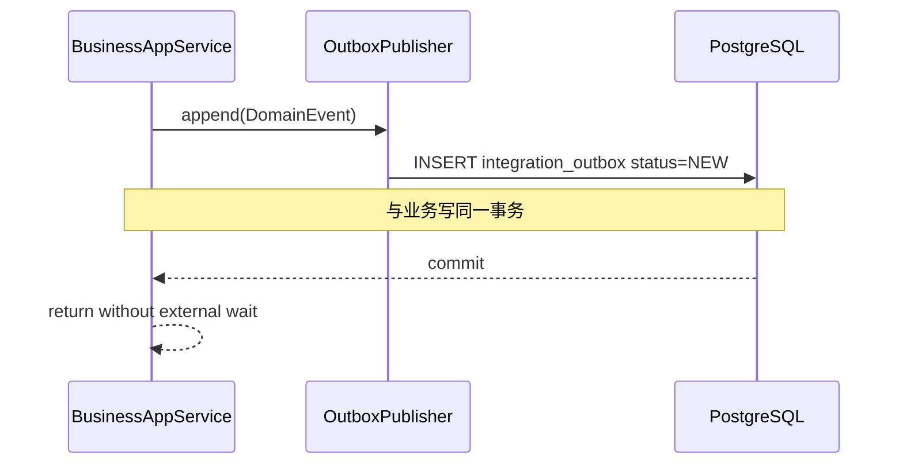
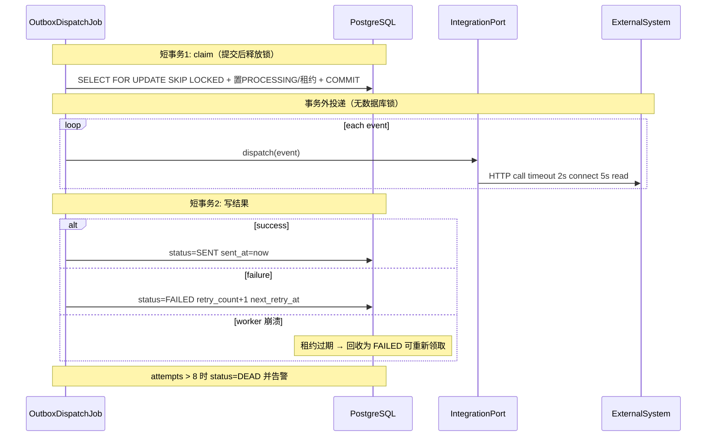
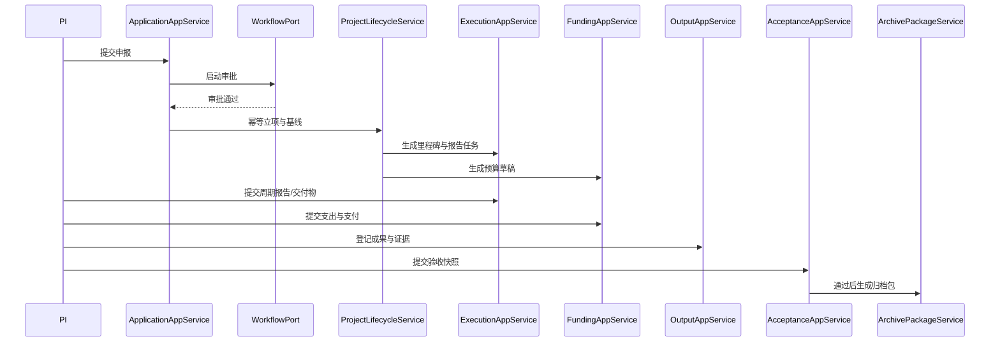
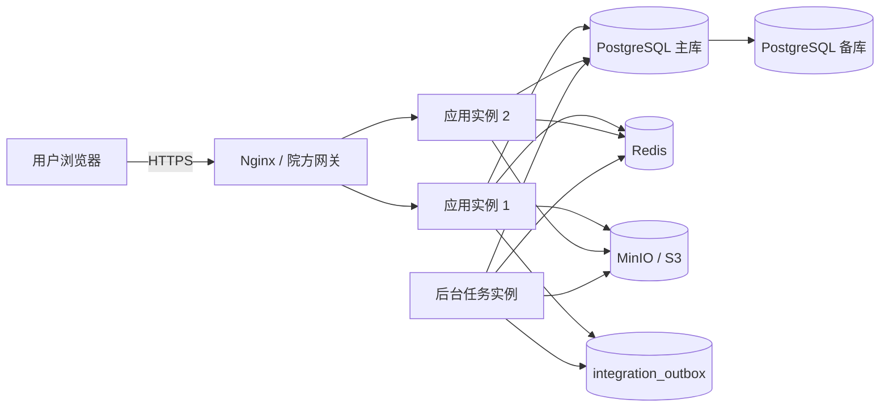

# 科研项目管理系统 — 集成、非功能与上线设计

> 覆盖：缓存、异步 outbox、定时任务、外部集成、非功能、部署、监控、备份、回滚、风险
> 一期不引入 MQ；用 PostgreSQL 事务内 Outbox 替代跨系统事件投递
> 本文的数字目标来自 PRD §10，须在 A1 规模确认后通过压测修订，不能当作已测结果
> 验证用例清单见 `07-验证用例清单.md`

---

## 1. 缓存设计

### 1.1 场景一：用户权限快照

| 维度 | 设计 |
|---|---|
| Key | `rpm:perm:user:{userId}:role:{roleId}` |
| Value | JSON：`permissionCodes`、`projectScopeVersion`、`deptIds`、`grantedProjectIds`、`expireAt` |
| TTL | 5 分钟；临时授权另带 `expireAt`，到期立即失效 |
| 写入时机 | 登录成功、角色变更、临时授权变更后异步重建 |
| 读取时机 | 每次请求鉴权；`AuthorizationService` 先读缓存，miss 回源 DB |
| 失效策略 | 角色/授权/组织变更主动 `DEL`；TTL 兜底；不使用永不过期缓存 |

Fallback：Redis 不可用 → 直接查 DB（限流保护），不得放行匿名访问。

### 1.2 场景二：项目摘要

| 维度 | 设计 |
|---|---|
| Key | `rpm:project:summary:{projectId}:{baselineId}` |
| Value | JSON：里程碑计数、报告到期数、预算/占用/支付/余额、成果数、开放风险数、`dataAsOf` |
| TTL | 60 秒 |
| 写入时机 | 项目详情首次读取、项目/基线/里程碑/报告/经费/成果/风险变更后异步重建 |
| 读取时机 | 项目列表和详情摘要；详情页各页签仍以各自查询为准 |
| 失效策略 | 领域事件触发 `DEL`；TTL 兜底；不缓存权限判断结果 |

Fallback：缓存 miss/Redis 不可用 → 查 DB 聚合；查询超时返回部分摘要并标记 `degraded=true`。

### 1.3 场景三：报表快照

| 维度 | 设计 |
|---|---|
| Key | `rpm:report:{reportCode}:{paramsHash}:{dataCutoff}` |
| Value | JSON：报表行、合计、口径版本、数据截止时间 |
| TTL | 5 分钟；日切后 `dataCutoff` 变化自然隔离 |
| 写入时机 | 报表查询成功且结果集小于阈值（如 5,000 行）时写入 |
| 读取时机 | 固定报表页、领导风险视图 |
| 失效策略 | 物化视图刷新后按 `reportCode` 前缀清理；TTL 兜底 |

Fallback：Redis 不可用 → 直接查询物化视图/只读副本；大结果集不写缓存。

**禁止写法**：只写“使用 Redis 提升性能”而不写 key、value、TTL、写入/读取时机、失效策略，视为不合格。

---

## 2. 异步与 Outbox

### 2.1 为什么不用 MQ

一期规模 300 峰值在线、年新增 2,000 项目，跨系统事件量有限；引入 MQ 会增加部署、监控、重放和运维成本。使用 PostgreSQL 事务内 Outbox：

- 业务写操作与待发送事件同事务，避免“业务成功、事件丢失”。
- 后台任务轮询投递，失败可重试、可人工补偿。
- 后续规模或集成复杂度达到阈值，再把 outbox 投递到 MQ，业务代码不变。

### 2.2 生产者实现步骤

1. `OutboxPublisher.append(DomainEvent event)` 入口。
2. 生成 `event_id`（UUID）、`event_type`、`aggregate_type`、`aggregate_id`、`payload`、`occurred_at`。
3. 在同一数据库事务插入 `integration_outbox`，`status=NEW`，`idempotency_key` 唯一。
4. 事务提交后立即返回，不等待外部系统。
5. 业务失败回滚时事件一并回滚。

### 2.3 投递任务实现步骤（评审修复 #11：短事务 claim，HTTP 不进数据库事务）

**硬规则：外部 HTTP 调用绝不进入数据库事务，也不得在行锁持有期间执行。** 投递分三段短事务：

1. **短事务 claim（领取）**：`OutboxDispatchJob` 每 5 分钟触发。
   `SELECT ... FROM integration_outbox WHERE (status IN ('NEW','FAILED') AND next_retry_at <= now()) OR (status='PROCESSING' AND lease_expires_at < now()) ORDER BY created_at LIMIT 100 FOR UPDATE SKIP LOCKED`，
   同事务置 `status=PROCESSING`、`processing_worker=hostname:pid`、`lease_expires_at=now()+300s`，**提交并释放锁**。
2. **事务外投递**：按 `event_type` 路由到 `IntegrationPort` 适配器，发起 HTTP（connect 2s / read 5s）；此阶段不持有任何数据库锁。
3. **短事务写结果**：
   - 成功：`status=SENT`、`sent_at=now()`；写 `integration_sync_log`。
   - 失败：`status=FAILED`、`retry_count+1`、指数退避 30s/2min/10min/30min/2h/6h；超过 8 次 `status=DEAD` 并告警。
4. **租约超时回收**：worker 崩溃时 `PROCESSING` 记录由租约过期逻辑回收为 `FAILED`（`lease_expires_at < now()`），可被重新领取；重放使用原 `event_id`，外部按 `event_id` 幂等。
5. 人工补偿：后台按 `event_id` 重放（重置租约），必须二次确认并写审计。

### 2.4 生产者流程时序图

### 2.5 投递流程时序图

### 2.6 消费端幂等

外部系统消费我们的通知时，必须用 `event_id` 去重；本系统接收外部回调时，用 `external_event_id + event_type` 去重。双方都保留 `integration_sync_log`，包含请求摘要、响应摘要、外部单号、状态、错误码。

---

## 3. 定时任务设计

调度框架：Spring Boot `@Scheduled` + ShedLock（PostgreSQL 锁表），不引入额外调度中间件。每个任务必须设置超时、重试、幂等键和失败明细。

### 3.1 `DeadlineReminderJob` — 到期与逾期提醒

#### ① 任务定义

| 项目 | 说明 |
|---|---|
| 任务类名 | `DeadlineReminderJob` |
| 业务目的 | 扫描申报截止、报告到期、里程碑延期、长期无更新，生成待办/通知/风险 |
| 触发类型 | Cron |
| 触发表达式 | `0 30 7 * * *`（每日 07:30） |
| 是否关键路径 | 否，辅助治理 |

#### ② 调度框架配置

- 框架：Spring `@Scheduled` + ShedLock。
- 任务类型：单机执行，按 `project_id` 哈希分片。
- 超时：30 分钟。
- 最大重试：2 次。
- 实例并发：禁止同一任务多实例并发（ShedLock）。

#### ③ 执行步骤

1. `DeadlineReminderJob.execute()` 获取分片参数。
2. 分页扫描 30 天内到期/已逾期的申报、报告、里程碑，每页 ≤500 条。
3. 对每条记录计算规则命中：`APPLICATION_DUE`、`REPORT_DUE`、`MILESTONE_DELAY`、`NO_UPDATE_30D`。
4. 幂等键 `reminder:{rule}:{bizType}:{bizId}:{date}`；已存在则跳过。
5. 生成 `notification`、`todo_item`，必要时生成 `project_risk`。
6. 写 `job_run` 统计；返回 `ProcessResult`。

#### ④ 并发与幂等

- 分片策略：`hash(project_id) % shardTotal == shardIndex`。
- 幂等键：规则 + 业务对象 + 日期。
- 并发兜底：`notification` 唯一索引 `(user_id, type, biz_id, biz_date)`；重复插入忽略。

#### ⑤ 失败处理

- 单条失败写 `job_failed_detail`，继续下一条。
- 任务级失败重试 2 次；仍失败告警值班研发。
- 人工补偿：按日期重跑，已生成通知不重复。

#### ⑥ 性能与资源

- 批大小 500；游标按 `id` 推进。
- 预计 5 分钟内完成；避开工作时间。
- 只读主库索引扫描，不锁表。

#### ⑦ 监控告警

| 监控项 | 指标 | 阈值 | 接收人 |
|---|---|---|---|
| 任务失败 | `job_fail_count` | >0 | 值班研发 |
| 执行时长 | `job_duration` | >10min | 值班研发 |
| 待生成提醒积压 | `pending_reminder_count` | >1000 | 产品+研发 |

### 3.2 `BudgetRiskScanJob` — 经费异常扫描

#### ① 任务定义

| 项目 | 说明 |
|---|---|
| 任务类名 | `BudgetRiskScanJob` |
| 业务目的 | 识别预算执行率异常、长期在审占用、经费进度与时间进度偏差 |
| 触发类型 | Cron |
| 触发表达式 | `0 0 8 * * *`（每日 08:00） |
| 是否关键路径 | 否 |

#### ② 调度框架配置

- 框架：Spring `@Scheduled` + ShedLock。
- 任务类型：单机分片。
- 超时：30 分钟。
- 最大重试：2 次。
- 实例并发：禁止。

#### ③ 执行步骤

1. 分页扫描执行中项目。
2. 读取当前 `budget_balance` 和项目时间进度。
3. 计算执行率、占用率、偏差；命中阈值生成 `project_risk`。
4. 幂等键 `budget-risk:{projectId}:{rule}:{periodKey}`。
5. 合并同类风险，避免重复通知。

#### ④ 并发与幂等

- 分片：按 `project_id` 哈希。
- 幂等：规则 + 项目 + 周期；同一周期不重复生成。
- 并发：风险表唯一索引兜底。

#### ⑤ 失败处理

- 单项目失败记录明细；任务级重试 2 次。
- 阈值配置错误导致全量告警时，支持按规则暂停并回滚风险批次。

#### ⑥ 性能与资源

- 每批 500 项目；只读查询 + 批量插入风险。
- 避开财务月结高峰。

#### ⑦ 监控告警

| 监控项 | 指标 | 阈值 | 接收人 |
|---|---|---|---|
| 任务失败 | `job_fail_count` | >0 | 值班研发 |
| 风险生成量 | `risk_created_count` | >500/日 | 科研管理+研发 |
| 执行时长 | `job_duration` | >15min | 值班研发 |

### 3.3 `OutboxDispatchJob` — 外部事件投递

#### ① 任务定义

| 项目 | 说明 |
|---|---|
| 任务类名 | `OutboxDispatchJob` |
| 业务目的 | 把事务内 outbox 事件可靠投递到财务/OA/档案等外部系统 |
| 触发类型 | 固定间隔 |
| 触发表达式 | 每 5 分钟 |
| 是否关键路径 | 是（影响集成时效，不影响本地事务） |

#### ② 调度框架配置

- 框架：Spring `@Scheduled` + ShedLock。
- 任务类型：单机多线程消费，`FOR UPDATE SKIP LOCKED`。
- 超时：5 分钟。
- 最大重试：8 次（指数退避）。
- 实例并发：允许多实例并行，但同一事件只被一个实例锁定。

#### ③ 执行步骤（与 §2.3 claim 流程一致）

1. **claim 短事务**：拉取 ≤100 条事件置 `PROCESSING` + 租约，提交。
2. **事务外**按 `event_type` 路由适配器，调用外部接口（超时和签名已配置）。
3. **结果短事务**：成功 `SENT`；失败 `FAILED`、`retry_count+1`、`next_retry_at`。
4. 超过 8 次标记 `DEAD`，告警并提供人工重放（重置租约）。
5. 每轮先执行租约回收：过期 `PROCESSING` → `FAILED`。

#### ④ 并发与幂等

- claim 使用 `FOR UPDATE SKIP LOCKED` + `PROCESSING` 状态 + 租约，两阶段防重复消费。
- worker 崩溃后租约超时回收，消息不丢失。
- 事件 `idempotency_key` 唯一；外部系统按 `event_id` 去重；重放保留原 `event_id`。

#### ⑤ 失败处理

- 单事件失败不影响其他事件。
- `DEAD` 进入人工补偿队列，后台页面按事件重放。
- 外部系统不可用超过 30 分钟告警。

#### ⑥ 性能与资源

- 批大小 100；并发 4；单次调用超时 5s。
- 预计 1 分钟内完成；积压时自动扩容 worker（单机线程数可配）。

#### ⑦ 监控告警

| 监控项 | 指标 | 阈值 | 接收人 |
|---|---|---|---|
| 待投递积压 | `outbox_pending_count` | >1000 | 值班研发 |
| 死信数量 | `outbox_dead_count` | >0 | 值班研发+集成负责人 |
| 投递失败率 | `outbox_fail_rate` | >5% | 值班研发 |

### 3.4 `ReconciliationJob` — 每日对账（评审修复 #12：任务拆分）

#### ① 任务定义

| 项目 | 说明 |
|---|---|
| 任务类名 | `ReconciliationJob` |
| 业务目的 | 拉取财务支付数据，生成对账差异（FUND-09） |
| 触发表达式 | `0 0 2 * * *`（每日 02:00） |
| 是否关键路径 | 是 |

#### ②～⑥ 关键配置

- 框架：`@Scheduled` + ShedLock，单机，超时 1 小时，重试 1 次。
- 幂等：对账批次 `batch_no` 唯一；同一天重跑覆盖未关闭批次，不重复生成已关闭差异；差异以 `batch_no + expense_request_id + diff_type` 幂等。
- 失败：批次置 `FAILED`，不阻塞业务；告警财务+研发；差异责任人必填（修复 #25）。
- 性能：按期间分页拉取，批 ≤500，避开财务月结。

#### ⑦ 监控告警

| 监控项 | 指标 | 阈值 | 接收人 |
|---|---|---|---|
| 对账差异 | `recon_diff_count` | >0 | 财务+研发 |
| 对账任务失败 | `job_fail_count` | >0 | 值班研发 |

### 3.5 `ReportRefreshJob` — 物化视图刷新

#### ① 任务定义

| 项目 | 说明 |
|---|---|
| 任务类名 | `ReportRefreshJob` |
| 业务目的 | 按依赖顺序刷新 4 个报表物化视图（V02），维护 `data_as_of` |
| 触发表达式 | `0 0 3 * * *`（每日 03:00） |
| 是否关键路径 | 否（失败保留上次数据） |

#### ②～⑥ 关键配置

- 刷新顺序：`mv_project_summary → mv_funding_summary → mv_output_summary → mv_risk_summary`（V02 `refresh_all_materialized_views()`，逐视图记录 `mv_refresh_log`）。
- 幂等：视图级 `mv_refresh_log`；`REFRESH MATERIALIZED VIEW CONCURRENTLY` 需唯一索引；失败保留上次数据并终止后续视图（依赖顺序），页面显示 `data_as_of`。
- 失败回退：CONCURRENTLY 失败重试普通刷新一次；仍失败告警，不影响业务查询。
- 手工补偿：`refresh_single_materialized_view(view, operator)` + 审计。

#### ⑦ 监控告警

| 监控项 | 指标 | 阈值 | 接收人 |
|---|---|---|---|
| 物化视图延迟 | `mv_lag_minutes` | >60 | 值班研发 |
| 刷新失败 | `mv_refresh_fail_count` | >0 | 值班研发 |

### 3.6 `ArchiveIntegrityCheckJob` — 归档完整性校验

#### ① 任务定义

| 项目 | 说明 |
|---|---|
| 任务类名 | `ArchiveIntegrityCheckJob` |
| 业务目的 | 校验归档包 manifest 哈希、文件数与对象存储一致性（含验收/处置归档） |
| 触发表达式 | `0 30 3 * * *`（每日 03:30） |
| 是否关键路径 | 否 |

#### ②～⑥ 关键配置

- 扫描 `archive_package.status IN ('READY','RECEIVED')`，从对象存储重算文件哈希比对（修复 #9）。
- 幂等：`package_id + manifest_hash`； RECEIVED 包哈希不一致为**最高级告警**（疑似篡改）。
- 失败：包标记 `CHECK_FAILED`，通知档案责任人，写审计 `ARCHIVE_INTEGRITY_ALERT`。

#### ⑦ 监控告警

| 监控项 | 指标 | 阈值 | 接收人 |
|---|---|---|---|
| 校验失败 | `archive_check_fail_count` | >0 | 档案责任人+研发 |
| RECEIVED 包哈希不一致 | `archive_tamper_count` | >0 | 档案负责人+安全+研发（P0） |

### 3.7 `ApplicationCloseJob` — 申报超期关闭（评审修复 #12：补 TC-APP-038/039 引用）

#### ① 任务定义

| 项目 | 说明 |
|---|---|
| 任务类名 | `ApplicationCloseJob` |
| 业务目的 | 批次关闭后处理过期草稿与超期补正（APPLY-08） |
| 触发表达式 | `0 30 1 * * *`（每日 01:30） |
| 是否关键路径 | 否 |

#### ②～⑥ 关键配置

- 草稿：批次 `endAt` 后 30 天未提交 → `EXPIRED` + 通知 + 附件按保留策略清理。
- 补正：补正期限（默认 15 天，可配置）届满未重新提交 → `REJECTED`（自动否决）+ 通知 + 审计。
- 幂等：`(application_id, close_type)` 唯一，重跑不重复关闭。
- 人工补偿：管理端按批次重跑；规则见 `08-评审修复补充接口设计.md` §9.2。

#### ⑦ 监控告警

| 监控项 | 指标 | 阈值 | 接收人 |
|---|---|---|---|
| 任务失败 | `job_fail_count` | >0 | 值班研发 |
| 自动否决量 | `auto_reject_count` | >50/日 | 科研管理 |

### 3.8 `ReportGenerationJob` — 周期报告生成（评审修复 #12：EXEC-03）

#### ① 任务定义

| 项目 | 说明 |
|---|---|
| 任务类名 | `ReportGenerationJob` |
| 业务目的 | 按月/季度为 EXECUTING 项目预生成周期报告草稿并建待办 |
| 触发表达式 | `0 0 6 1 * *`（每月 1 日 06:00，按周期配置决定是否实际生成） |
| 是否关键路径 | 否 |

#### ②～⑥ 关键配置

- 依据 `report_period` 配置（月/季、生成日、截止日偏移）扫描 `EXECUTING` 项目。
- 幂等：`(project_id, period_type, period_key)` 唯一（`uk_progress_report_period` 兜底），已存在跳过。
- 生成 `progress_report(DRAFT)` + 版本占位 + PI 待办（到期日=截止日）；PI 也可手工创建，唯一约束防重复。
- 新立项项目：立项次月起按配置生成。

#### ⑦ 监控告警

| 监控项 | 指标 | 阈值 | 接收人 |
|---|---|---|---|
| 生成失败 | `job_fail_count` | >0 | 值班研发 |
| 应生成未生成 | `report_missing_count` | >0 | 科研管理 |

### 3.9 `FileSessionCleanupJob` 与 `SpecialApprovalExpireJob` — 辅助清理

| 任务 | 触发 | 职责 | 幂等 |
|---|---|---|---|
| `FileSessionCleanupJob` | 每小时 | 中止过期（48h）`file_upload_session`，清理 S3 未完成 multipart；顺带清理过期/已撤销超 90 天的 `external_link_grant`（09 §2） | `session_id` / `token_hash` |
| `SpecialApprovalExpireJob` | 每日 04:00 | `valid_until` 届满的特批置 `EXPIRED`，RELEASE 受控占用（FUND-04） | `(special_approval_id, expire_date)` |
| `TempGrantExpireJob` | 每小时 | 临时授权到期回收 + 权限缓存失效（P1） | `grant_id` |

三者为低风险辅助任务，配置同上：ShedLock 单机、超时 15 分钟、失败告警值班研发。

---

## 4. 外部集成

| 系统 | 交换内容 | 方式 | 超时 | 重试 | 降级 | 幂等键 |
|---|---|---|---|---|---|---|
| 统一身份 OIDC/CAS/LDAP | 登录、组织、在离职 | OIDC/CAS + 定时同步 | connect 1s / read 3s | 1 次 | 本地受控账号；离岗立即禁用 | `sso_subject` |
| 财务系统 | 预算映射、支付、冲正、凭证 | API + outbox + 每日对账 | connect 2s / read 5s | 3 次指数退避 | Excel/CSV 导入 | `external_payment_no + event_type` |
| OA/统一待办 | 待办标题、链接、状态 | API 双向 | connect 2s / read 5s | 3 次 | 站内待办 | `todo_id + action` |
| 企业微信/钉钉/邮件 | 待办、催办、预警 | 官方接口 | connect 2s / read 5s | 2 次 | 站内信 | `message_id` |
| 档案系统 | 目录、文件、校验值、回执 | API 或标准包 | connect 5s / read 30s | 3 次 | 导出归档包 | `package_id + manifest_hash` |
| 文档预览 | Office/PDF 预览 | 院方预览服务 | connect 2s / read 10s | 0 | 鉴权下载 | `file_id + version` |

通用规则：

1. 所有调用设置连接/读取超时；禁止无限等待。
2. 只对幂等接口自动重试；非幂等接口靠业务幂等键。
3. 外部失败不影响本地事务；页面显示同步状态和最后成功时间。
4. 消息不含敏感正文；链接失效或无权时明确提示，不泄露摘要。
5. 接口上线门：字段映射、唯一键、时间口径、幂等、重放、超时、对账、权限、测试环境和责任人未明确前，不进入自动双向同步。

---

## 5. 端到端编排

### 5.1 申报到归档主链路

### 5.2 事务协调

- 一期单库，**不引入 Saga/TCC**。立项、预算生效、支出占用、验收冻结均在本地数据库事务内完成。
- 跨系统最终一致用 outbox + 重试 + 对账 + 人工补偿，不承诺跨系统强实时分布式事务。
- 补偿成对：`RESERVE ↔ RELEASE`、`PAY ↔ REVERSE`、`APPROVE ↔ CANCEL`；补偿必须幂等。
- 如果未来拆服务，再按 Saga 设计持久化状态机；当前不预先引入。

### 5.3 TraceID

- 接入层 `TraceIdFilter` 生成或透传 `X-Trace-Id`，写入 MDC。
- 每层日志、审计、outbox、外部请求头都携带同一 TraceID。
- 异步任务从 `integration_outbox.payload.trace_id` 恢复上下文；外部回调从请求头读取。
- 前端错误页展示 `trace_id`，便于支持定位。

---

## 6. 非功能性要求

### 6.1 性能与容量

| 指标 | 目标 | 设计支撑 | 不达标降级 |
|---|---|---|---|
| 普通查询 | 300 并发下 P95 ≤1s、P99 ≤2s | 索引 + 分页 + 摘要缓存 + 只读副本 | 限流、关闭非关键聚合 |
| 关键提交 | P95 ≤2s | 单库本地事务、预算行锁范围小 | 外部同步异步化 |
| 列表导出 | 小数据同步；超阈值异步 | `export_task` + 后台任务 | 10 万行任务显示进度 |
| 文件 | 单文件默认 200MB | MinIO 分片/断点续传增强 | 大文件转异步扫描 |
| 容量 | 5 年、10,000 项目 | 索引 + 归档 + 分区预留 | 读写分离/垂直扩容 |
| 数据准确 | 金额/状态/权限测试 100% 通过 | 资金事件 + 唯一约束 + 对账 | 不允许为性能跳过校验 |

### 6.2 可用性与恢复

- 月度可用性 ≥99.5%（维护窗口是否计入在 SLA 明确）。
- RPO ≤15 分钟：PostgreSQL WAL 归档 + 增量备份；RTO ≤4 小时。
- 每季度至少一次恢复演练，验证数据库与 MinIO 对象可共同恢复，记录实际 RPO/RTO。
- 外部财务/OA 不可用不丢已保存业务；显示同步状态并支持补偿。
- 发布前完成数据库迁移备份、兼容性验证和回退预案。

### 6.3 安全与合规

- 全站 HTTPS；HSTS；Cookie `HttpOnly + Secure + SameSite`。
- 密码/令牌使用成熟方案；Token 可撤销；敏感操作二次认证。
- 防 SQL 注入、XSS、CSRF、越权、恶意文件、暴力破解和批量接口滥用。
- 上传校验扩展名、MIME、大小、魔数；病毒扫描按院方要求；下载安全文件名。
- 传输与存储加密；密钥独立管理；敏感字段脱敏；密钥不得写入代码库。
- 安全日志 ≥6 个月；业务/财务/档案审计 ≥10 年；最终以院方制度为准。

### 6.4 易用性与可维护性

- PC 优先，适配 1366×768 及以上；支持院方当前 Chrome/Edge。
- 表单分步、自动保存、明确必填原因；退回意见定位到字段/附件。
- 列表四态：loading / empty / error / forbidden；批量操作二次确认。
- 颜色不是唯一风险提示；键盘可操作；对比度和焦点可辨识。
- 默认中文；一期不做多语言和离线编辑；日期/金额/时区集中处理。
- 统一错误码、TraceID、结构化日志和指标；敏感信息不进日志。
- 数据库变更版本化；权限、状态机、预算和幂等有自动化回归测试。

---

## 7. 部署与运维

### 7.1 部署拓扑

- 应用无状态，前置 Nginx/网关；后台任务独立部署，避免与 Web 抢资源。
- PostgreSQL 主备 + WAL 归档；Redis 可选哨兵/集群；MinIO 多副本或院方对象存储。
- 一期不强制 Kubernetes；容器/虚拟机按院方运维能力选择。

### 7.2 配置项

| 配置 | 说明 | 存放 |
|---|---|---|
| 数据库连接 | URL、用户、密码、连接池 | 环境变量/密钥管理 |
| **Flowable（评审修复 #6）** | `spring.flowable.database-schema=flowable`；**`spring.flowable.database-schema-update=false`**（禁止引擎启动自动建表/改表，ACT_* 表由 `V03__flowable_schema.sql` 管理）；升级 Flowable 版本必须同步新增 Flyway 增量脚本 | 应用配置 |
| Redis | 地址、密码、超时 | 环境变量/密钥管理 |
| MinIO | endpoint、bucket、access key/secret | 密钥管理 |
| OIDC | issuer、client id/secret、回调地址 | 密钥管理 |
| 财务接口 | base URL、签名密钥、超时 | 密钥管理 |
| 通知 | 企微/钉钉/邮件凭据 | 密钥管理 |
| 业务阈值 | 预算预警阈值、提醒天数、导出阈值 | 配置中心/数据库配置表 |

禁止把密钥写入代码库、镜像或前端构建产物。

**Flyway 迁移清单**（空库建库顺序）：

| 脚本 | 内容 |
|---|---|
| `V01__baseline_schema.sql` | 74 张业务表基线 |
| `V02__materialized_views.sql` | 4 个报表物化视图 + 刷新日志/函数（修复 #2） |
| `V03__flowable_schema.sql` | 独立 `flowable` schema 的 ACT_* 表（修复 #6） |
| `V04__fix_data_integrity.sql` | 基线唯一、豁免、归档不可变、异常待办、幂等键、审计字段（修复 #7/#8/#9/#10/#16/#17/#19/#21/#27） |
| `V05__fix_outbox_and_concurrency.sql` | Outbox claim/租约、通知待办幂等、迟报语义、对账差异（修复 #11/#18/#20/#23/#25） |
| `V06__fix_business_api_support.sql` | 延期申请、特批、文件上传会话、档案更正（修复 #4/#13/#14） |
| `V07__p1_scope_support.sql` | 专家评审分配/提交/汇总、外部链接授权、轻量任务、验收标准重定（PRD V2.1 D-16 P1 补充，见 09 §8） |

迁移验证（上线门禁）：空库建库全量通过、重复执行幂等、备份恢复后 `flyway_schema_history` 一致、Flowable schema 校验与引擎版本匹配。

### 7.3 监控与告警

| 层 | 指标 | 告警 |
|---|---|---|
| 应用 | QPS、P95/P99、5xx、线程池、连接池 | 5xx >1% 持续 5 分钟 |
| 数据库 | 连接数、慢查询、锁等待、复制延迟、WAL 积压 | 复制延迟 >30s |
| Redis | 命中率、内存、eviction | 内存 >80% |
| 任务 | 失败数、时长、积压 | 失败 >0 或积压 >1000 |
| 集成 | outbox 积压、死信、外部失败率 | 死信 >0 |
| 业务 | 待办积压、逾期报告、对账差异 | 对账差异 >0 |

### 7.4 备份与恢复

- PostgreSQL：每日全量 + WAL 持续归档；保留 ≥30 天；每季度恢复演练。
- MinIO：版本化 + 跨副本/异地备份；定期抽样校验 SHA-256。
- 配置与密钥：独立备份，恢复演练包含配置。
- 恢复顺序：PostgreSQL → MinIO → Redis（可重建）→ 应用 → 后台任务。

### 7.5 上线与回滚

上线前：

1. 数据库迁移脚本在预发执行并验证；备份完成。
2. 关键接口压测、权限穿透、资金并发、归档校验通过。
3. 配置项、证书、外部接口白名单就绪。
4. 监控告警、值班表、回退联系人确认。

回滚：

1. 应用回滚到上一版本镜像；数据库迁移必须向后兼容，禁止不可逆删除。
2. 如迁移必须回退，使用预演脚本和备份恢复，不在生产直接改表。
3. 回滚后验证登录、项目列表、申报、支出、验收关键链路。
4. 记录回滚原因、影响范围、数据补偿和审计。

---

## 8. 风险与待确认项

| 编号 | 风险/待确认 | 等级 | 处理 |
|---|---|---|---|
| R-01 | 试点项目类型、部门、审批链未定 | 高 | 需求评审确认；技术按可配置设计，不绑定类型 |
| R-02 | 财务接口能力/字段映射未定 | 高 | 先支持 Excel/CSV 导入；接口能力确认后接 API |
| R-03 | 院方 PostgreSQL 版本/扩展支持未定 | 中 | 架构评审确认；DDL 避免非必要扩展 |
| R-04 | 统一身份协议（OIDC/CAS/LDAP）未定 | 高 | 先做适配器接口，联调前确认 |
| R-05 | 专家评审是否双盲 | 中 | 默认单盲/有限披露，保留脱敏扩展 |
| R-06 | 归档接收协议与保存年限 | 高 | 档案部门确认；先支持标准包导出 |
| R-07 | 预算特批的具体权限与流程 | 高 | 需求评审确认；本文按“新预算版本”落地 |
| R-08 | 历史数据迁移范围与质量 | 高 | 分批迁移、异常清单、抽样签认 |
| R-09 | 报表指标口径最终签认 | 中 | 指标字典 + 业务/财务共同签认 |
| R-10 | 移动端范围 | 低 | 一期响应式 Web；原生 App 二期评估 |
| R-11 | 文件病毒扫描服务 | 中 | 院方安全部门确认；未接入前先隔离上传 |
| R-12 | 是否容器化/Kubernetes | 低 | 按院方运维能力选择，不作为一期前提 |
